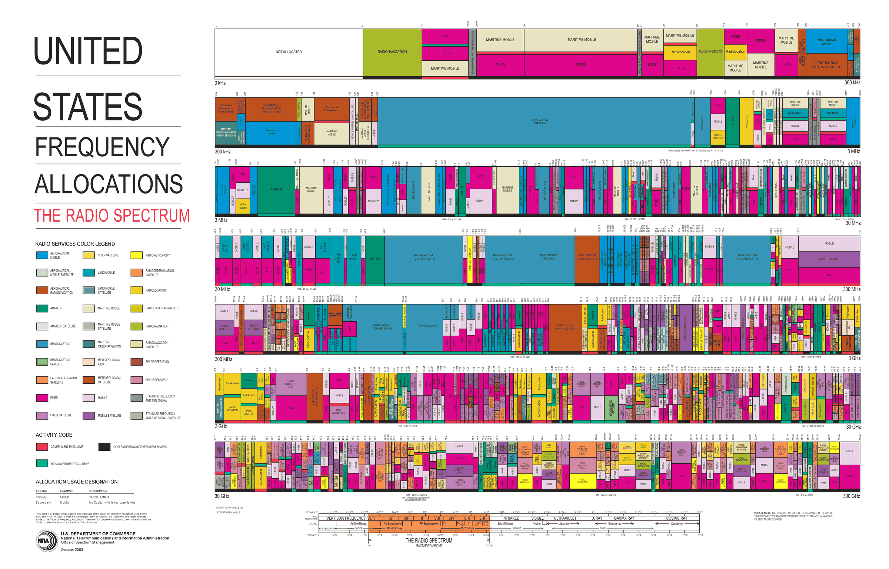

<!-- .slide: class="title-slide" -->

# ECE 448

Software Defined Radios

## Lesson 2 — Noise Figure and Link Budget

Spring 2027 · Dr. Neil Rogers

---

## Where We Were

- Lesson 1: the course SDR, the PlutoSDR
- Every signal we build or decode has to arrive strong enough to use
- Before we transmit, we can predict whether it will

Today: **a link budget** adds every gain and loss between two radios and compares the result to the noise floor.

Note:
Open with the question every radio engineer asks first: will the link close? A budget answers it before we transmit, and every lab this semester then checks that the signal is there on the display.

---

## Today's Plan

1. The allocated spectrum and the ISM bands
2. The Friis equation, in watts and in dB
3. Antennas: gain, beamwidth, and orientation
4. Noise: SNR, noise figure, the cascade, and the noise floor
5. SNR, sensitivity, and margin: a drone link end to end
6. Reading SNR off an SDR display

Note:
The same order as the 2025 slides. Items two through five are one calculation built in pieces, and the drone link at the end uses all of them.

---

## Will the Link Close?

The path takes 109.8 dB, and the signal still arrives 10.2 dB above what the receiver needs.

Note:
This is the worked example from the end of the lesson. Walk left to right: 28 dBm out of the radio, cable, antenna, then the path takes almost 110 dB. Point at the dotted line, the receiver's datasheet sensitivity. The green bracket is the margin. Everything today is how to compute each step.

---

## The Spectrum Is Allocated

Every band has assigned services, and most bands are shared.

Note:
This is the 2003 edition; NTIA posts the current one. Let them look for a minute and pick out a band they use every day: broadcast FM near 100 MHz, cellular, GPS at 1575 MHz. The point is density: almost nothing is empty, which is why so much of this course is about finding and separating signals.

---

## Who May Transmit Where

- The FCC and NTIA allocate every band. The **ISM** bands allow low-power unlicensed use under FCC Part 15.
- Receiving is unrestricted; in class we transmit only when the lesson says to.

Note:
Pull up the NTIA allocation chart on the screen if there is time. Point out that nearly everything is licensed. The ISM bands are where Wi-Fi, Bluetooth, and drones live because nobody needs a license there. Note that the course PlutoSDR, in extended-frequency mode, covers all three common ISM bands. Make the transmit rule explicit: cadets transmit at 915 MHz into a cable through a 30 dB attenuator, or, if the instructor says so, over the air at low power, and only when the lesson says so.

---

## The Friis Equation

$$P_r = \frac{P_t\ G_t\ G_r\ \lambda^2}{(4\pi R)^2}$$

- Check line of sight first.
- Then power, antenna gains, wavelength, and distance.

Note:
Build the equation one factor at a time, as in the 2025 slides: power transmitted, then the gains, then wavelength, then distance. The 4 pi R squared is spreading over a sphere; the lambda squared is there because a fixed-gain antenna has an effective area proportional to lambda squared.

---

## Decibels

| Parameter | Linear | dB |
| :-- | :-- | :-- |
| $P_t$ | 120 W | $50.8$ dBm |
| $G_t$ | 1201.2 | $30.8$ dB |
| $G_r$ | 281.5 | $24.5$ dB |

Products become sums in dB: $\times 2$ is $+3$ dB, 1 mW is 0 dBm, 1 W is $+30$ dBm.

Note:
Have them convert the table before revealing the dB column. dBm is relative to 1 mW and dBi is gain relative to an isotropic antenna.

---

## Friis in Decibels

$$P_r = P_t + G_t + G_r - L_p$$

$$L_p = 20\log_{10} f_\text{Hz} + 20\log_{10} R_\text{m} - 147.55$$

At 3.7 GHz over 80 km: $L_p = 141.9$ dB, so $P_r = 50.8 + 30.8 + 24.5 - 141.9 = -35.8$ dBm.

Note:
The minus 147.55 is twenty log of four pi over c, with frequency in hertz and distance in meters. The path loss is spreading, not absorption.

---

## Path Loss Rules of Thumb

| 3 km at | Path loss |
| :-- | :-- |
| 915 MHz | 101.2 dB |
| 2.45 GHz | 109.8 dB |
| 5.8 GHz | 117.3 dB |

- Doubling the distance or the frequency adds 6 dB of path loss.

Note:
This is why long-range telemetry uses 915 MHz: at 3 km it loses 8.6 dB less than 2.4 GHz.

---

## Antennas

- **Gain** is directivity times efficiency, in dBi; 3 dB lower at the **beamwidth** edge.
- Orientation matters: a banking drone points its beam away.

Note:
Omni on the left two panels: equal in every horizontal direction, nulls straight up and down. Directional on the right: one 20 degree beam. Cables and connectors subtract their insertion loss. A budget either assumes the worst orientation or states the one it assumes.

---

## SNR and Noise Figure

$$\text{SNR} = \frac{P_\text{sig}}{P_\text{noise}} \qquad \text{NF} = 10\log_{10}\frac{\text{SNR}\_\text{in}}{\text{SNR}\_\text{out}}$$

- Every stage lowers the SNR; NF says by how many dB.
- Typical receivers: 2 to 8 dB. A good LNA is about 1 dB.

Note:
SNR is the one noise number this course uses. A passive loss at room temperature has a noise figure equal to its loss: three dB of coax lowers the SNR by three dB.

---

## Cascaded Noise Figure

$$F = F_1 + \frac{F_2 - 1}{G_1} + \frac{F_3 - 1}{G_1 G_2} + \cdots$$

The first stage sets the floor. It should have a low noise figure and enough gain to make the rest unimportant.

Note:
Use linear ratios. All of the gain ahead of a stage divides down its extra noise. Any loss in front of the first amplifier adds to the noise figure dB for dB.

---

## Where the LNA Goes

The same three parts give 1.4, 4.2, or 11.0 dB; mount the LNA at the antenna.

Note:
Read the three rows off the figure; no need to work the arithmetic on the board.

---

## Noise Sources and the Noise Floor

$$N_\text{floor} = -174 + 10\log_{10}B + \text{NF} \quad \text{(dBm)}$$

- Thermal noise, $kTB$, is $-174$ dBm/Hz at 290 K.
- 1 MHz with NF 7 dB gives $-107.0$ dBm.
- Halving the bandwidth lowers the floor 3 dB.

Note:
Minus 174 dBm per hertz is the number to remember. Sixty dB for one megahertz takes it to minus 114, and the noise figure adds the rest. Shot noise and smaller sources, generation-recombination, temperature fluctuation, and quantum noise, add to it; a receiver lumps them into one noise temperature.

---

## The Atmosphere

Below about 10 GHz the clear atmosphere adds little; oxygen absorbs about 15 dB/km near 60 GHz.

Note:
Clear-air absorption at sea level, from the ITU-R model. Every band our SDRs reach is in the shaded strip. Rain, foliage, and walls add loss at any frequency.

---

## SNR, Sensitivity, and Margin

$$\text{SNR} = P_r - N_\text{floor} \qquad \text{margin} = P_r - P_\text{sens}$$

- $P_\text{sens}$ is the datasheet sensitivity.
- Design for about 10 dB of margin.

Note:
Datasheets quote the sensitivity directly in dBm. Ten dB of margin covers fading, pointing, weather, and a warm receiver.

---

## Worked Example: A Drone Link

| Parameter | Value |
| :-- | :-- |
| $P_t$ | 630 mW |
| $P_{rx,\text{min}}$ | $-93$ dBm |
| $G_{tx}$, $G_{rx}$ | 4 dBi, 1 dBi |
| $f$, $R_\text{max}$ | 2.45 GHz, 3 km |
| Max bank angle (HPBW) | $20^\circ$ |
| Insertion loss | 1.5 dB each side |

Received $-82.8$ dBm, so the margin is $10.2$ dB against a 10 dB goal.

Note:
From the 2025 slides. EIRP is 28.0 minus 1.5 plus 4.0, 30.5 dBm. Path loss is 109.8 dB. Banking to the edge of the half-power beamwidth costs 3 dB, then plus 1 dBi and minus 1.5 dB at the ground: minus 82.8 dBm. The sensitivity comes straight from the datasheet.

---

<!-- .slide: class="viz-cue-slide" -->

## Link Budget Explorer

- Drag the distance from 3 km to 6 km: the margin drops 6.0 dB.
- Raise the bandwidth to 20 MHz: the floor rises 13 dB.
- The GPS preset arrives about 18 dB below the floor.

↗ Interactive on the lesson page

Note:
Demo live from the lesson page. Start on the drone preset, double the distance, then widen the bandwidth. Then load GPS: the signal is below the noise floor, and the receiver still works because it correlates against a code it already knows. That is spread spectrum, and we will see its cousin, frequency hopping, in Lesson 16.

---

## Reading SNR on an SDR

1. L05-fm-spectrum.grc on the PlutoSDR: 99.9 MHz, gain Manual, 40 dB.
2. Read the peak and the floor; subtract.
3. Sink's FFT Size: 2048 → 4096.

Note:
Instructor demo, with background from PySDR's Noise and dB chapter; cadets run the same flowgraph from Lesson 5. Keep the PlutoSDR Source's gain mode on Manual so its AGC does not move the levels. The peak minus the floor, both read on the same dB axis, is the SNR. In step 3 the floor drops 3 dB; the wide FM station drops with it, so its displayed SNR stays put. A narrow carrier would stay where it was.

---

## Key Point

A link closes when the received power clears the noise floor by the SNR the receiver needs. Path loss sets the size of the problem, and the first stage of the receiver sets the floor.

Note:
If they remember one formula, it is minus 174 plus ten log B plus NF.

---

## Looking Ahead

- Lesson 3: what a digital signal looks like as the SNR falls
- Lesson 4: inside the SDR, where the noise figure and bandwidth are set
- Practice set: decibels, path loss, the noise floor, where the LNA goes, a GPS link budget, and reading SNR on a display

Note:
Before next time they should be able to compute a path loss and a noise floor to within a dB. The GPS question on the practice set is the 2025 homework, and it deserves the most time.
