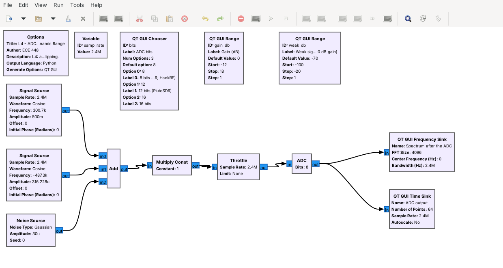
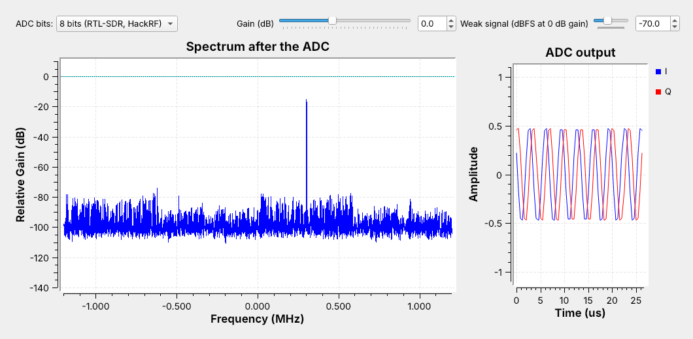
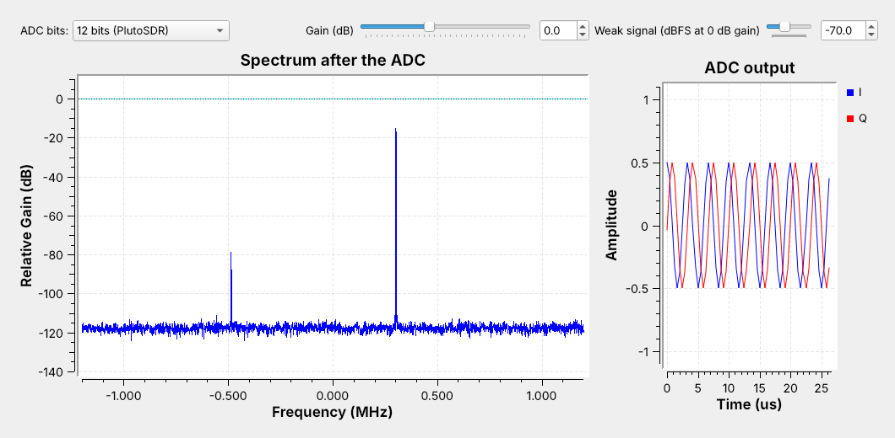
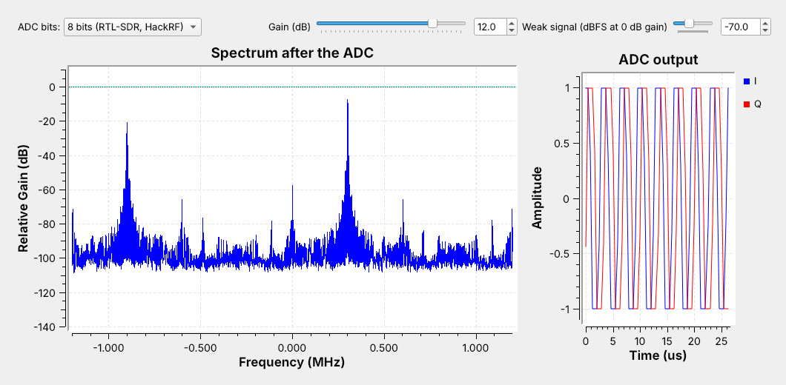

<!-- .slide: class="title-slide" -->

# ECE 448

Software Defined Radios

## Lesson 4 — SDR Introduction

Spring 2027 · Dr. Neil Rogers

---

## Where We Were

- Lesson 2: the first amplifier sets the receiver's noise figure
- Lesson 3: a digital signal is points in the I-Q plane
- Today: the hardware that turns a band of spectrum into those points

Note:
Bring the RTL-SDR, HackRF, PlutoSDR, and ADALM-PHASER to the front of the room and pass the first three around while the next slides are up.

---

## Today's Plan

1. What makes a radio software defined
2. The four course SDRs
3. Inside an SDR: front end, mixer and LO, I and Q, ADCs
4. Sample rate and bandwidth
5. Bits and clipping, in a flowgraph
6. Choosing the radio and its settings
7. Explore a band: SDR Flex, then GQRX

Note:
Item five runs live from L04-adc-bits.grc, which needs no hardware. If GNU Radio is not yet installed on the projector laptop, use the screenshots on the lesson page. Item seven opens SDR Flex in the browser, then needs an RTL-SDR on the projector laptop for GQRX.

---

## One Radio, Many Signals

Each bar is a course SDR's tuning range; the dashed lines are signals this course decodes.

Note:
The RTL-SDR receives FM at 100 MHz, AIS at 162 MHz, key fobs at 433.92 MHz, and ADS-B at 1090 MHz with the same hardware. Only the software changes. Point out that the PlutoSDR cannot reach the FM band and that only the ADALM-PHASER works at X band.

---

## What Makes a Radio Software Defined

- A hardware radio builds each function as a circuit: one radio, one job.
- An SDR digitizes early and does filtering, demodulation, and decoding in software.
- Changing the job means changing the flowgraph, not the hardware.

Note:
An SDR is a radio in which software defines some or all of the physical layer. It still needs an antenna, a filter, an amplifier, and a converter; everything after the converter is a program.

---

## The Course SDRs

| Radio | Tunes | Max rate | Bits | Transmit |
| :-- | :-- | :-- | :-: | :-- |
| RTL-SDR Blog V4 | 0.5–1766 MHz | 2.56 MS/s | 8 | no |
| HackRF One | 1–6000 MHz | 20 MS/s | 8 | half duplex |
| PlutoSDR | 325–3800 MHz | 4 MS/s sustained | 12 | full duplex |
| ADALM-PHASER | 10.0–10.5 GHz | via its Pluto | 12 | — |

- The PlutoSDR's converters reach 61.44 MS/s, but its USB 2.0 link streams about 4 MS/s without drops.
- Every number comes from the manufacturer's data, linked on the lesson page.

Note:
The RTL-SDR's 2.56 MS/s is the datasheet's rate without dropped samples. The ADALM-PHASER mixes 10.0 to 10.5 GHz down to about 2.2 GHz and a PlutoSDR digitizes it, so its rate and bits are the PlutoSDR's.

---

## Inside an SDR

- Front end: filter and LNA
- Mixer and LO: down to 0 Hz
- ADCs: \(I\) and \(Q\) to the host

Note:
The LNA comes right after the filter because, from Lesson 2, the first amplifier sets most of the noise figure. A transmitter runs the same chain backward with DACs.

---

## The Mixer Moves the Band

\[\cos a \cos b = \tfrac{1}{2}\cos(a - b) + \tfrac{1}{2}\cos(a + b)\]

A low-pass filter keeps the difference; one real mixer also folds the station below the LO onto the positive axis.

Note:
A station at 100.3 MHz with an LO at 100.0 MHz comes out at 0.3 MHz, and the filter removes the 200.3 MHz sum. Setting the center frequency in GNU Radio sets the LO. Point to the amber station: 98.6 MHz lands at 1.4 MHz, on top of 101.4 MHz. I and Q separate them.

---

## I and Q

- One mixer folds \(f_{LO} + \Delta\) and \(f_{LO} - \Delta\) onto the same \(\Delta\).
- A second mixer, with the LO shifted 90°, tells them apart.
- Each sample is \(I + jQ\): it rotates one way above the LO and the other way below, so 98.6 MHz lands at \(-1.4\) MHz.

Note:
Lesson 5 shows the negative frequencies this makes possible on GNU Radio's plots. Do not derive it here.

---

## Zero-IF and Superheterodyne

- **Zero-IF**: one quadrature mixer straight to 0 Hz
- **Superheterodyne**: to a fixed IF first, then to 0 Hz
- ADALM-PHASER: 10.0–10.5 GHz to about 2.2 GHz, then a PlutoSDR

GNU Radio receives complex samples whatever the architecture.

Note:
Zero-IF puts anything that leaks into the mixer output at 0 Hz in the middle of the band, which is one source of Lesson 5's DC spike. The ADALM-PHASER mixes X band to about 2.2 GHz and the PlutoSDR does the rest. The PlutoSDR follows the zero-IF chain; the RTL-SDR and HackRF reach the same I/Q stream by other routes.

---

## Sample Rate and Bandwidth

- Complex samples at \(f_s\) show a band \(f_s\) wide, centered on \(f_{LO}\).
- GNU Radio carries each sample in 8 bytes: \(8 f_s\) bytes per second.
- 2.4 MS/s is 19.2 MB/s; 20 MS/s is 160 MB/s.

Choose a little more than the signal's bandwidth, not the radio's maximum.

Note:
A laptop that cannot keep up drops samples, and most drivers print an overflow message in the console. The radio's own filters roll off near the window's edges. The next slide cues the SDR Window widget on the lesson page.

---

<!-- .slide: class="viz-cue-slide" -->

## SDR Window

- FM on the RTL-SDR at 2.4 MS/s: three stations in view
- HackRF at 20 MS/s: the whole FM band, 160 MB/s into GNU Radio
- PlutoSDR: cannot tune to 98 MHz, and streams at most 4 MS/s

↗ Interactive on the lesson page

Note:
Start on FM with the RTL-SDR, switch to the HackRF and raise the rate to 20 MS/s, then pick the PlutoSDR. On the ISM band, put one Wi-Fi channel in view with the HackRF, then show how little of it the PlutoSDR's 4 MS/s covers.

---

## Bits and Clipping

- An \(N\)-bit ADC has \(2^N\) levels between \(-\)full scale and \(+\)full scale.
- More bits put the converter's own noise floor lower.
- 0 dBFS is full scale; above it, the ADC clips.

Note:
8 bits is 256 levels, 12 bits is 4096. The rounding error acts like a small noise; finer steps mean less of it. Do not derive a dB-per-bit rule; the flowgraph shows it.

---

## The Quantizer Flowgraph

- A strong tone at \(-6\) dBFS and a weak one 64 dB below it
- Then a gain and an ADC block with 8, 12, or 16 bits

Note:
The ADC block is an Embedded Python Block: it clips I and Q to plus and minus one and rounds to 2 to the N levels. The sink's 0 dB is not full scale, so read differences.

---

## 8 Bits

The floor and spurs reach within about 60 dB of the strong tone; the weak tone lies below them.

Note:
Point to minus 0.49 MHz, where the weak tone should be. It sits below the spurs. Because the input is a pure tone, much of the rounding error shows up as spurs rather than smooth noise.

---

## 12 Bits

The floor drops about 20 dB and the spurs are gone; the weak tone sits about 40 dB above the floor.

Note:
Switch the menu live. The weak signal did not get stronger; the floor dropped beneath it. Then drag the weak-signal slider down until the tone disappears.

---

## Too Much Gain

The strong tone rises only 7 dB, and clipping creates a false signal near \(-0.9\) MHz.

Note:
On a real SDR these false signals look exactly like transmissions. Set the gain against the strongest signal in the window.

---

## Choosing the Radio and Its Settings

1. **Radio**: its tuning range covers the signal, and it transmits if the task does.
2. **Sample rate**: a little more than the signal's bandwidth.
3. **Gain**: the strongest signal in the window stays below full scale.

Note:
Broadcast FM: RTL-SDR at 2.4 MS/s. A 20 MHz Wi-Fi channel: HackRF at its 20 MS/s maximum, with no margin at the edges; the PlutoSDR streams only about 4 MS/s. Transmit into a cable: HackRF or PlutoSDR. Direction of an X-band source: ADALM-PHASER.

---

## Walkthrough: Explore a Band

1. SDR Flex: open an example capture; drag across a signal; demodulate it.
2. GQRX on the RTL-SDR: tune to 98 MHz; read the waterfall.
3. Click a station, set the mode to WFM, and listen.
4. Raise the gain until false stations appear; back it off.

Note:
Run this live. SDR Flex is at livethisdream.github.io/sdr-flex: right-click the source chip for an example capture, drag a box across a signal, pick a demodulator. Its browser version has no live radio, so switch to GQRX for the band. Each station is a steady stripe about 200 kHz wide in the waterfall. Raise the gain in steps: weak stations rise first, then new stripes appear where nothing transmits, the clipping from the flowgraph on a real radio. SDR++ has the same controls if a laptop lacks GQRX.

---

## Key Point

An SDR mixes a band to 0 Hz and digitizes \(I\) and \(Q\). The sample rate sets the visible spectrum; the ADC's bits and the gain set how weak a signal can be near a strong one.

---

## Looking Ahead

- Lesson 5: install GNU Radio and build the first flowgraphs
- Complex sampling, aliasing, the DC spike, and gain on a live RTL-SDR
- Download L04-adc-bits.grc before then

Note:
Remind cadets that Lesson 5 walks through the radioconda install, which they need before the L5 Lab; its pre-lab checks the install.
