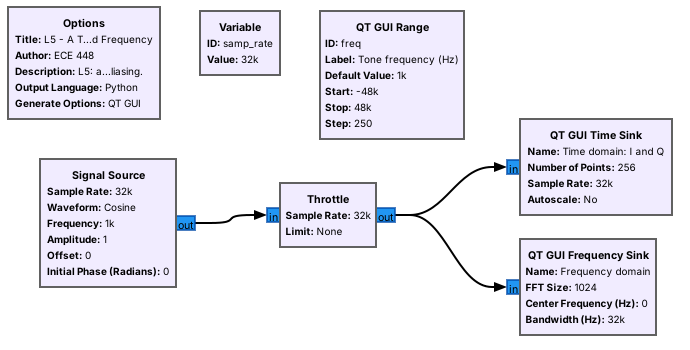
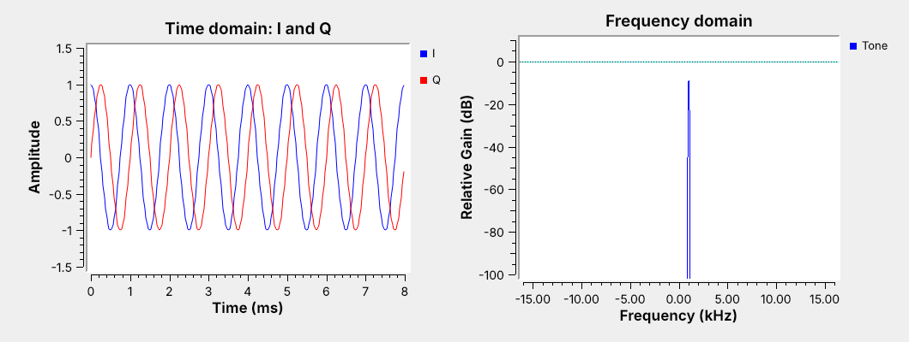
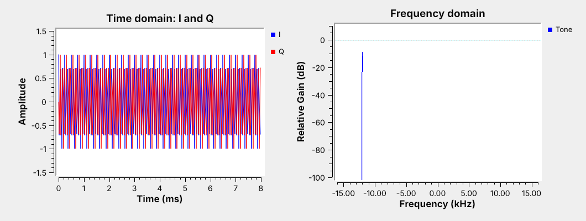
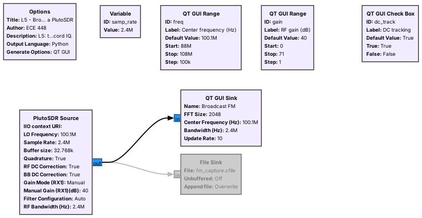

<!-- .slide: class="title-slide" -->

<div class="title-left">

# ECE 448

Software Defined Radios

## Lesson 5 — GNU Radio Introduction

Spring 2027 · Dr. Neil Rogers

</div>

<div class="title-right">


</div>

---

## Where We Were

- Lesson 3: a digital signal is points in the I-Q plane
- Lesson 4: the SDR turns a carrier into a stream of complex samples
- Everything after the converter is software

Today: **GNU Radio**, the software we use to build every receiver in this course.

Note:
Open GRC on the projector before class with the tone flowgraph loaded. The first demo runs in the first five minutes.

---

## Today's Plan

1. Install with radioconda
2. Your first flowgraph: a tone in time and frequency
3. Variables and sliders; data types and converting them
4. Complex sampling and aliasing
5. Connect the PlutoSDR and view the FM band in GRC
6. Gain, recording IQ, and reading it in Python

Note:
Items two through four follow the GNU Radio wiki's Beginner Tutorials, built live from an empty canvas. Item five needs a PlutoSDR in extended-frequency mode and an antenna at the front of the room.

---

## The Radio Is a Flowgraph



A flowgraph is blocks wired together; GRC draws it and generates the Python that runs it.

Note:
Point out source, throttle, and the two sinks, then press run. Show them the generated Python file in the same folder so they see there is no magic.

---

## Install With Radioconda

- One installer: GNU Radio 3.10 plus the PlutoSDR's drivers and blocks
- Windows, macOS, and Linux
- Windows users also install Analog Devices' PlutoSDR USB driver once

Verify: `gnuradio-companion`, `iio_info -s`, and the `iio_attr` check for the 70 MHz to 6 GHz range

Note:
The installer link and the full verification table are on the lesson page. A Pluto that fails the iio_attr line is still in its stock 325 MHz to 3.8 GHz mode and needs switching to extended-frequency mode at EI. The pre-lab requires a working install, so anyone stuck should come to EI before the lab.

---

## Your First Flowgraph

- File, New: an **Options** block and a `samp_rate` variable.
- Add **Signal Source**, **Throttle**, **QT GUI Time Sink**; wire and run.
- **Throttle** paces a flowgraph with no hardware; real hardware sets its own pace.

Note:
This is the wiki's "Your First Flowgraph." Build it live from an empty canvas, then add a Frequency Sink off the throttle. Warn them now: a throttle in a flowgraph with an SDR causes dropped samples.

---

## A Tone in Time and Frequency



I and Q are a cosine and a sine; a complex tone has one spike, at $+1$ kHz.

Note:
Ask why there is no spike at minus 1 kHz. A complex tone rotates in one direction; a real cosine would show both. Drag the slider negative and watch the spike move.

---

## Variables and Sliders

- A **Variable** holds a shared number, such as `samp_rate`.
- A **QT GUI Range** is a variable with a slider.
- Do: set the source's frequency to `freq` and drag the slider.

Note:
The wiki's variables and runtime-updating tutorials. Change samp_rate from 32000 to 64000 and show every block following it, then set it back. Add the freq slider live.

---

## Data Types and Converting Them

| Color | Type | Bytes/sample |
| :-- | :-- | :-: |
| Blue | complex | 8 |
| Orange | float | 4 |
| Green | int | 4 |
| Yellow | short | 2 |
| Purple | byte | 1 |

Do: **Complex to Float** into a two-input float Time Sink shows $I$ and $Q$ as two traces.

Note:
Connect a complex output to a float input on purpose and show the red arrow. That is the most common error they will hit this week. Then insert Complex to Float and wire both outputs to a two-input float sink.

---

## Complex Sampling and Aliasing



Outside $\pm f_s/2$, a tone moves by $f_s$: at $f_s = 32$ kHz, 20 kHz appears at $-12$ kHz.

Note:
Drag the slider slowly past 16 kHz on the live flowgraph and let them see the spike jump to the other side. Complex samples show minus fs over two to plus fs over two.

---

<!-- .slide: class="viz-cue-slide" -->

## Sampling Wheel

- 4 kHz: eight samples per cycle, counterclockwise
- Past 16 kHz: the wheel reverses and the spike jumps negative
- Real samples: a spike and its mirror, and no direction

<p class="viz-cue">↗ Interactive on the lesson page</p>

Note:
This is the wagon-wheel effect from movies. Each sample advances more than half a turn, which looks the same as a smaller step backward.

---

## Connect the PlutoSDR

- Antenna on the **RX** port; USB cable on the middle micro-USB port.
- GNU Radio finds the Pluto on USB by itself.
- Course Plutos tune 70 MHz to 6 GHz, so the FM band is in range.

Note:
Out of the box a Pluto tunes 325 MHz to 3.8 GHz; the course Plutos are in extended-frequency (AD9364) mode. Only one flowgraph can stream from the Pluto at a time. SDR Flex in the browser is an optional quick look for anyone who wants one; no step needs it.

---

## A Real Signal in GRC



The display spans $f_c \pm f_s/2$: 2.4 MHz of the FM band at once.

Note:
PlutoSDR Source: LO frequency from the slider, 2.4 MS/s, gain Manual from the slider. No throttle here. Drag the center frequency across the band and name the local stations.

---

## Reading the Spectrum and Waterfall

<div class="fig" data-inline-svg="./fig/L05-fm-band-sim.svg" style="max-width:820px; margin:0 auto;"></div>

Note:
This figure is simulated; the live display is the real one. Stations are about 200 kHz wide on odd tenths of a megahertz. Point out the DC tracking check box; the lab compares tracking on and off. Tune a little off a station either way, since tracking can also eat into a signal right at 0 Hz.

---

## Setting the Gain

- Raise the gain until the noise floor lifts a few dB.
- Stop before strong stations grow copies elsewhere: that is overload.
- No single setting shows a strong local station and a weak distant one well.

Note:
Demo both extremes live: gain at zero hides the weak stations; gain at the top of its range makes spurs appear between stations. Then find the setting in between. The Pluto's Slow Attack AGC is the automatic alternative; we keep Manual to see the trade-off.

---

## Recording IQ

- A **File Sink** writes raw complex samples, 8 bytes each.
- 2.4 MS/s fills 19.2 MB every second.
- Record the sample rate and center frequency with the file.

Note:
Enable the File Sink for about one second, then disable it, and show the file size against the 19.2 MB per second on the slide. Mention SigMF, which later lessons use for handed-out captures.

---

## IQ in Python

```python
x = np.fromfile("fm.cfile", dtype=np.complex64)
power_dbfs = 10*np.log10(np.mean(np.abs(x)**2))
X = np.fft.fftshift(np.fft.fft(x[:2048]))
```

One line reads a GNU Radio capture into NumPy.

Note:
Run L05-psd.py on the capture just recorded and compare the plot to the frequency sink. They should match.

---

## Key Point

<div class="callout">An SDR hands GNU Radio a stream of complex samples that shows \(f_s\) of spectrum centered on \(f_c\). A flowgraph is the receiver: everything we do to that stream is a block.</div>

Note:
Every lesson from here on adds blocks between a source and a sink.

---

## Looking Ahead

- L5 Lab: build both flowgraphs, measure aliasing, record the FM band
- Lesson 6: AM modulation and demodulation in a flowgraph
- Lesson 7: today's FM band turned into audio, with RDS

Note:
Cadets must install radioconda before the lab. The pre-lab checks it.
