<!-- .slide: class="title-slide" -->

# ECE 448

Software Defined Radios

## Lesson 6 — AM Simulation

Spring 2027 · Dr. Neil Rogers

---

## Where We Were

- Lesson 5: a flowgraph is sources, blocks, and sinks
- A complex tone turns in one direction; a real one shows both sides
- Today we put processing blocks between the source and the sink

Today: **amplitude modulation**, built and received in GNU Radio with no hardware.

Note:
Have L06-dsb-am.grc open in GRC before class with the speakers on and the volume low. Every demo today runs from the three L06 flowgraphs.

---

## Today's Plan

1. DSB-AM: the transmitter, its spectrum, and an envelope detector
2. Modulation index and overmodulation
3. DSB-SC: no carrier, and a coherent receiver
4. SSB: one sideband, the phasing method, and tuning by ear
5. Identifying each on a spectrum, and where each is on the air

Note:
All three flowgraphs share one message: a 1 kHz tone at 0.6 plus a 2.5 kHz tone at 0.4, on a 10 kHz carrier, at 48 kHz.

---

## A Message on a Carrier

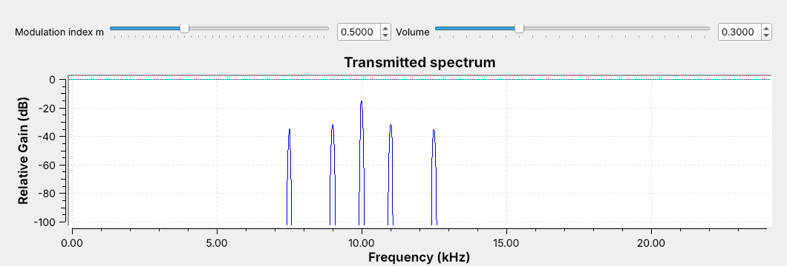

Modulation moves an audio message up to a carrier, so each transmitter gets its own channel.

Note:
Run the DSB-AM flowgraph and let them hear the two tones. Ask what the five lines are before explaining them.

---

## DSB-AM

$$s(t) = A_c\left[1 + mx(t)\right]\cos(2\pi f_c t)$$

- $m$ is the **modulation index**; the bracket is the **envelope**.
- A tone at $f$ makes sidebands at $f_c - f$ and $f_c + f$.
- The bandwidth is $2W$, here 5 kHz (7.5 to 12.5 kHz).

Note:
Drag m on the frequency sink: the sideband lines grow and the carrier stays put. The louder 1 kHz tone makes the taller pair.

---

## The DSB-AM Flowgraph

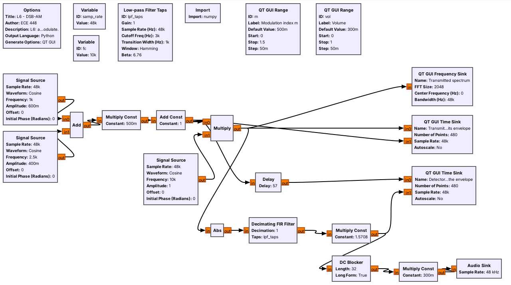

The Audio Sink paces the flowgraph, so there is no Throttle.

Note:
Walk the top row against the equation: add, Multiply Const m, Add Const 1, Multiply by the carrier. The sound card takes exactly 48,000 samples per second, which is the hardware clock from Lesson 5.

---

## Modulation Index

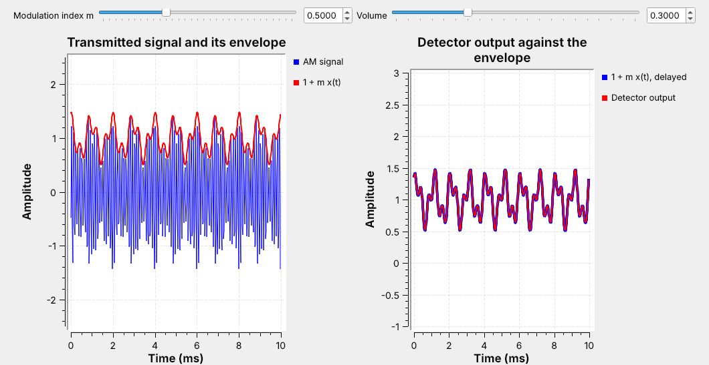

The detector output lies on the envelope: the received audio matches the source.

Note:
The Delay block holds the reference back 57 samples, half the low-pass filter's length, so the two traces line up.

---

## The Envelope Detector

- **Abs** rectifies, like a diode.
- A **low-pass filter** at 3 kHz keeps the envelope and removes the carrier.
- Multiply by $\pi/2$, because a rectified cosine averages $2/\pi$ of its peak.

Note:
This is the crystal-radio receiver in three blocks. The low-pass filter removes everything above the message. The DC Blocker removes the constant 1 before the speaker.

---

## Low-pass Filter Taps

- **Cutoff** 3 kHz and **transition** 1 kHz define the filter.
- GNU Radio picks the length: 115 taps.
- The output lags by half the taps: 57 samples, or 1.2 ms.

Note:
Open the Low-pass Filter Taps block and show the four settings. The 2.5 kHz tone sits just inside the passband. The Delay block's expression, len(lpf_taps)//2, follows the filter if they change it.

---

## Overmodulation

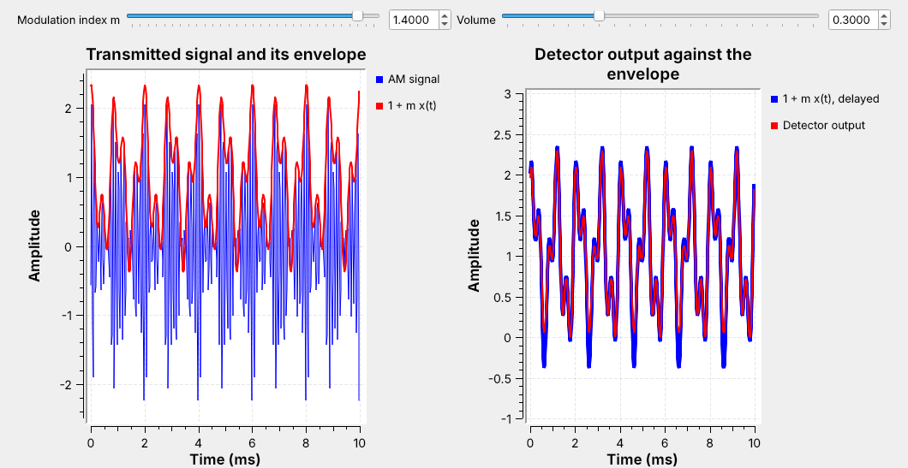

Push $m$ too far and the envelope goes negative; the detector folds it up.

Note:
Drag m slowly from 0.5 to 1.4 with the audio on and ask the class to call out when the traces split and when they hear it. m at or below 1 is safe for any message; this one never quite reaches minus 1, so it holds a little past 1. Overmodulation also spreads the spectrum into the neighboring channel.

---

## DSB-SC

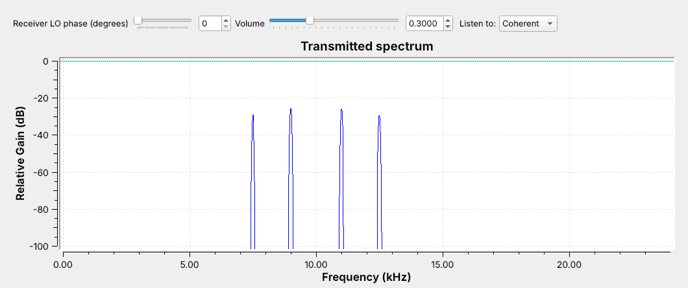

$$s(t) = A_cx(t)\cos(2\pi f_c t)$$

Note:
Open L06-dsb-sc.grc. Same sidebands, same 5 kHz, and no carrier line. All of the power is in the sidebands. Go back to the DSB-AM sink for a moment: its tallest line was the carrier, which carries no information; AM keeps it only so the receiver can be a simple envelope detector.

---

## Coherent Demodulation

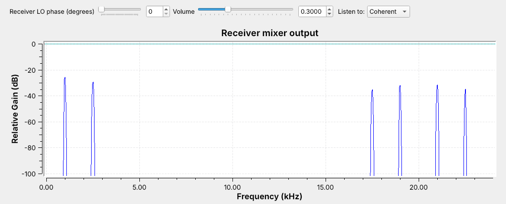

The mixer puts the message back near 0 Hz, with a copy near 20 kHz; the low-pass filter keeps the message.

Note:
This frequency sink sits on the receiver's Multiply output. A Multiply Const of 2 after the filter restores the level, because the mixing leaves half the amplitude near 0 Hz.

---

## Coherent Against Envelope

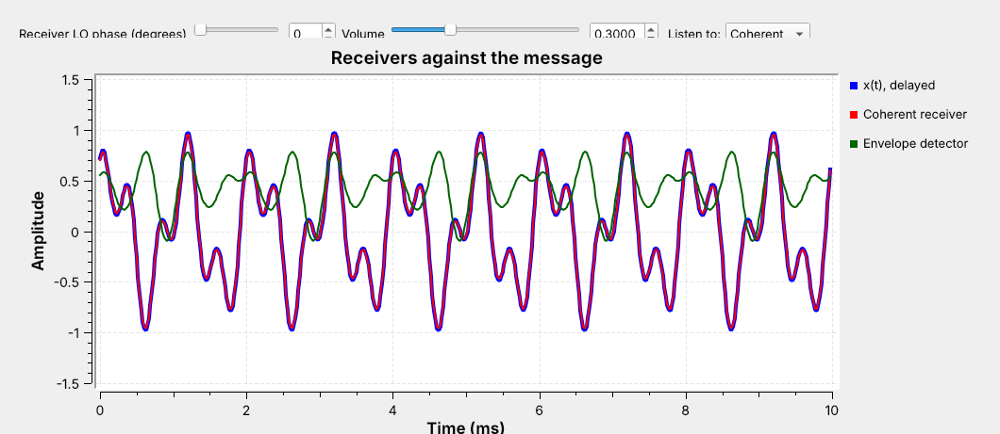

The coherent output (red) lies on the message; the envelope detector (green) gives a filtered $\vert x(t)\vert$.

Note:
Switch Listen To between Coherent and Envelope. The envelope detector recovers the absolute value of the message, which is the same folding as overmodulation.

---

## The LO Must Match

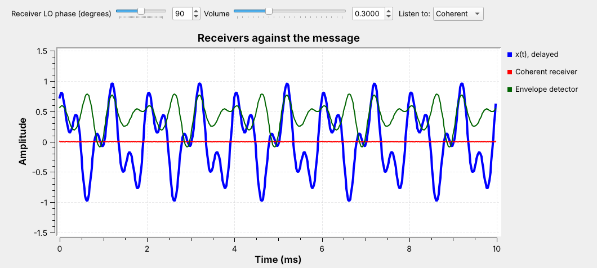

A phase error makes the output smaller; at $90°$ it is zero.

Note:
Drag the LO phase from 0 to 90 with the audio on and let the tones fade out. FM stereo sends a 19 kHz pilot so the receiver can rebuild its 38 kHz LO; that is Lesson 7.

---

## SSB

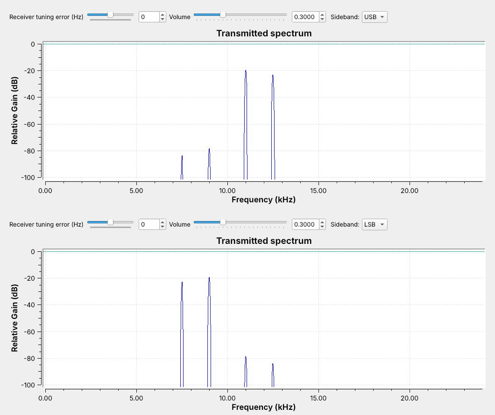

One sideband carries the whole message, in half the bandwidth.

Note:
Open L06-ssb.grc and switch the Sideband menu. Point out that the LSB reverses the spectrum: the higher tone is the line farther below the carrier. The suppressed sideband is about 60 dB down.

---

## The Phasing Method

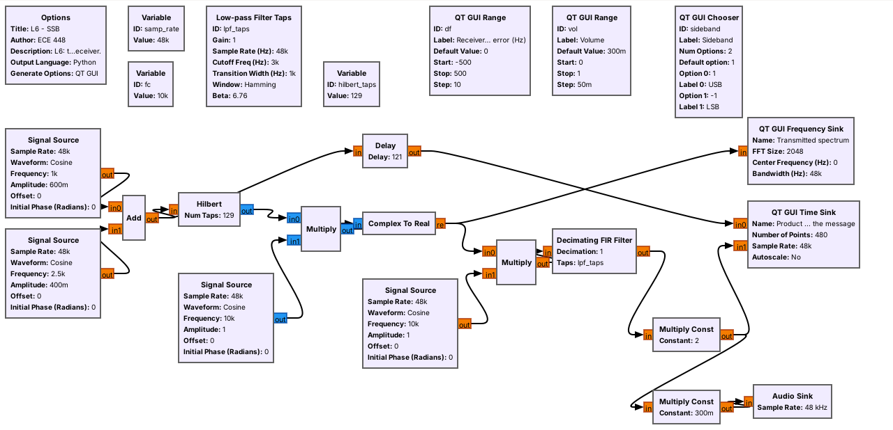

$$s(t) = \mathrm{Re}\left\{z(t)e^{\pm j2\pi f_c t}\right\}$$

Note:
The Hilbert block outputs z(t), the message with only its positive frequencies, the one-direction idea from Lesson 5's complex tone. The sign of the carrier frequency picks USB or LSB.

---

## Receiving SSB

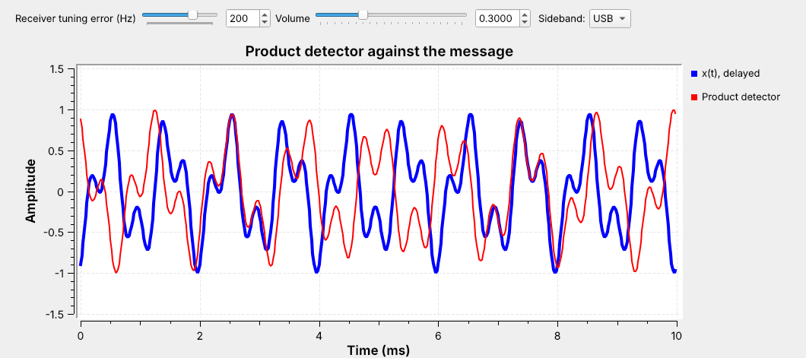

A tuning error $\Delta f$ shifts every audio tone by $\Delta f$.

Note:
Drag the tuning error to plus and minus 200 Hz with the audio on. On USB with the LO 200 Hz high, 1 and 2.5 kHz drop to 800 Hz and 2.3 kHz; on LSB they rise to 1.2 and 2.7 kHz. The tones change pitch but never fade. Listeners notice the shift at a few tens of hertz, and speech stays intelligible to about 100 Hz. That is why an SSB operator tunes by ear and needs no carrier recovery.

---

<!-- .slide: class="viz-cue-slide" -->

## AM Explorer

- DSB-AM: raise $m$ past 1 and watch the envelope fold
- DSB-SC: the carrier line disappears
- USB and LSB: half the bandwidth, and the envelope is not the message

↗ Interactive on the lesson page

Note:
The two-tone SSB envelope is the reason SSB needs a product detector. With one tone the SSB envelope is constant.

---

## Identifying Each on a Spectrum

| Signal | Carrier line | Sidebands | Bandwidth | Receiver |
| :-- | :-: | :-: | :-: | :-- |
| DSB-AM | yes | two | $2W$ | envelope |
| DSB-SC | no | two | $2W$ | coherent |
| SSB | no | one | $W$ | product |

Note:
Two questions identify any of them: is there a steady line at the center, and is the signal symmetric about it?

---

## Key Point

DSB-AM puts most of its power in a carrier so the receiver can be an envelope detector. DSB-SC and SSB drop the carrier, and the receiver has to supply its own.

Note:
Every receiver in the rest of the course either recovers a carrier or does not need one. This is the first place that choice appears.

---

## On the SDR

- AM broadcast uses 540 to 1700 kHz; aircraft use AM from 118 to 137 MHz.
- Long-range HF voice uses SSB.
- On an SDR, the envelope detector is one block: **Complex to Mag**.

Note:
An SDR delivers the signal at complex baseband with the carrier at 0 Hz, so the envelope is just the magnitude of each sample. GNU Radio's AM Demod block is Complex to Mag plus a filter.

---

## Looking Ahead

- L6 Lab: build DSB-AM from an empty canvas, then measure DSB-SC and SSB
- Lesson 7: real AM and FM with an RTL-SDR

Note:
The pre-lab is block settings and spectrum reading; the bench is where they turn the sliders and record what they see.
