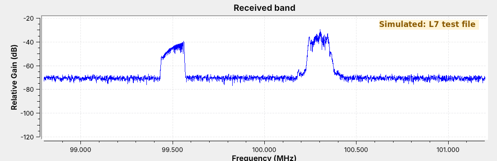
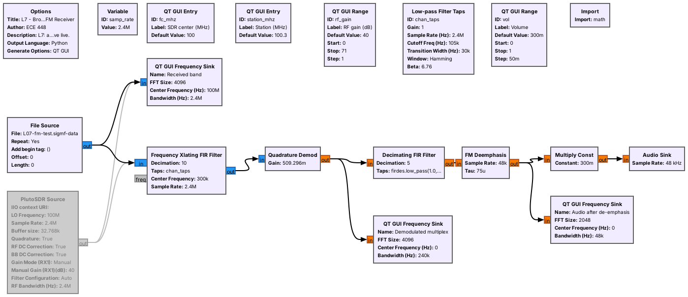
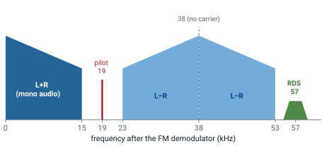
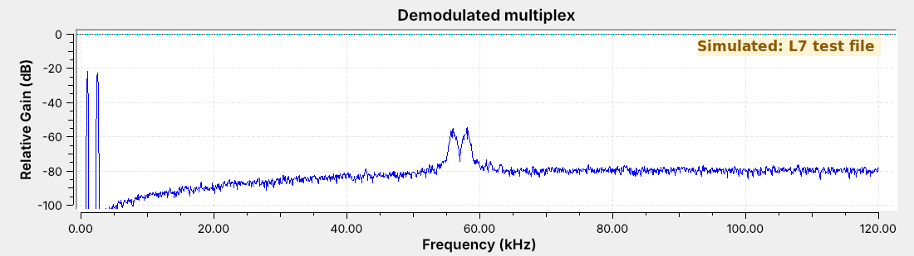
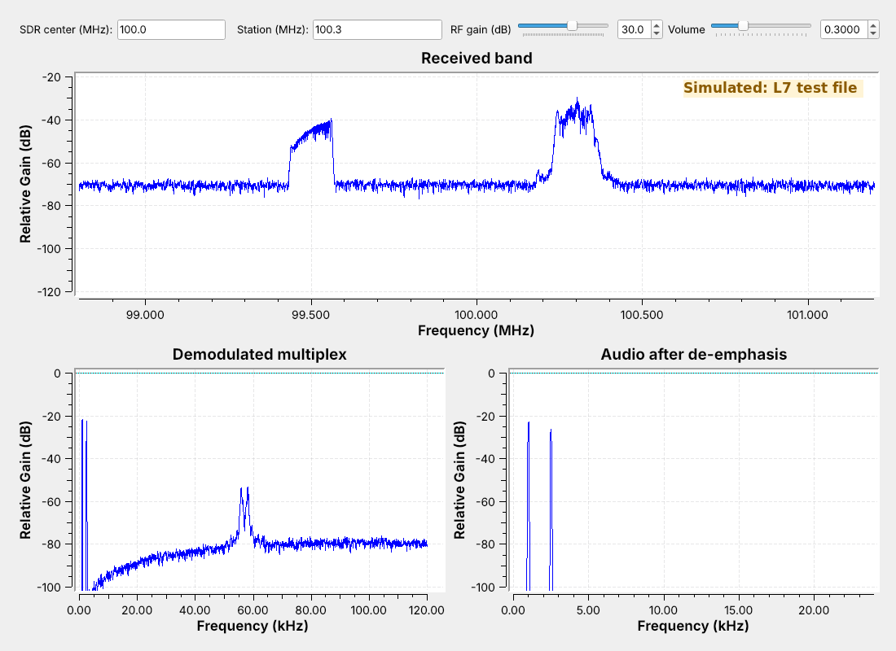
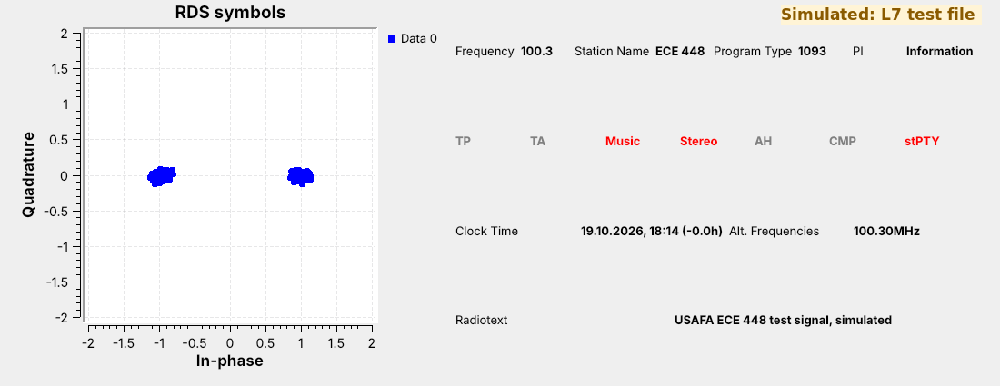
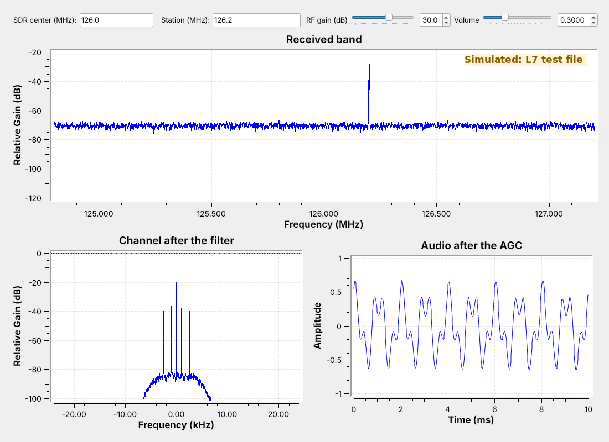
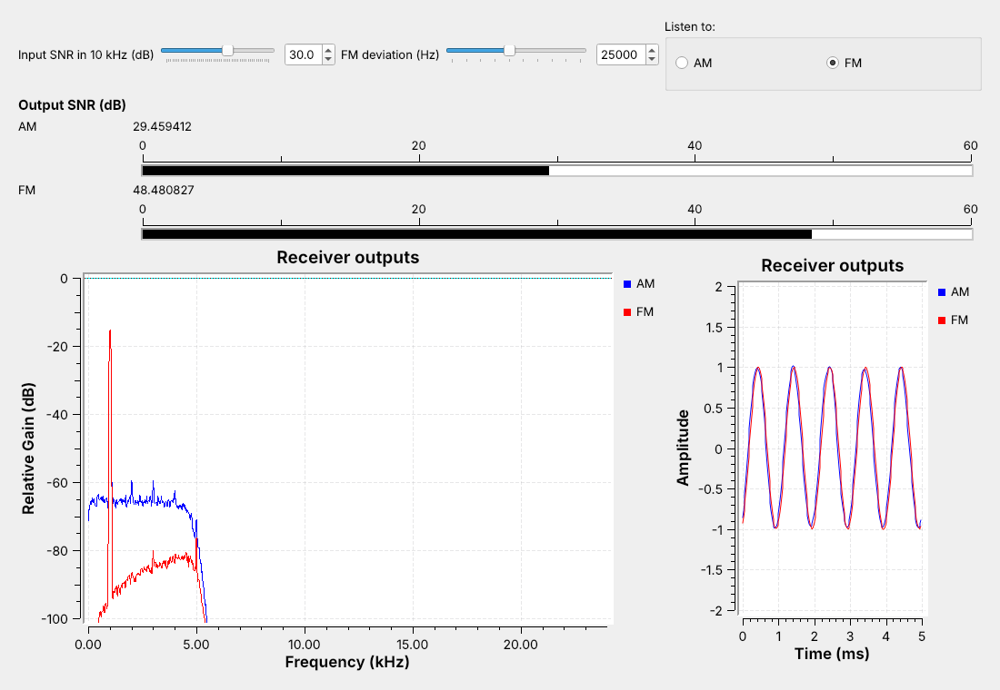
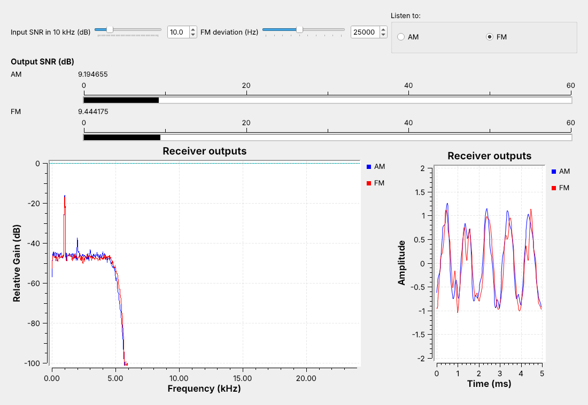

<!-- .slide: class="title-slide" -->

# ECE 448

Software Defined Radios

## Lesson 7 — AM and FM Receivers

Spring 2027 · Dr. Neil Rogers

---

## Where We Were

- In Lesson 5 an RTL-SDR recorded 2.4 MS/s of the FM band to a file.
- In Lesson 6 we built and received AM, DSB-SC, and SSB in simulation.
- Today the signal comes from a capture or from the air.

Today we build a **broadcast FM receiver** with **RDS** and an **AM receiver** for the aircraft band, and we compare AM and FM in the same noise.

Note:
Before class, run L07-fm-test-tx.grc and L07-am-test-tx.grc once, in the folder that holds the receivers. Each writes 76.8 MB and stops on its own. Have L07-wbfm-rx.grc open with the volume low.

---

## Two Stations in a Capture

The goal is audio from the station at 100.3 MHz, and its station name.

Note:
This is a test file from a GNU Radio transmitter flowgraph, the same kind of file as their L5 capture. The station at 100.3 carries the L6 two-tone message and RDS; 99.5 carries a 600 Hz tone. The figure carries a Simulated label.

---

## Wideband FM

- The carrier's **frequency** follows the message, up to $\Delta f$ = 75 kHz away.
- A station is about $2(\Delta f + W)$ wide: 180 kHz for 15 kHz audio.
- US stations sit 200 kHz apart.

Note:
The width rule is Carson's rule, a rule of thumb; we use it only to set the channel filter. Narrowband FM on two-way radios uses 2.5 or 5 kHz of deviation. AM carrying the same 15 kHz audio would be 30 kHz wide, so broadcast FM is six times wider.

---

## The Receiver Flowgraph

A channel filter, a demodulator, an audio filter, and de-emphasis feed the speaker.

Note:
We disabled the RTL-SDR Source; switching to live means disabling the File Source and enabling the SDR. The flowgraph needs no Throttle, because the Audio Sink paces the File Source, as in Lesson 6.

---

## Channel Filter and Decimation

- The **Frequency Xlating FIR Filter** shifts, filters, and decimates in one block.
- It shifts by $f_\text{station} - f_c$ = 300 kHz and passes ±90 kHz.
- Decimating by 10 leaves 240 kS/s.

Note:
The filter has a 105 kHz cutoff and a 30 kHz transition, so it passes 90 kHz and is 28 dB down by 120 kHz, the new Nyquist frequency. The filter removes the station at 99.5. Type 99.5 into Station to tune it instead.

---

## The Quadrature Demodulator

$$\text{gain} = \frac{f_s}{2\pi\Delta f} = \frac{240\ \text{kHz}}{2\pi \cdot 75\ \text{kHz}} = 0.509$$

- The phase step between samples is the frequency.
- With this gain, 75 kHz of deviation gives an output of 1.

Note:
The block ignores amplitude, so an FM receiver needs no AGC.

---

## The Multiplex

The demodulator's output carries mono audio, the stereo pilot and difference signal, and RDS.

Note:
L-R is DSB-SC on 38 kHz, the Lesson 6 signal that needs carrier recovery; the 19 kHz pilot lets the receiver rebuild 38 kHz by doubling it. RDS sits at 57 kHz, three times the pilot. The test station is mono, so it has no pilot; its RDS stereo flag is only a data bit.

---

## The Multiplex, Measured

The noise floor rises with frequency.

Note:
FM noise at the demodulator output grows with distance from the carrier, so the top of the audio band and RDS receive the most noise. That rising noise is the reason for de-emphasis, on the next slide.

---

## Audio and De-emphasis

- A 15 kHz low-pass filter decimates by 5, from 240 to 48 kS/s.
- **De-emphasis** (75 μs) cuts the treble the transmitter boosted.
- It removes the high-frequency noise along with the boost.

Note:
US pre-emphasis boosts 15 kHz by about 17 dB; the de-emphasis corner is 2.1 kHz. Europe uses 50 microseconds.

---

## Running the Receiver

Note:
Play the audio. The audio sink shows exactly the two message tones. Type 99.5 into Station and the 600 Hz tone plays. Then show how to point the File Source at fm_capture.cfile and type its center frequency.

---

## RDS

- The **Radio Data System** sends 1187.5 bit/s on 57 kHz.
- It is BPSK: a DSB-SC signal that needs its carrier recovered.
- It carries the station name, program type, and radiotext.

Note:
1187.5 is 57 kHz divided by 48. The bits are differentially coded, so a 180 degree error in the recovered carrier does no harm. The PS name is eight characters, sent two at a time. North America calls it RBDS.

---

## Decoding RDS

Two clusters show BPSK with its carrier recovered, and the panel shows ECE 448.

Note:
Open L07-rds-rx.grc. It shifts 57 kHz to 0 and resamples to 19 kHz, 16 samples per bit. A matched filter and Symbol Sync find the bit timing, the Constellation Receiver recovers the carrier, and a Differential Decoder feeds the gr-rds blocks. The panel swaps two labels: the PI code, 1093, appears under Program Type.

---

## An AM Receiver

The filter cuts off at 5 kHz and decimates by 50, and **Complex to Mag** detects the envelope.

Note:
Aircraft and ATIS are AM between 118 and 137 MHz. After Complex to Mag it is the L6 receiver: the 3 kHz low-pass taps and a DC Blocker, plus an AGC because the level depends on distance.

---

## AM and FM in the Same Noise

Same tone, power, and noise: at 30 dB in, the AM meter reads about 29 dB and the FM meter about 48 dB.

Note:
L07-am-vs-fm.grc sends AM at m = 1 and FM at 25 kHz deviation with the same transmitted power and the same noise. The FM receiver's wider channel lets in six times the noise, and its output is still the cleaner one; FM's noise floor sits about 20 dB under AM's. Drag the deviation up and FM's meter climbs; drag it to 5 kHz and most of the advantage goes away.

---

## Turning the Noise Up

- Near 10 dB, FM breaks into clicks and its advantage is gone.
- AM only gets steadily noisier.

Note:
Drag Input SNR down with the speaker on FM and let them hear the clicks start below about 15 dB. That collapse is the FM threshold. Repeat at 5 kHz and 50 kHz deviation: wider deviation sounds cleaner when the signal is strong and breaks up sooner as the noise rises. Near threshold the live meters wander by about 1 dB.

---

<!-- .slide: class="viz-cue-slide" -->

## FM Explorer

- Raise the deviation: the lines spread wider.
- Raise the tone frequency: the lines move apart.
- Nearly all of the signal stays inside Carson's band.

↗ Interactive on the lesson page

Note:
Start from the L7 flowgraph preset. The point is that the rule of thumb is good enough to set a channel filter.

---

## Key Point

FM spreads the message over a wider channel and, while the signal is strong, comes out cleaner than AM. Turn the noise up far enough and FM breaks up into clicks, sooner for a wider channel; AM just gets noisier.

Note:
Broadcast FM is strong and has a 200 kHz channel. Aircraft use AM: a weak AM signal stays intelligible, and two transmitters at once are both heard.

---

## Find the Station

- SDR Flex: select an FM signal, demodulate it.
- Live: tune the FM band in GQRX; choose **WFM (stereo)**.
- Turn on RDS and read the station name.
- Note the frequency for the GRC receiver.

Note:
Open SDR Flex (livethisdream.github.io/sdr-flex) on an example capture and demodulate an FM signal; RDS there needs the full server. Then demo live: choose the RTL-SDR in GQRX, click a strong station, set WFM (stereo), open the RDS panel and enable decoding. Write the frequency and name on the board, close GQRX (one program per RTL-SDR; on Windows use SDR++ or SDR# instead), then run L07-rds-rx.grc on that station and check that the names match.

---

## On the SDR

- Tune a few hundred kHz off the station, away from the DC spike.
- Set RF gain from your L5 gain table.
- Receiving is unrestricted, and the RTL-SDR receives only.

Note:
ATIS frequencies are in the FAA Chart Supplement and on sectional charts. RDS needs a stronger signal than the audio, because 57 kHz sits where the multiplex noise is highest.

---

## Looking Ahead

- The L7 Lab plays your L5 capture, then receives live FM, RDS, and ATIS.
- Lesson 8 sends bits as FSK, which is FM with a two-valued message.

Note:
The pre-lab asks for the receiver's shift and rates, the demodulator gain, and the ATIS receiver settings. At the bench they turn the noise up on AM and FM and record where the clicks start. The bench starts with building the WBFM receiver from an empty canvas.
