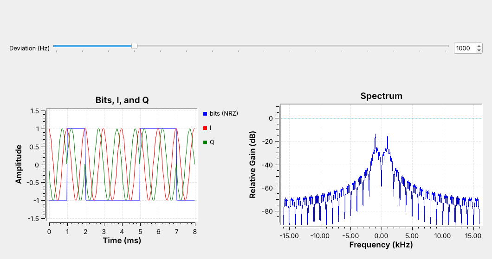
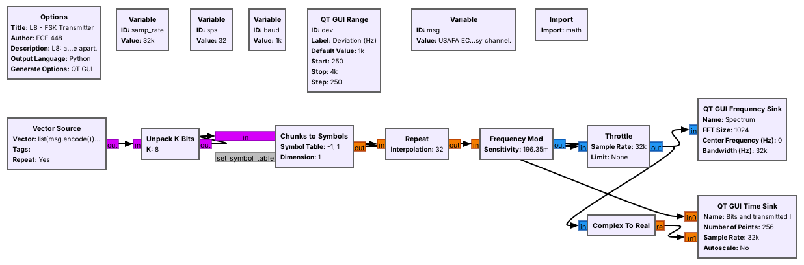
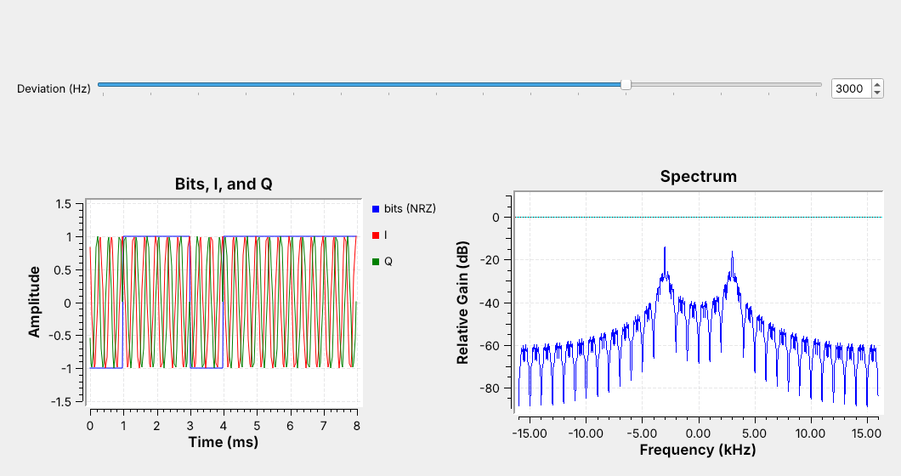
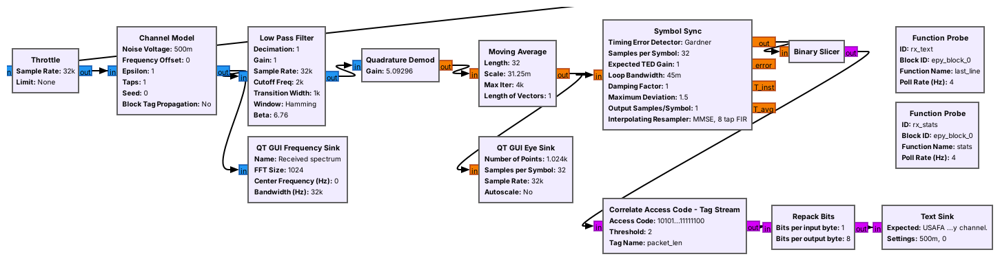
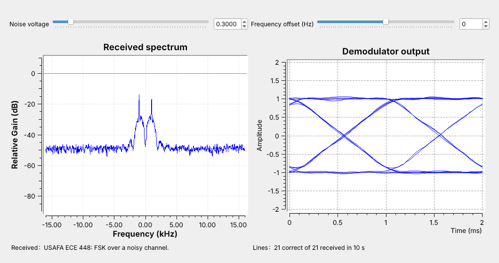
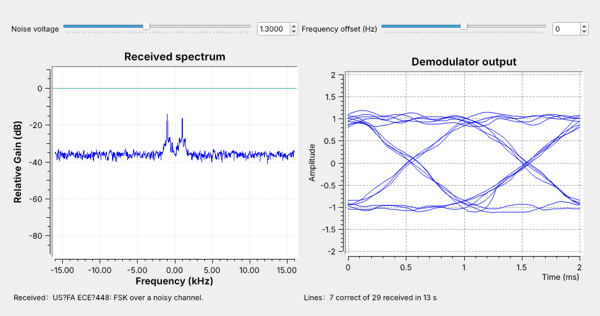
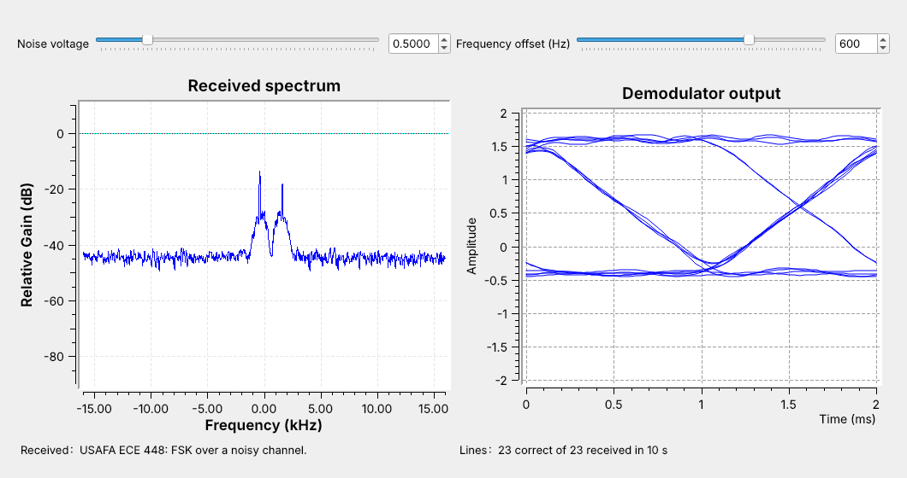

<!-- .slide: class="title-slide" -->

# ECE 448

Software Defined Radios

## Lesson 8 — FSK

Spring 2027 · Dr. Neil Rogers

---

## Where We Were

- Lesson 5: a flowgraph is sources, blocks, and sinks
- Lessons 6 and 7: an analog message on a carrier, AM and FM
- From here on the message is data

Today: **FSK**, which sends each bit as one of two tones.

Note:
Have L08-fsk-link.grc open and running on the projector before class. The text label at the bottom is the hook: the line of text is going through a modulator, noise, and a demodulator in real time.

---

## Today's Plan

1. The transmitter: bits to tones with Frequency Mod
2. The channel: noise and frequency offset on sliders
3. The receiver: filter, quadrature demodulator, symbol timing, slicer
4. Packets: from bits back to text
5. Turn up the noise, then the offset
6. FSK on a real radio

Note:
Everything today runs from two flowgraphs with no hardware, in the order of the GNU Radio wiki's Simulation example: FSK. Item one uses L08-fsk-tx.grc; items two to five use L08-fsk-link.grc.

---

## A Message on Two Tones

A 1 is a tone at $+\Delta f$ and a 0 is a tone at $-\Delta f$; here $\Delta f = 1$ kHz.

Note:
Run L08-fsk-tx.grc. Point at the two spectral peaks first, then at the time plot. I is the same 1 kHz cosine during every bit, because at h = 2 each bit turns the phase through one full circle. Q is what changes: it flips relative to I when the direction of rotation changes, which is the complex-tone idea from Lesson 5.

---

## Where FSK Is Used

- Pagers, weather balloons, and amateur APRS
- Key fobs and garage-door remotes at 315 and 433.92 MHz
- Bluetooth and many drone links, as Gaussian FSK (GFSK)

The envelope is constant, so the power amplifier can run at full output.

Note:
Ask who has a car key fob on them. Lesson 17 records and decodes those. GFSK is FSK with a Gaussian filter on the bits, and the receiver blocks are the same.

---

## The Transmitter

Bytes become bits, bits become $\pm 1$, and **Frequency Mod** turns each $\pm 1$ into a tone.

Note:
Walk the chain left to right. Frequency Mod is the FM transmitter block; the only difference between FM and FSK is that the message is a square wave of bits. The block keeps the phase continuous between bits, which keeps the spectrum compact.

---

## Three Numbers Set the Signal

$$R_s = \frac{f_s}{\text{sps}} = \frac{32\ \text{kHz}}{32} = 1000\ \text{baud}$$

$$k = \frac{2\pi \Delta f}{f_s} = 0.196\ \text{rad/sample}$$

$$h = \frac{2\Delta f}{R_s} = 2$$

Note:
Symbol rate, deviation, and modulation index. k is what Frequency Mod calls its sensitivity; show it in the block's properties. h compares the tone spacing with the symbol rate.

---

## Bandwidth

$$B \approx 2(\Delta f + R_s)$$

At 1000 baud, 1 kHz of deviation takes about 4 kHz and 3 kHz takes about 8 kHz. The number sets the receiver's filter.

Note:
Drag the deviation slider live from 1 kHz to 3 kHz and let the class watch the spectrum widen. This is Carson's rule from FM, used only to set the receiver's first filter. Wider deviation separates the tones but a wider filter lets in more noise.

---

## The Channel

- Open `L08-fsk-link.grc`: transmitter, channel, and receiver in one file.
- The **Channel Model** adds noise and a frequency offset, each on a slider.
- Drag the noise slider: the tones stay put, the floor moves.

Note:
The top row is the transmitter they just saw. Run it, drag the noise slider up and down so they see the floor move, then leave it at 0.5 and the offset at 0 while walking the receiver.

---

## The Receiver

Filter to the signal, turn frequency into a number, and decide each bit.

Note:
The low-pass cutoff is deviation plus symbol rate, 2 kHz: the filter passes minus 2 to plus 2 kHz, the 4 kHz band.

---

## The Quadrature Demodulator

- It measures the phase step from one sample to the next.
- A phase step of $2\pi f/f_s$ is a frequency $f$.

$$g = \frac{f_s}{2\pi\Delta f} = 5.09$$

The tone at $+\Delta f$ comes out as $+1$, and the tone at $-\Delta f$ as $-1$.

Note:
The gain is the reciprocal of the transmitter's sensitivity, so the demodulator undoes the modulator. This is the same block as in an FM receiver.

---

## Finding the Bits

A moving average, **Symbol Sync**, and a **Binary Slicer** at zero decide each bit.

Note:
Explain the eye diagram: many two-bit stretches overlaid. The crossings are bit edges; the gap between them is the eye opening. Symbol Sync samples where the moving average peaks, at the end of each bit, and keeps adjusting its timing because the two clocks never match exactly.

---

## Packets

- The transmitter adds a 64-bit **access code** and a 32-bit header to each line.
- The receiver finds the access code, allowing 2 bit errors, and reads the length.
- Repack Bits rebuilds the bytes; the Text Sink shows the line.

Note:
Without the access code the receiver has bits but no idea where a byte starts. The header holds the line's length in bytes twice, and the receiver passes that many bytes on as bits. Lesson 10 needs the same framing for ASCII over PAM.

---

## Turn Up the Noise

- 0.5 V: the eye is wide open and every line arrives.
- 1.3 V: the floor is about 8 dB higher, spikes cross zero, and most lines have an error.
- 2 V: almost no packets.

Note:
Drag the noise slider up slowly and let the class watch the eye thicken, the FM clicks appear, and the line count fall. The fall from clean text to no text takes a small turn of the slider. Tie it back to Lesson 2: a link that only just works fails on the first fade.

---

<!-- .slide: class="viz-cue-slide" -->

## FSK Explorer

- Raise the deviation: the tones separate and the band widens
- Raise the noise slowly: note where the first red dot appears
- Double the symbol rate: red dots appear at a lower noise voltage

↗ Interactive on the lesson page

Note:
The widget uses the same receiver as the flowgraph but an ideal clock, so its error counts run slightly better than the flowgraph's.

---

## Frequency Offset

The levels shift by $f_\text{off}/\Delta f$; this link tolerates about $\pm 600$ Hz.

Note:
2 ppm at 915 MHz is 1.8 kHz, more than this link tolerates. Real receivers use a wide deviation or remove the offset before demodulating. The lab measures both.

---

## FSK on a Real Radio

Tone spacing gives $2\Delta f$; the shortest dwell gives $1/R_s$.

Note:
This waterfall is simulated. The tracks are 40 kHz apart, so the deviation is 20 kHz, and the preamble's shortest dwell is 1 ms, so the symbol rate is 1000 baud. On a live waterfall a row often lasts longer than a bit, so measure the dwell in URH or on the Quadrature Demod output. To run today's link over the air, replace the Channel Model with a Pluto or HackRF sink and source. Transmit only into a cable, a shielded enclosure, or at very low power in an ISM band, and only when the lesson says to. Nothing today transmits.

---

## Key Point

FSK sends each bit as one of two tones. The transmitter is a Frequency Mod block; the receiver filters to \(2(\Delta f + R_s)\), demodulates frequency into \(\pm 1\), samples each bit at its peak, and slices at zero.

Note:
Every digital receiver in the rest of the course ends the same way: timing, then a slicer.

---

## Looking Ahead

- L8 Lab: build the transmitter, then measure the link's noise and offset limits
- Lesson 9: bits as amplitudes, PAM
- Lesson 10: ASCII text over PAM

Note:
The lab needs no hardware. Cadets should download both flowgraphs before the period.
