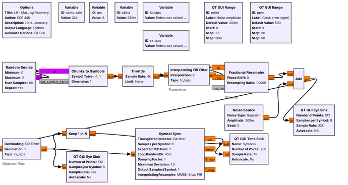
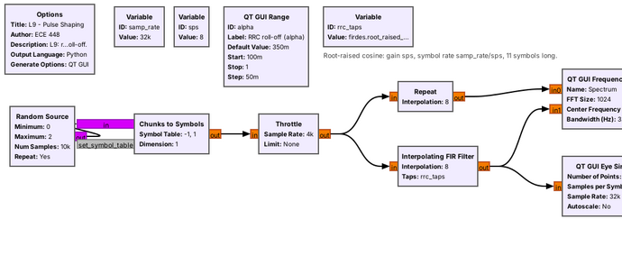
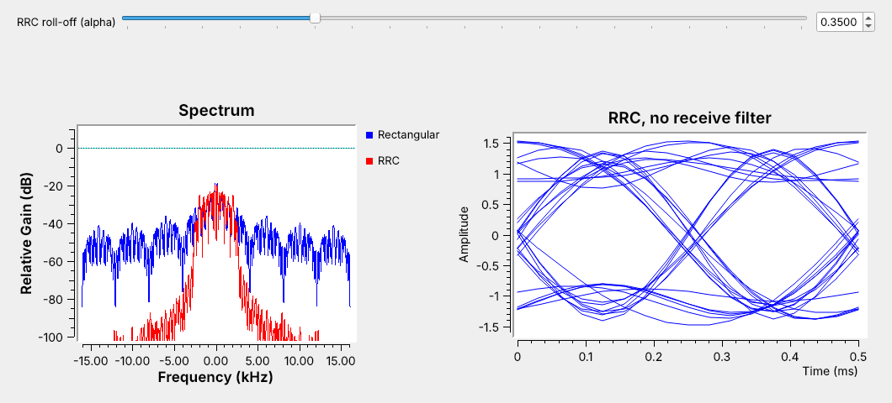
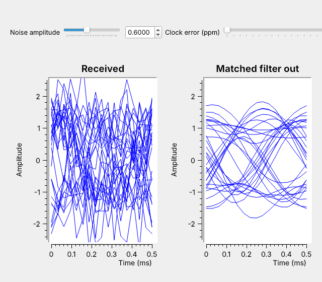
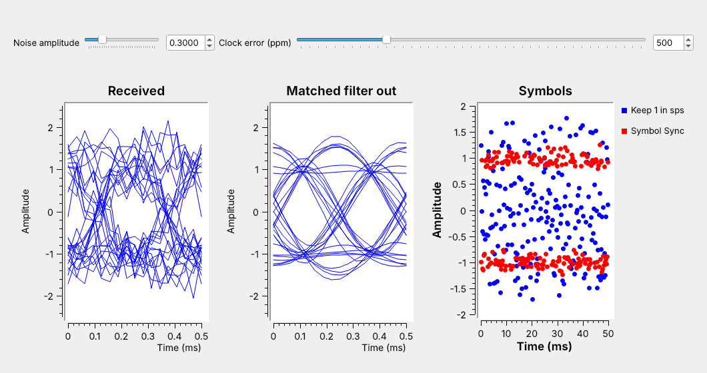

<!-- .slide: class="title-slide" -->

<div class="title-left">

# ECE 448

Software Defined Radios

## Lesson 9 — PAM Theory

Spring 2027 · Dr. Neil Rogers

</div>

<div class="title-right">


</div>

---

## Where We Were

- Lesson 3: a constellation shows one sample per symbol
- Lesson 5: a flowgraph is the receiver
- Lesson 8: FSK carried bits as frequency

Today: a PAM link in GNU Radio, from bits to one clean sample per symbol.

Note:
Open both L9 flowgraphs in GRC before class. The pulse-shaping demo runs in the first fifteen minutes.

---

## Today's Plan

1. Binary and M-ary PAM, noise, constellations, Gray coding
2. Pulse shaping: raised cosine and bandwidth
3. The eye diagram
4. Matched filtering
5. Symbol-timing recovery with Symbol Sync

Note:
Part 1 follows the 2025 PAM slides. Every later part adds one block to the flowgraph. Items two, four, and five run live.

---

## The PAM Flowgraph



Each block is one idea from this lesson.

Note:
Trace the signal left to right: symbols, transmit filter, channel, matched filter, then Keep 1 in N and Symbol Sync side by side. Lesson 10 puts text in at the left and gets it back out at the right.

---

## Binary and M-ary PAM

<div class="fig" data-inline-svg="./fig/L09-pam-levels.svg" style="max-width:720px; margin:0 auto;"></div>

$$R_s = \frac{R_b}{\log_2 M}$$

Note:
Binary PAM sends plus A for a 1 and minus A for a 0, and the receiver decides by the sign. The same eight bits go out both ways: 4-PAM uses half as many symbols, each twice as long. In GNU Radio, a Chunks to Symbols block does the mapping from a table.

---

## What Noise Does to the Levels

<div class="fig" data-inline-svg="./fig/L09-pam-noise.svg" style="max-width:700px; margin:0 auto;"></div>

A sample past a dashed threshold is a wrong decision.

Note:
Top: a little noise, no errors. Middle: more noise, a few red dots. Bottom: 4-PAM at the same power, so its levels are about plus or minus 0.45 and 1.34, and the same little noise as the top; the levels are closer, so it already makes errors.

---

## Constellations and Gray Coding

<div class="fig" data-inline-svg="./fig/L09-constellations.svg" style="max-width:740px; margin:0 auto;"></div>

Neighboring points differ in one bit. Now label the 8-PSK points.

Note:
PAM's points lie on the real axis; m-PSK's lie on a circle and come back in Lesson 15. Noise usually pushes a sample to a neighbor, so with Gray coding a wrong decision usually costs one bit. Give the class two minutes to Gray-code the blank 8-PSK; one answer going around is 000, 001, 011, 010, 110, 111, 101, 100. It is also in the practice set.

---

## Why Not Rectangular Pulses?

- A rectangular pulse has a sinc spectrum.
- Its first sidelobe is only 13 dB down, and the sidelobes fall off slowly.
- The signal spills into neighboring channels.

Note:
The jumps between levels are what spread the spectrum. A licensed transmitter has an emission mask outside its channel, and a rectangular pulse can exceed it.

---

## Raised Cosine and Bandwidth

<div class="fig" data-inline-svg="./fig/L09-rc-spectrum.svg" style="max-width:720px; margin:0 auto;"></div>

$$B = (1+\alpha)R_s$$

Note:
At α = 0 the bandwidth is the minimum, R_s, but the pulse is infinitely long. At α = 1 the bandwidth doubles. We use 0.35 all lesson.

---

## Zero Intersymbol Interference

<div class="fig" data-inline-svg="./fig/L09-rc-pulses.svg" style="max-width:720px; margin:0 auto;"></div>

Each pulse is zero at every other symbol instant.

Note:
Point at each red dot: the sum passes exactly through the symbol value there. Between the dots it does not, which is why sampling time matters.

---

## Root-Raised Cosine: Half at Each End

- The transmitter and receiver each use a **root-raised cosine** (RRC).
- Together the two filters make one raised cosine.
- The receive half also rejects noise outside the signal band.

Note:
The transmitted signal alone has some ISI. Only the receive filter's output is ISI-free.

---

## Pulse Shaping in GNU Radio



```python
firdes.root_raised_cosine(sps, samp_rate, samp_rate/sps, alpha, 11*sps)
```

Note:
The five arguments are the gain, sps; the sample rate; the symbol rate; alpha; and the number of taps. The Interpolating FIR Filter inserts sps minus one zeros after each symbol and then filters. 32 kHz over 8 samples per symbol gives 4 kbaud.

---

## Rectangular and RRC Spectra



RRC at $\alpha = 0.35$ fits $4 \times 1.35 = 5.4$ kHz.

Note:
Run it live and drag alpha: the red edge follows one plus alpha times Rs over two. Point out the eye on the right is not clean yet; that is the missing matched filter.

---

## Symbol Rate and Bandwidth

A 12.96 kHz channel at $\alpha = 0.35$ fits 9.6 kbaud: `sps` = 5 at 48 kHz.

| Modulation | Bit rate | Bandwidth |
| :-- | :-: | :-: |
| 2-PAM | 9.6 kb/s | 12.96 kHz |
| 4-PAM | 19.2 kb/s | 12.96 kHz |

Note:
4-PAM doubles the bit rate in the same channel by changing the Chunks to Symbols table, but its levels sit closer, so it breaks at less noise. Doubling the symbol rate instead doubles the bandwidth and no longer fits.

---

## The Eye Diagram

<div class="fig" data-inline-svg="./fig/L09-eye-anatomy.svg" style="max-width:560px; margin:0 auto;"></div>

Sample where the eye is widest open.

Note:
Height is noise margin, width is timing margin, the center is where to sample. GNU Radio draws it with the QT GUI Eye Sink.

---

<!-- .slide: class="viz-cue-slide" -->

## PAM Eye Explorer

- Lower α: the spectrum narrows and the eye's waist pinches.
- RRC only: the eye picks up ISI.
- Move the sample time or lower the SNR: wrong decisions climb.

<p class="viz-cue">↗ Interactive on the lesson page</p>

Note:
Switch to rectangular to show the spectrum spreading, then back to RRC plus matched filter.

---

## Matched Filtering



The same RRC at the receiver opens the eye that noise closed.

Note:
Turn the noise slider up to 0.6 live. The received eye closes, and the matched-filter eye stays open. The filter passes the signal's few kilohertz and blocks the noise across the rest of the 32 kHz.

---

## Symbol-Timing Recovery



Plain decimation drifts through the eye; Symbol Sync tracks its center.

Note:
The flowgraph exaggerates the error to 500 ppm so the drift shows in seconds. Even 20 ppm at 4 kbaud slips a whole symbol every 12.5 seconds.

---

## The Symbol Sync Block

| Parameter | L9 value |
| :-- | :-- |
| Timing error detector | Gardner |
| Samples per symbol | 8 |
| Loop bandwidth | 0.045 |
| Output samples/symbol | 1 |

Note:
Gardner uses the sample halfway between symbols, where transitions cross zero on average, and the loop averages out the spread of the individual crossings. Larger loop bandwidth tracks faster but jitters more.

---

## The PAM Receiver in GNU Radio

| Idea | Block |
| :-- | :-- |
| Symbol mapping | Chunks to Symbols |
| Pulse shaping | Interpolating FIR Filter |
| Matched filter | Decimating FIR Filter |
| Eye check | QT GUI Eye Sink |
| Timing recovery | Symbol Sync |

Note:
On an SDR the channel is real: the noise and clock error come from hardware, and this receiver already handles both.

---

## Key Point

<div class="callout">The RRC filter at the transmitter fixes the bandwidth at \((1+\alpha)R_s\). The same RRC filter at the receiver rejects the noise and removes the ISI, and Symbol Sync finds the center of the eye.</div>

Note:
Every PAM, PSK, and QAM link in the rest of the course uses this chain.

---

## Looking Ahead

- Lesson 10: ASCII text over this PAM link
- Bytes to bits, a frame marker, and a slicer back to bits
- L10 Lab: the link over real radios

Note:
Before Lesson 10, run both L9 flowgraphs and be able to find the symbol rate that fits a channel.
