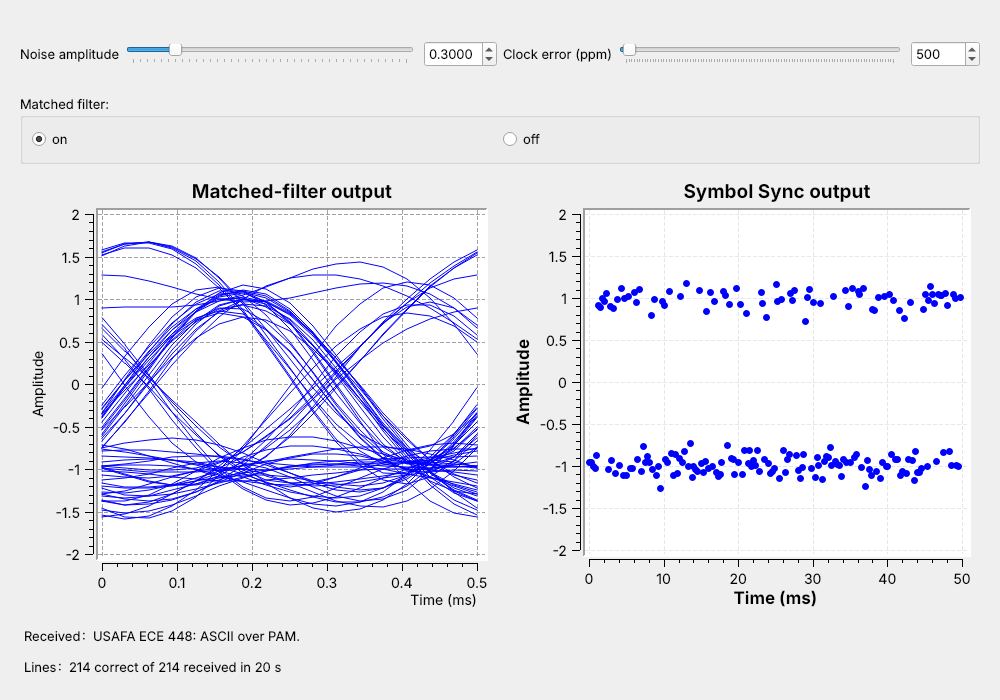
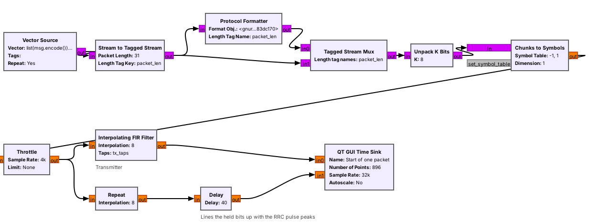
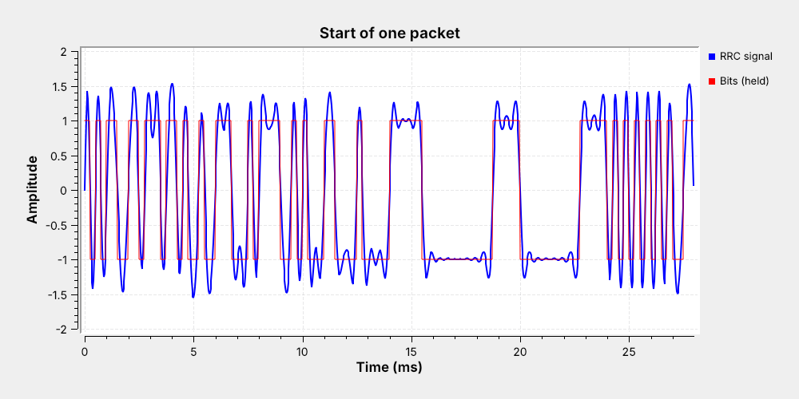
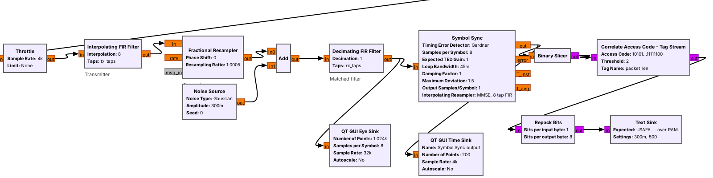
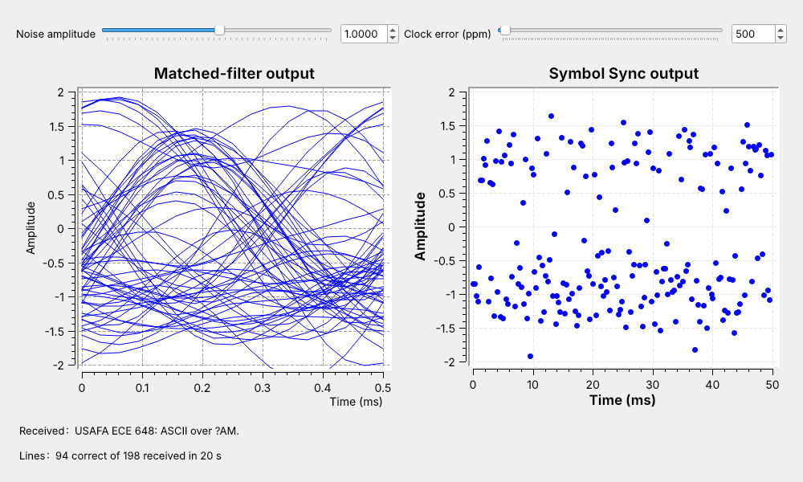
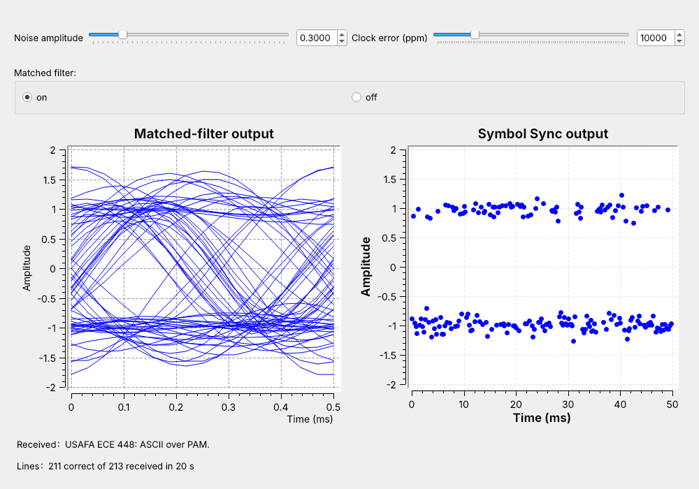

<!-- .slide: class="title-slide" -->

# ECE 448

Software Defined Radios

## Lesson 10 — ASCII over PAM

Spring 2027 · Dr. Neil Rogers

---

## Where We Were

- Lesson 3: a slicer decides each 2-PAM symbol at zero
- Lesson 8: text in packets behind an access code
- Lesson 9: the PAM link, from bits to one clean sample per symbol

Today: text in at one end of the PAM link and out the other.

Note:
Open both L10 flowgraphs in GRC before class. The link flowgraph runs in the first five minutes and again for the noise and clock-error parts.

---

## Today's Plan

1. Text to bits: ASCII and bit order
2. Packets: access code, header, payload
3. The receiver: slicer, access-code search, bytes
4. Noise and clock error
5. On a real radio

Note:
Parts 1 and 2 are the transmitter, part 3 the receiver. Part 4 runs live with the sliders.

---

## A Line of Text over PAM

Every line arrives at noise 0.3 and a 500 ppm clock error.

Note:
Run L10-pam-link.grc live. The eye and the Symbol Sync plot are Lesson 9's checks. The Lines label climbs by about 11 every second.

---

## Text to Bits

'U' is 0x55; Unpack K Bits sends it MSB first: 01010101.

Note:
The Vector Source holds list(msg.encode()) plus 10, the newline. Our line is 30 characters plus the newline: 31 bytes, 248 bits, 62 ms at 4 kbaud.

---

## Where Does a Byte Start?

One bit late, "USA" reads 0xAA, 0xA6, 0x82.

Note:
Nothing in the bit stream marks a byte boundary. The fix is a known pattern in front of the data, which the receiver searches for.

---

## Packets

- 64-bit **access code**, then the length twice, then the text

Note:
The packet uses the same format as the L8 link. The access code and header add 96 bits to the 248 bits of text, so a packet is 344 bits and lasts 86 ms. The link sends 11.6 packets a second, and 72% of the bits are text. A 200-byte payload raises the text share to 94%.

---

## The Transmitter in GNU Radio

Protocol Formatter writes the header; Tagged Stream Mux puts it in front.

Note:
Stream to Tagged Stream cuts the message into 31-byte lines and tags each one with packet_len. The format object is digital.header_format_default with the default access code. From Unpack K Bits on, it is the L9 transmitter: alpha 0.35, sps 8, 32 kHz.

---

## One Packet on the Wire

0–16 ms access code · 16–24 ms length 31, twice · then 'U', 'S'

Note:
The time sink triggers on the packet_len tag. 31 in 16 bits is eleven zeros and five ones, so the header sits low for 2.75 ms and high for 1.25 ms, twice. The payload starts at 24 ms with 01010101.

---

## The Receiver

- Matched filter and Symbol Sync: Lesson 9's settings
- New: Binary Slicer, Correlate Access Code, Repack Bits

Note:
The channel is a Fractional Resampler for the clock error and a Noise Source. The Binary Slicer outputs a 1 for any sample above zero. Repack Bits packs 8 bits into a byte, MSB first. The Text Sink is the Embedded Python Block from Lesson 8.

---

## Finding the Access Code

- Compare the last 64 bits with the code after every bit.
- Random bits match about 32 of 64.
- At most 2 differences: a packet starts here.
- Read the 32-bit header, then pass on that many bytes.

Note:
The two copies of the length must agree, or the block drops the packet. 64 random bits come within 2 bits of the code about once in 9 times 10 to the 15 tries, once in 70,000 years at 4 kbaud.

---

<!-- .slide: class="viz-cue-slide" -->

## PAM Packet Explorer

- Lower the SNR: red circles, then wrong characters.
- Inverted: the match count drops to zero and nothing arrives.
- Read LSB first: packets arrive, text is unreadable.

↗ Interactive on the lesson page

Note:
Start at 12 dB, where the search finds the packet at bit 40. Press new noise a few times near 8 dB to show the header check failing.

---

## Noise

$$\text{SNR} = \frac{8}{\sigma^2}, \qquad \text{BER} = Q\left(\sqrt{\text{SNR}}\right)$$

Note:
The matched filter keeps about an eighth of the noise, Lesson 9's 9 dB. At sigma 1 the SNR is 9 dB and the BER 2.3 times 10 to the minus 3. A line needs all 280 header and payload bits right, so about 52% of the lines sent arrive intact. The label counts only lines whose header survived, so it should read about 56%; this run shows 47%, and the line shown has two wrong characters.

---

## Noise Sweep

| $\sigma$ | SNR | Predicted lines | Measured lines |
| :-: | :-: | :-: | :-: |
| 0.7 | 12.1 dB | 99.3% | 98.9% |
| 0.8 | 11.0 dB | 94% | 94% |
| 1.0 | 9.0 dB | 52% | 47% |
| 1.2 | 7.4 dB | 7% | 6% |

99% of lines at 12 dB, almost none at 6 dB.

Note:
We measured each row headless, over 3000 packets. The small shortfall comes from Symbol Sync's timing jitter; with perfect timing the same filters match the formula. Design the link budget for at least 12 dB at the slicer plus a fade margin.

---

## Clock Error

Symbol Sync locks cold to about 25,000 ppm; a crystal is off by about 20 ppm.

Note:
The eye sink assumes exactly 8 samples per symbol, so it smears at 1%. Symbol Sync tracks the difference. Started cold, the link loses under 1% of lines at 10,000 ppm and a few percent from 15,000 to 25,000 ppm, often fails to lock at 30,000, and never locks at 40,000. Raised a step at a time while locked, it follows 40,000 ppm and beyond.

---

## Mismatched Settings

| Receiver setting | Result |
| :-- | :-- |
| Polarity inverted | no packets: 0 of 64 bits match |
| LSB first | packets arrive, text unreadable |
| Wrong `sps` | no packets |
| Wrong access code | no packets |

Note:
Read LSB first, 'U' 01010101 becomes 10101010, 0xAA. The polarity case happens on a real radio, which is the next slide.

---

## PAM Text on a Real Radio

- One PlutoSDR at 915 MHz, TX port cabled to RX port
- Resample 32 kHz up to 1.024 MS/s and back down
- Costas Loop for the carrier phase, plus a polarity switch

Nothing in L10 transmits; the L10 Lab transmits into a cable.

Note:
In class we transmit only into a cable, into a shielded enclosure, or at very low power in an ISM band, and only when the lesson says to. The Costas Loop is Lesson 15; today it is one block that can lock upside down, which inverts every bit.

---

## Key Point

Text becomes bytes, bytes become bits, and each line goes out as a packet behind a 64-bit access code. The receiver slices each symbol to a bit, finds the access code, and reads the length and the bytes that follow.

Note:
Every packet link in the rest of the course finds its packets by searching for a known pattern.

---

## Looking Ahead

- L10 Lab: build the transmitter, sweep noise and clock error, then a PlutoSDR
- Lesson 11: write a custom block like the Text Sink

Note:
Before the lab, run both L10 flowgraphs and be able to count the bits and the time in a packet.
