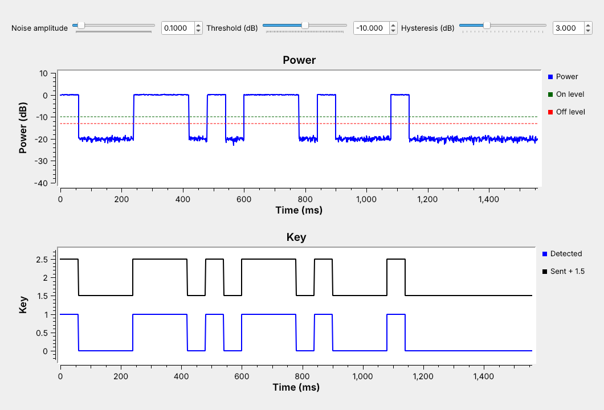
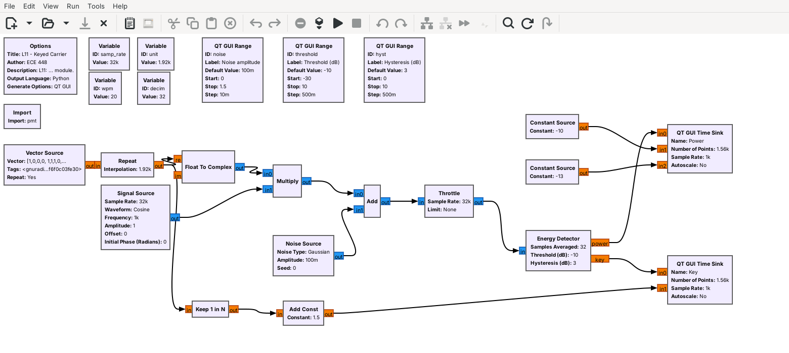
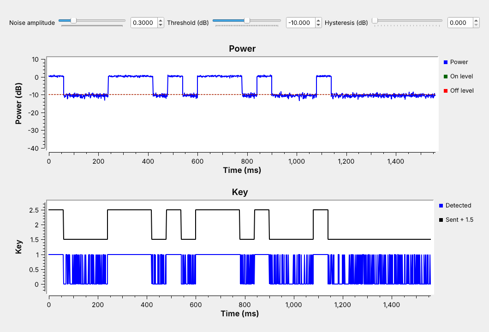
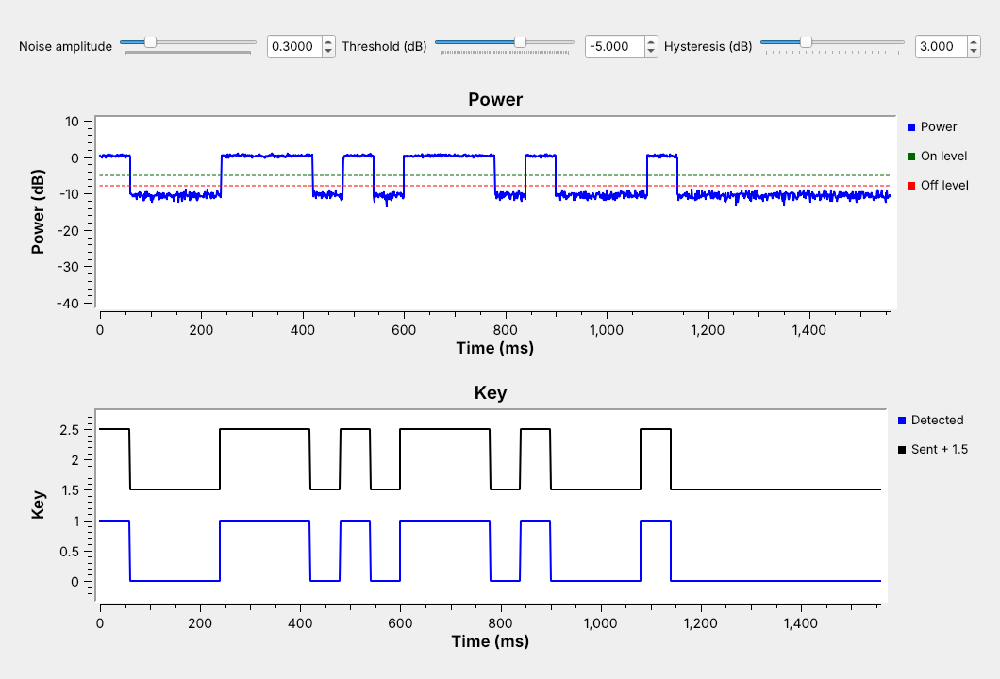
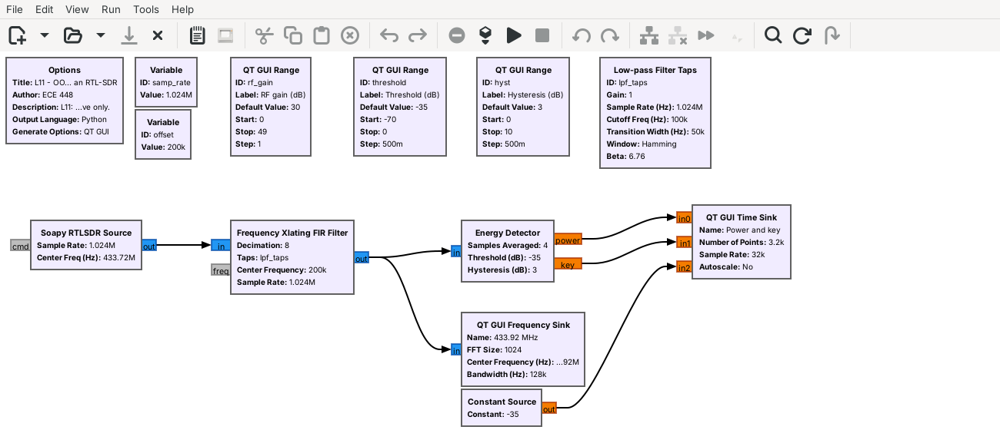

<!-- .slide: class="title-slide" -->

<div class="title-left">

# ECE 448

Software Defined Radios

## Lesson 11 — Out-of-Tree Modules and Custom Blocks

Spring 2027 · Dr. Neil Rogers

</div>

<div class="title-right">


</div>

---

## Where We Were

- Lesson 8: the Text Sink, a Python block inside one `.grc` file
- Lesson 10: the same block, pasted into a second flowgraph

Today we write a block of our own and install it like a stock block.

Note:
Have GRC open with L11-keyed-carrier.grc, and a terminal at the radioconda prompt in the unzipped gr-ece448 directory. The build runs live in part 3.

---

## Today's Plan

1. Make the module with gr_modtool
2. Write the Energy Detector: work() and its YAML file
3. Test, build, and install it

Then we set its levels and use it on a laptop and an RTL-SDR.

Note:
Parts 1 and 3 are LO 5.1, the packaging. Part 2 and the levels are LO 5.2, the block itself.

---

## A Keyed Carrier



Our block turns the carrier into a key: 1 while it is on.

Note:
Run L11-keyed-carrier.grc live. Morse ECE at 20 WPM, so a dit is 60 ms. On the Power plot the carrier reads 0 dB and the floor near minus 20 dB.

---

## Embedded Block or Module?

| | Embedded Python Block | OOT module |
| :-- | :-- | :-- |
| Code lives in | one `.grc` file | its own directory |
| Reuse | copy and paste | any flowgraph |
| Testing | by eye | a unit test |

Note:
The tree is GNU Radio's own library; a module we build ourselves is out of tree. After install, the block is in GRC's library like any stock block.

---

## Make the Module

```
gr_modtool newmod ece448
cd gr-ece448
gr_modtool add -t decimator -l python energy_detector
```

Arguments: `decim=32, threshold_db=-20.0, hysteresis_db=3.0`

Note:
gr_modtool add then asks for a copyright holder, the argument list, and whether to add a Python QA file. Answer yes.

---

## The Module Tree

<div class="fig" data-inline-svg="./fig/L11-oot-tree.svg" style="max-width:720px; margin:0 auto;"></div>

On 3.10.9, add `energy_detector.py` to `gr_python_install(FILES ...)`.

Note:
GNU Radio 3.10.9, Ubuntu 24.04's package, misses that edit; radioconda's 3.10.12 makes it. Without it the module installs with no block.

---

## Four Kinds of Block

<div class="fig" data-inline-svg="./fig/L11-block-types.svg" style="max-width:720px; margin:0 auto;"></div>

One output per $N$ inputs makes the Energy Detector a decimator.

Note:
Sync like Multiply Const, decimator like a decimating filter, interpolator like Repeat, general like Correlate Access Code, whose output count changes.

---

## The Energy Detector

<div class="fig" data-inline-svg="./fig/L11-energy-steps.svg" style="max-width:720px; margin:0 auto;"></div>

Average power of each $N$ samples, in dB, then a key with hysteresis.

Note:
Key on above the threshold, off below the threshold minus the hysteresis. With N = 32 at 32 kHz, one output per millisecond. A tone of amplitude 1 reads 0 dB; with the carrier off, read the noise floor off the Power plot.

---

## work()

```python
n = len(output_items[0])
x = input_items[0][:n * self.decim].reshape(n, self.decim)
power_db = 10 * np.log10(np.mean(x.real**2 + x.imag**2, axis=1) + 1e-12)
for i, p in enumerate(power_db):
    if self.key == 0.0 and p > self.threshold_db:
        self.key = 1.0
    elif self.key == 1.0 and p < self.threshold_db - self.hysteresis_db:
        self.key = 0.0
    output_items[1][i] = self.key
output_items[0][:] = power_db
return n
```

Note:
A decimator gets exactly n times decim inputs. The reshape averages each run of 32 in one NumPy call. self.key carries the state between calls.

---

## The YAML File

```yaml
id: ece448_energy_detector
label: Energy Detector
category: '[ECE 448]'
templates:
  imports: from gnuradio import ece448
  make: ece448.energy_detector(${decim}, ${threshold_db}, ${hysteresis_db})
  callbacks:
  - set_threshold_db(${threshold_db})
  - set_hysteresis_db(${hysteresis_db})
```

Note:
GRC reads only this file, never the Python. Below this come the parameters, the complex input, and the power and key outputs. The callbacks let a slider move the levels while the flowgraph runs.

---

## Test, Build, Install

```
mkdir build && cd build
cmake -G Ninja -DCMAKE_INSTALL_PREFIX=${CONDA_PREFIX} \
      -DCMAKE_PREFIX_PATH=${CONDA_PREFIX} ..
cmake --build .
ctest --output-on-failure
cmake --install .
```

Note:
Run it live. ctest runs the four test methods in qa_energy_detector.py as one entry and prints 100% tests passed, 0 tests failed out of 1. Restart GRC so it reloads its block library.

---

## The Block in GRC



Note:
Search the library for Energy Detector, under ECE 448. The rest of the flowgraph builds the test signal: Vector Source of the Morse pattern, Repeat, and a 1 kHz tone.

---

## Chatter



On the Power plot the floor sits near $-10.5$ dB, on the threshold.

Note:
Move the noise slider to 0.3 and the hysteresis to 0 live. Then add 3 dB of hysteresis with the threshold left at minus 10: the key turns on and rarely turns off. The threshold must move up before hysteresis can help.

---

## Setting the Levels



Read both levels off the plot. Set the threshold halfway between them, and the hysteresis above the floor's ragged edge.

Note:
On the plot the carrier sits just above 0 dB and the floor near minus 10.5 dB. On level minus 5, off level minus 8. Averaging more samples smooths the floor, so the levels can sit closer to the noise, but each output covers more time.

---

## Energy Detector Explorer

<iframe src="../viz/energy-detector.html" width="100%" height="510" style="border:1px solid #cddce9; border-radius:6px;" title="Energy detector explorer"></iframe>

Note:
Start at the chatter case. Raise the threshold, add hysteresis, then change the samples averaged: 8 gives a ragged floor and 0.25 ms outputs, 64 a smoother floor and 2 ms outputs.

---

## On Your Laptop

- Every radioconda install has `gr_modtool`
- CMake needs a C++ compiler, even for a Python-only module
- `conda install -c conda-forge gnuradio-build-deps`
- Windows: Visual Studio 2022 Build Tools, WSL2 Ubuntu, or an Embedded Python Block

Note:
macOS also needs xcode-select --install; we did not test a Mac or the Windows Build Tools route. L11-keyed-carrier-epy.grc runs the same class in an Embedded Python Block with nothing installed.

---

## OOK on an RTL-SDR



The same block keys on a 433.92 MHz remote. The flowgraph only receives.

Note:
Find the bursts first in SDR Flex (GQRX as the fallback): tune 433.92 MHz and watch the waterfall while pressing the remote. SDR Flex can pass them to rtl_433, a ready-made decoder that names the device. Then close the explore tool and open the flowgraph. Tuned 200 kHz low to keep the DC spike off the signal. N = 4 at 128 kHz is about 31 microseconds per output, short enough for pulses a few hundred microseconds long. Not run for the page: it needs an RTL-SDR and a remote.

---

## Key Point

<div class="callout">A block several flowgraphs need belongs in an out-of-tree module: gr_modtool writes the files, we write work(), the YAML file, and a unit test, and CMake builds, tests, and installs it.</div>

Note:
The Energy Detector is the first block in gr-ece448; Lesson 12 can reuse it.

---

## Looking Ahead

- L11 Lab: build gr-ece448, then write a Key Timer block in a module of your own
- Lesson 12: turn the key into Morse letters

Wiki tutorials: Creating Your First Block · Embedded Python Block · Creating Python OOT with gr-modtool

Note:
Before the lab, make sure gr_modtool runs at the radioconda prompt, and decide with your instructor whether your laptop takes the module route or the Embedded Python Block route.
