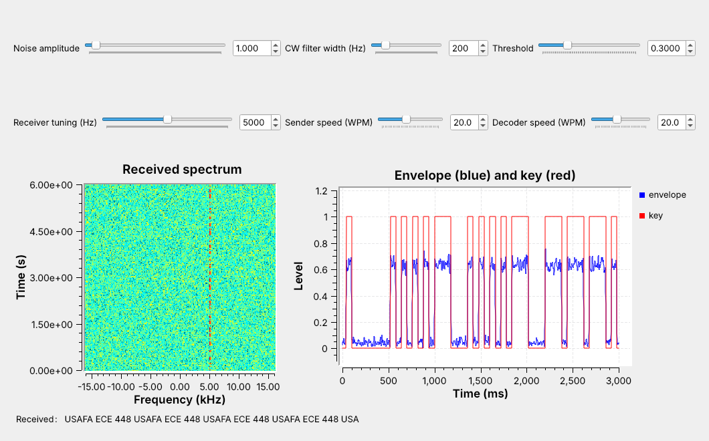
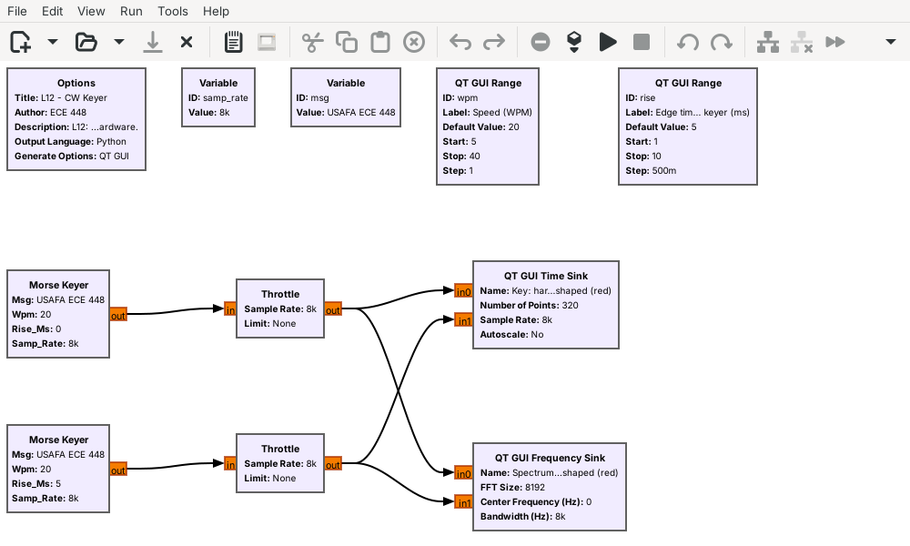
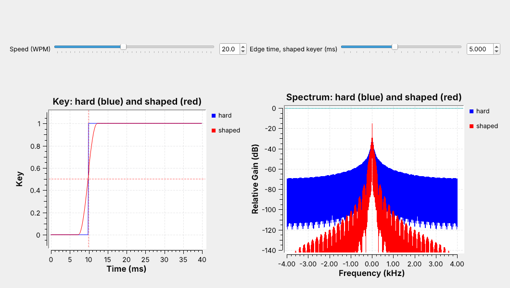
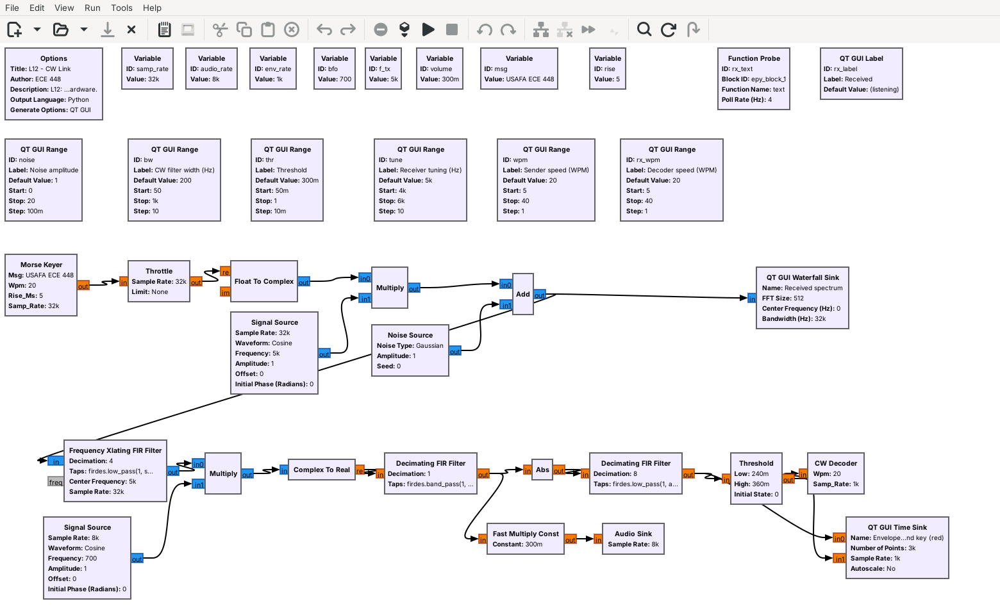
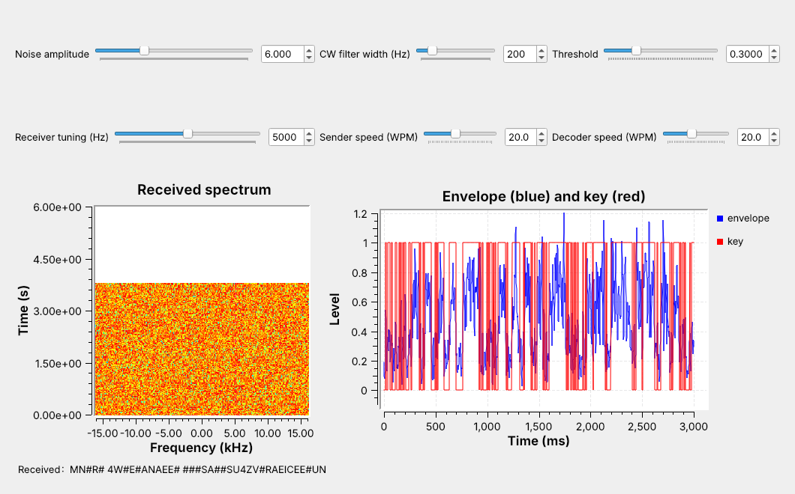
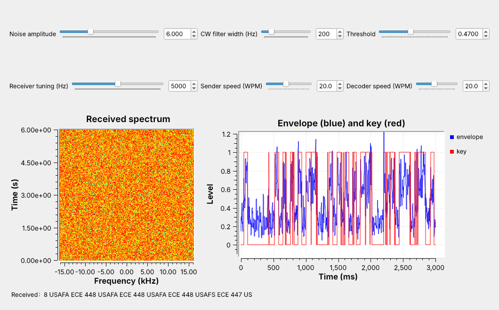
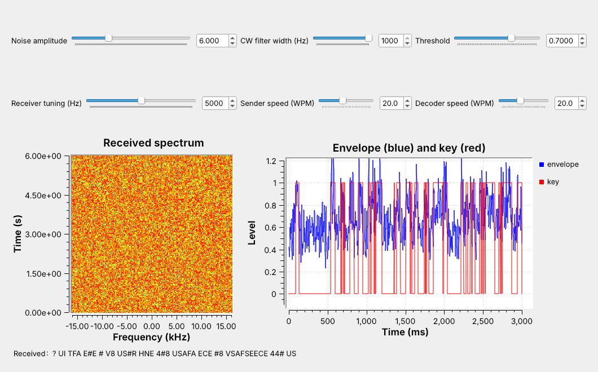

<!-- .slide: class="title-slide" -->

# ECE 448

Software Defined Radios

## Lesson 12 — CW

Spring 2027 · Dr. Neil Rogers

---

## Where We Were

- Lesson 2: a narrower bandwidth lowers the noise floor
- Lesson 6: AM, the envelope detector, and the product detector
- Lesson 11: custom blocks in Python

Today: Morse code on a carrier, keyed, received, and decoded.

Note:
Open both L12 flowgraphs in GRC before class. The link flowgraph runs in the first five minutes, with the audio on, and again for the noise and filter parts.

---

## Today's Plan

1. CW and Morse timing
2. The keyer and key clicks
3. The receiver: product detector, CW filter, envelope, threshold
4. The decoder
5. Noise and filter width

Note:
Parts 1 and 2 are the transmitter, parts 3 and 4 the receiver. Part 5 runs live with the sliders.

---

## Morse Code on an SDR

A keyed carrier at +5 kHz, its envelope, and the decoded text.

Note:
Run L12-cw-link.grc live with the audio on. Each dash of color on the waterfall is one key-down. The blue envelope sits near 0.64 for a mark, and the red key follows it.

---

## CW and On-Off Keying

- A carrier on for a **mark**, off for a **space**
- Lesson 6's AM with a message of 0 or 1
- About 100 Hz wide, so it reaches far on little power

Still in use: amateur CW segments such as 7.000–7.125 MHz, and VOR and NDB identifiers.

Note:
CW stands for continuous wave. Pilots check a navigation beacon's Morse identifier before using it. The U.S. amateur bands keep their lowest segments for CW and data, with no voice.

---

## Morse Timing

Dit 1 unit, dah 3; gaps of 1, 3, and 7 units.

Note:
The receiver only compares lengths, so it never needs an absolute time. PARIS has 14 marks and comes to exactly 50 units with its word gap.

---

## Words per Minute

$$t_\text{dit} = \frac{1.2\text{ s}}{W}$$

| Speed | Dit | Dah | Word gap |
| :-: | :-: | :-: | :-: |
| 5 WPM | 240 ms | 720 ms | 1.68 s |
| 20 WPM | 60 ms | 180 ms | 0.42 s |
| 40 WPM | 30 ms | 90 ms | 0.21 s |

Note:
One WPM sends PARIS, 50 units, once a minute, so a unit is 1.2 s. At 20 WPM PARIS takes 3.0 s. Our line, USAFA ECE 448, is 126 units, 7.56 s at 20 WPM.

---

## The Keyer in GNU Radio

One keyer is hard-keyed; the other shapes each edge over 5 ms.

Note:
The Morse Keyer is an Embedded Python Block. It outputs 1 while the key is down and 0 while it is up, at 8 kHz. That stream is the carrier's envelope.

---

## Key Clicks

The edges look alike in time; in frequency, the shaped one stays close to the carrier.

Note:
A receiver tuned near a hard-keyed transmitter hears a click at every edge. Drag the edge-time slider live: at 1 ms the red skirts sit just below the blue, and they fall as the edge grows. The edge has to stay well under a dit; at 40 WPM a dit is 30 ms, and 5 ms edges still leave 25 ms at full power.

---

<!-- .slide: class="viz-cue-slide" -->

## CW Keyer Explorer

- Drag the edge time to 0: the shaped spectrum rises to meet hard keying.
- Raise the speed: the spectrum widens.
- Type your own message and read its length.

↗ Interactive on the lesson page

Note:
Start with PARIS at 20 WPM, where the readouts give a 60 ms dit and 3.00 s.

---

## The Receiver

Tune, product detector, CW filter, envelope, threshold, decoder.

Note:
The Xlating filter moves the 5 kHz carrier to 0 Hz, keeps plus and minus 600 Hz, and decimates by 4 to 8 kHz. The CW filter is a 200 Hz band-pass at 700 Hz. Abs and the low-pass are Lesson 6's envelope detector, decimating to 1 kHz.

---

## The Product Detector

- Multiply by a 700 Hz **BFO**, keep the real part.
- The carrier becomes a 700 Hz tone.
- A tuning error $\Delta f$ moves the tone to $700 + \Delta f$ Hz.

The tone has to stay inside the CW filter.

Note:
Tuned 40 Hz low, the tone comes out at 740 Hz, and a narrower filter leaves less room for that error. The Xlating filter's 600 Hz limit also keeps a signal 1.4 kHz below the carrier from landing on the same tone.

---

## Envelope and Threshold

Set the threshold halfway between the space and mark levels.

Note:
The envelope reads about 0.64 during a mark on the plot. The Threshold block switches up at 1.2 times thr and down at 0.8 times thr; that hysteresis stops chatter near the threshold. At noise 6 the space level rises to 0.26, so thr must move from 0.3 to 0.47.

---

## Decoding Marks and Spaces

Marks under 2 units are dits; a 2-unit space ends a letter, a 5-unit space a word.

Note:
Each boundary sits between two values a perfect sender produces. A pattern not in the table comes out as a #. The lab finds how far the sender's speed can drift from the decoder's.

---

## Noise

Noise at 6 hides the carrier on the waterfall, yet most of the text arrives.

Note:
Raise the noise slider live and watch the waterfall fill, the envelope's space level rise, and the first wrong letters appear. Each one is a mark that noise split, shortened, or invented: here A read as S and 8 as 7.

---

## Filter Width

1 kHz: much of the text breaks. 50 Hz: nearly all of it arrives.

Note:
Same noise, three filters: drag the CW filter slider live. A narrower filter passes less noise, which is Lesson 2's point. Its limit is tuning: the tone must stay inside the filter.

---

## CW on a Real Radio

- L12 Lab: one PlutoSDR, TX port to RX port, 30 dB attenuator
- An AGC restores the envelope level; check the threshold line
- Nothing in L12 transmits over the air
- SDR Flex or GQRX: hear a VOR's Morse identifier in AM

Note:
In class we transmit only into a cable, into a shielded enclosure, or at very low power in an ISM band, and only when the lesson says to. The PlutoSDR flowgraph has run only in simulation so far; the lab is its first run on hardware. In SDR Flex (GQRX as the fallback), tune the nearest VOR (108 to 118 MHz; its frequency and identifier are on an FAA sectional, free at SkyVector) in AM mode and wait for its identifier, a 1020 Hz tone. Most amateur CW is on HF (needs an upconverter or direct sampling); 2 m CW at 144.0 to 144.1 MHz is in range.

---

## Key Point

CW keys a carrier on and off, and a dit lasts 1.2/W s at W WPM. Shaped edges keep it narrow. A narrow filter rejects the noise, and a threshold midway between the envelope's two levels recovers the text.

Note:
Many of the remotes in Lesson 17 use the same on-off keying, and the same receiver chain finds their bits.

---

## Looking Ahead

- L12 Lab: key your initials, sweep the noise, then a PlutoSDR
- Lesson 13: DTMF, two tones at once

Note:
Before the lab, run L12-cw-link.grc and be able to compute a dit length from a WPM.
