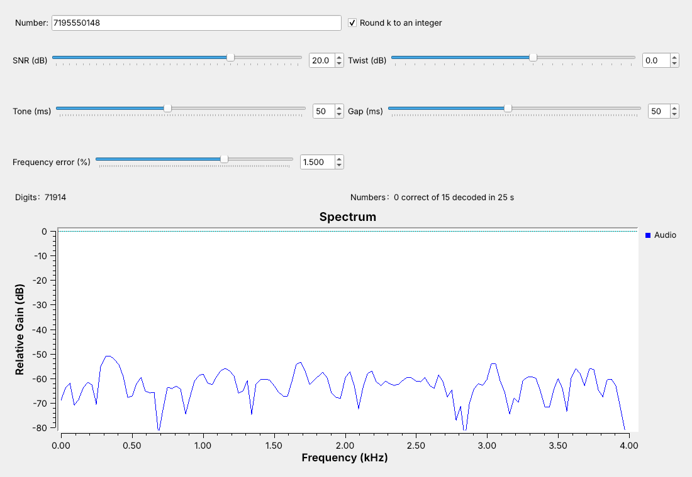

<!-- .slide: class="title-slide" -->

# ECE 448

Software Defined Radios

## Lesson 13 — DTMF

Spring 2027 · Dr. Neil Rogers

---

## Where We Were

- Lesson 7: an FM receiver turns a channel into audio
- Lesson 12: CW, one tone switched on and off
- Today we decode digits sent as pairs of tones.

Note:
Open L13-dtmf-rx.grc, L13-dtmf-keypad.grc, and L13-dtmf-link.grc before class, with the WAV files in the same folder.

---

## Today's Plan

1. The keypad grid and one key in GNU Radio
2. The rules a receiver must meet
3. Goertzel bins
4. The receiver and its decision rules
5. Testing the decoder

Note:
Parts 1 and 2 are the signal, parts 3 and 4 the receiver. Part 5 runs live with the link flowgraph's sliders.

---

## A Phone Number in Sound

Each digit raises one row bin and one column bin. The capture is simulated.

Note:
Run L13-dtmf-rx.grc live. The capture is synthetic: L13-dtmf-capture.grc dialed it with 50 ms tones and gaps, -2 dB of twist, and 20 dB SNR. Row peaks reach 0.15, half the 0.3 amplitude; column peaks 0.12.

---

## The Keypad Grid

'5' sends 770 Hz and 1336 Hz.

Note:
Each tone is about 10.5% above the previous one in its group, and no row tone's second harmonic lands on a column tone. The closest pair is 697 and 770 Hz, 73 Hz apart. The A to D column set call precedence on AUTOVON and carries control codes on radio systems.

---

## One Key in GNU Radio

`row_f` = `[697, 770, 852, 941][key // 4]` · `col_f` = `[1209, 1336, 1477, 1633][key % 4]`

Note:
Two float Signal Sources at amplitude 0.3, an Add, and a Multiply Const by the Press button. Everything runs at 8 kHz; a Rational Resampler raises it by 6 to 48 kHz for the Audio Sink, because not every laptop sound card accepts 8 kHz.

---

## Two Tones, One Key

In time the tones beat; in frequency they separate.

Note:
Run it and hold Press. The receiver works in frequency because the digit is obvious there.

---

## The Rules a Receiver Must Meet

| Rule | Accept | Reject |
| :-- | :-- | :-- |
| Tone length | 40 ms or longer | shorter than 23 ms |
| Gap | 40 ms or longer | |
| Frequency error | within ±1.5% | beyond ±3.5% |
| Twist (column − row) | −8 to +4 dB | |

Note:
The rules come from ITU-T Q.24 and the Bell System. Auto-dialers typically send 50 ms on and 50 ms off, 10 digits a second. The 23 ms reject rule keeps speech from looking like a digit. Lines lose more at high frequencies, so the column tone usually arrives weaker, which the standard calls normal twist.

---

## The Capture

The simulated capture uses 50 ms tones and gaps, −2 dB twist, and 20 dB SNR.

Note:
L13-dtmf-capture.grc chains the DTMF Dialer Embedded Python Block, a Noise Source, a Head, and a Wav File Sink. It writes one dialing and a 500 ms pause, 1.5 s at 8 kHz. SNR is tone power over noise power across 0 to 4 kHz, during a tone. The three 5s are separate because a gap separates them.

---

## Separating Neighboring Tones

- Eight band-pass filters, each followed by an energy detector
- Each must reject a neighbor 73 Hz away
- Separating $\Delta f$ takes about $1/\Delta f$ of signal: 14 ms

Note:
A 40 ms tone leaves room for a block of about 25 ms, with margin for the tone's start and end.

---

## The Goertzel Bin

$$k = \frac{f N}{f_s}, \qquad c = 2\cos\left(\frac{2\pi k}{N}\right)$$

$$q_n = c q_{n-1} - q_{n-2} + x_n$$

With $N = 205$ at 8 kHz, blocks last 25.6 ms and bins sit 39.0 Hz apart.

Note:
The Goertzel recursion computes one DFT bin with one multiply per sample. For 697 Hz, k = 17.86; for 1209 Hz, k = 30.98. The power after the last sample comes from the last two values of q.

---

## Bins Against Tone Spacing

Nulls 39 Hz either side; a neighbor lands 19 to 26 dB down.

Note:
Each bin is a band-pass filter read once per block. A longer block narrows the bins but outlasts a short tone; a shorter one widens them. The lab measures both. The classic decoder rounds k, which moves the 697 Hz bin to 702.4 Hz.

---

## The Receiver

Stock **Goertzel** blocks show the bins; the **DTMF Decoder** decides.

Note:
Each stock Goertzel block outputs the bin divided by N once per block; Complex to Mag shows half the tone's amplitude. The DTMF Decoder runs its own eight bins on a 205-sample block every 102 samples.

---

## The Decision Rules

1. Best row and column bins hold 35% of the block's energy.
2. Each beats its group's other bins by 6 dB.
3. Twist within −10 to +6 dB.
4. Three blocks in a row agree.

Note:
Test 1 rejects noise and speech, test 2 a second tone in a group, test 3 excessive twist; the limits sit 2 dB outside the standard's because measured powers vary by about a decibel from block to block. The blocks start 102 samples apart, so a tone must outlast about one 25.6 ms block, which rejects bursts under 23 ms. A block without the digit must come before it counts again, so 555 reads as three digits.

---

<!-- .slide: class="viz-cue-slide" -->

## DTMF Explorer

- Lower the SNR: "too little energy."
- Move the frequency error until a tone leaves its main lobe.
- Lower N until the main lobes overlap.

↗ Interactive on the lesson page

Note:
Start at key 5, N 205, 20 dB. Raise twist past +6 dB to show test 3. The explorer tests one block; the flowgraph needs three.

---

## Decoder Performance in Noise

| SNR | 3 dB | 2 dB | 1 dB | 0 dB |
| :-- | :-: | :-: | :-: | :-: |
| Correct | 40/40 | 40/40 | 25/40 | 5/40 |

Note:
Each bin sees about 20 dB less noise than the 4 kHz band. The limit comes from test 1: at 0 dB half the block's energy is noise. Ten minutes of noise alone produced no false digits.

---

## Frequency Error and Rounding k

| Error | ±1.0% | ±1.5% | ±2.0% |
| :-- | :-: | :-: | :-: |
| $k$ unrounded | 40/40 | 40/40 | 0/40 |
| $k$ rounded | 40/40 | 0/40 | |

Note:
Rounded, the 697 Hz bin sits at 702.4 Hz, and some bins move by up to 10 Hz. A 1.5% error adds 10 to 25 Hz more. Unrounded k removes the rounding error; the recursion works for any k.

---

## DTMF on a Real Radio

- Repeaters and remote sites take DTMF over FM.
- An RTL-SDR and an FM receiver can feed 8 kHz audio to the decoder.
- The L13 Lab decodes a phone through the laptop microphone.

Note:
Nothing in this lesson transmits. In class we transmit only into a cable, into a shielded enclosure, or at very low power in an ISM band, and only when the lesson says to.

---

## Key Point

Each DTMF key is one row tone plus one column tone. Goertzel bins of 205 samples at 8 kHz separate tones 73 Hz apart, and a digit counts when one row bin and one column bin dominate for three blocks.

Note:
Every tone-based signaling system in the course decodes the same way: it measures the power at a few known frequencies over a block and applies decision rules to those powers.

---

## Looking Ahead

- The L13 Lab builds the keypad, decodes an unknown capture, measures the limits, and decodes a phone.
- Lesson 14 receives HD Radio beside an FM station.

Note:
Before the lab, run the receiver on L13-capture.wav and be able to find k for any tone.
