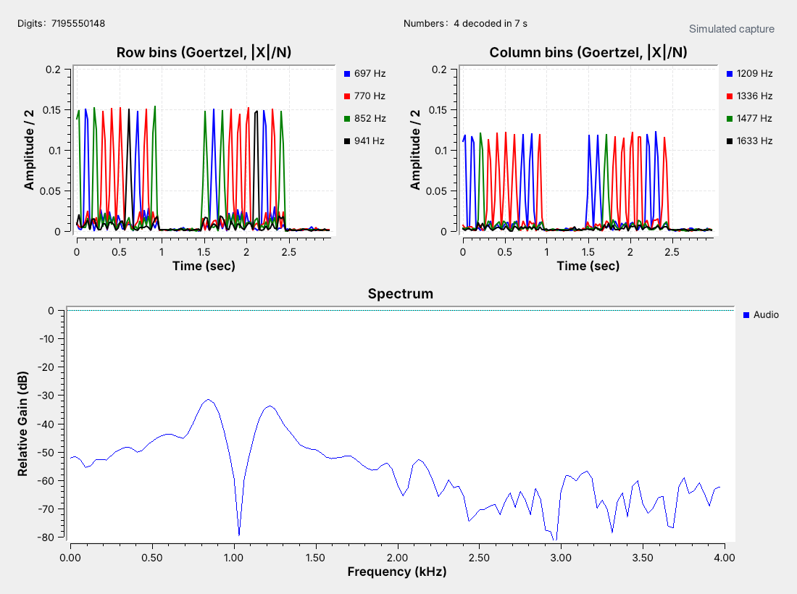
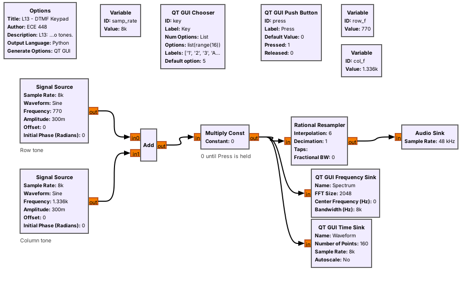
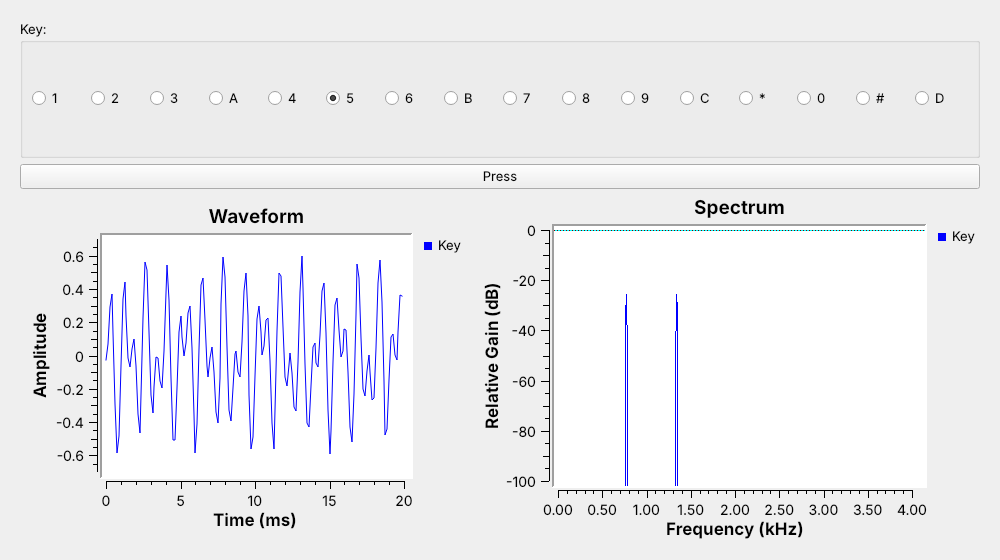
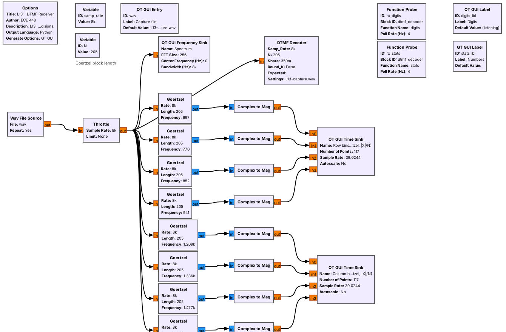
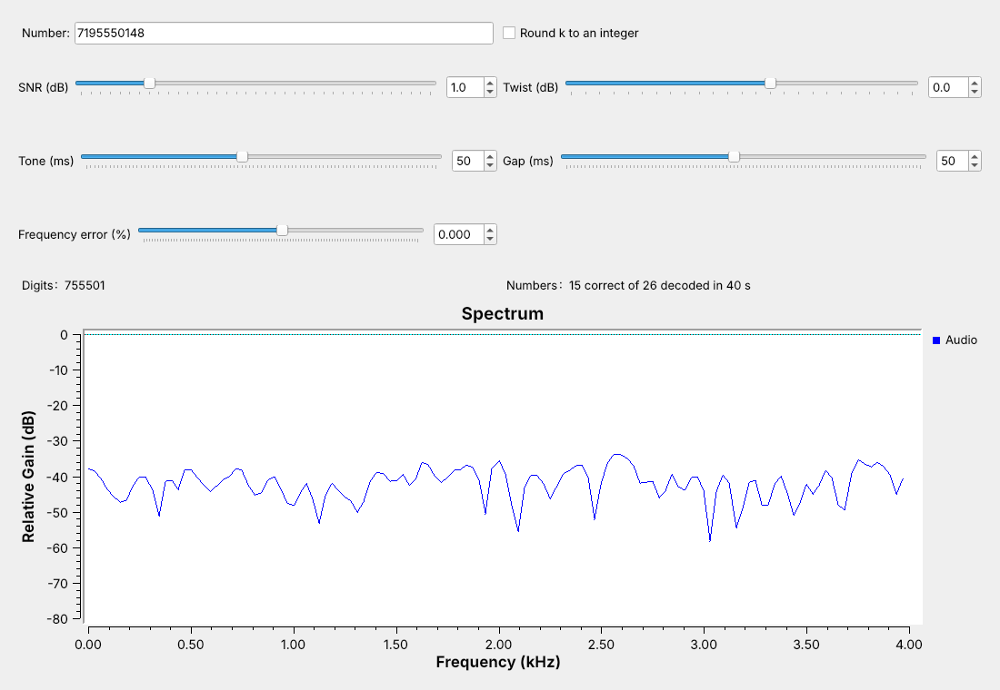

<!-- .slide: class="title-slide" -->

# ECE 448

Software Defined Radios

## Lesson 13 — DTMF

Spring 2027 · Dr. Neil Rogers

---

## Where We Were

- Lesson 7 turned an FM channel into audio.
- Lesson 12 decoded CW, one tone switched on and off.
- Today we decode digits sent as pairs of tones.

Note:
Open L13-dtmf-rx.grc, L13-dtmf-keypad.grc, and L13-dtmf-link.grc before class, with the WAV files in the same folder.

---

## Today's Plan

1. The keypad grid and one key in GNU Radio
2. Timing and twist
3. Goertzel blocks
4. The receiver and its decision rules
5. Testing the decoder

Note:
Parts 1 and 2 are the signal, parts 3 and 4 the receiver. Part 5 runs live with the link flowgraph's sliders.

---

## A Phone Number in Sound

Each digit raises one row bin and one column bin. The capture is simulated.

Note:
Run L13-dtmf-rx.grc live. The capture is synthetic: L13-dtmf-capture.grc dialed it with 50 ms tones and gaps, -2 dB of twist, and 20 dB SNR. Row peaks reach 0.15, half the 0.3 amplitude; column peaks 0.12.

---

## The Keypad Grid

'5' sends 770 Hz and 1336 Hz.

Note:
The frequencies are chosen so that no tone's harmonics land on another tone. The closest pair is 697 and 770 Hz, 73 Hz apart. The A to D column set call precedence on AUTOVON and carries control codes on radio systems.

---

## One Key in GNU Radio

`row_f` = `[697, 770, 852, 941][key // 4]` · `col_f` = `[1209, 1336, 1477, 1633][key % 4]`

Note:
Two float Signal Sources at amplitude 0.3, an Add, and a Multiply Const by the Press button. Everything runs at 8 kHz; a Rational Resampler raises it by 6 to 48 kHz for the Audio Sink, because not every laptop sound card accepts 8 kHz.

---

## Two Tones, One Key

In time the tones beat; in frequency they separate.

Note:
Run it and hold Press. The receiver works in frequency because the digit is obvious there.

---

## Timing and Twist

- Tones last 40 ms or longer.
- Gaps between digits last 20 ms or longer.
- The column tone may arrive a few dB weaker: **twist**.

Note:
Auto-dialers typically send 50 ms on and 50 ms off, 10 digits a second. A receiver ignores bursts much shorter than a tone, which keeps speech from looking like a digit. Lines lose more at high frequencies, so the column tone often arrives weaker; the link has a twist slider.

---

## The Capture

The simulated capture uses 50 ms tones and gaps, −2 dB twist, and 20 dB SNR.

Note:
L13-dtmf-capture.grc chains the DTMF Dialer Embedded Python Block, a Noise Source, a Head, and a Wav File Sink. It writes one dialing and a 500 ms pause, 1.5 s at 8 kHz. The three 5s are separate because a gap separates them.

---

## Ready-Made Decoders

- multimon-ng and Android DTMF apps read the capture.
- How else could we decode it?

Note:
From the 2025 deck: the transmitter is easy, the decoder not so easy. Play L13-capture.wav into multimon-ng or a phone app to show the digits, then ask how we would build the decoder ourselves.

---

## Separating Neighboring Tones

- Eight band-pass filters, each followed by an energy detector
- Each must reject a neighbor 73 Hz away
- A narrower filter has to listen longer

Note:
A 40 ms tone leaves room for a block of about 25 ms, with margin for the tone's start and end.

---

## The Goertzel Block

| Parameter | Setting |
| :-- | :-- |
| Sample rate | 8000 |
| Length | 205 |
| Frequency | one DTMF tone |

205 samples at 8 kHz last 25.6 ms: bins 39 Hz apart, nulls 39 Hz either side.

Note:
The Goertzel algorithm measures the energy at one frequency over a block, far cheaper than an FFT when only eight frequencies matter. GNU Radio has it as a stock block. 205/8000 = 25.6 ms fits in a 40 ms tone; 8000/205 = 39 Hz.

---

## Bins Against Tone Spacing

Bins 39 Hz apart, nulls 39 Hz either side; each neighbor lands far down.

Note:
Each bin is a band-pass filter read once per block. A longer block narrows the bins but outlasts a short tone; a shorter one widens them. The lab changes N and watches both.

---

## The Receiver

Stock **Goertzel** blocks show the bins; the **DTMF Decoder** decides.

Note:
Each stock Goertzel block outputs the bin divided by N once per block; Complex to Mag shows half the tone's amplitude. The DTMF Decoder runs its own eight bins on a 205-sample block every 102 samples.

---

## The Decision Rules

1. Best row and column bins hold 35% of the block's energy.
2. Each beats its group's other bins by 6 dB.
3. Twist is within −10 to +6 dB.
4. Three blocks in a row agree.

Note:
Test 1 rejects noise and speech, test 2 a second tone in a group, test 3 a pair whose levels differ too much. The blocks start 102 samples apart, so a tone must outlast about one 25.6 ms block, which rejects short bursts. A block without the digit must come before it counts again, so 555 reads as three digits.

---

<!-- .slide: class="viz-cue-slide" -->

## DTMF Explorer

- Lower the SNR: "too little energy."
- Move the frequency error until the tone slides off its bin.
- Lower N until the main lobes overlap.

↗ Interactive on the lesson page

Note:
Start at key 5, N 205, 20 dB. Raise twist past +6 dB to show test 3. The explorer tests one block; the flowgraph needs three.

---

## Add Noise Until Digits Drop

Every number arrives to about 2 dB; some drop near 1 dB; almost none at 0 dB.

Note:
Run the link live and pull the SNR slider down. With bins 39 Hz apart, nulls 39 Hz either side, each bin sees only a small slice of the noise. Ten minutes of noise alone produced no false digits. With no noise, every key decodes at 1.5% frequency error and none at 2%.

---

## DTMF on a Real Radio

- Repeaters and remote sites take DTMF over FM.
- Listen in GQRX on an RTL-SDR, Narrow FM; UDP audio can feed multimon-ng.
- Or feed 8 kHz FM audio to the DTMF Decoder.
- The L13 Lab decodes a phone through the laptop microphone.

Note:
Nothing in this lesson transmits. In class we transmit only into a cable, into a shielded enclosure, or at very low power in an ISM band, and only when the lesson says to.

Tutorials this lesson follows: GNU Radio wiki Embedded Python Block, Goertzel, Signal Source, and Wav File Source pages; multimon-ng is the deck's ready-made decoder.

---

## Key Point

Each DTMF key is one row tone plus one column tone. Goertzel blocks of length 205 at 8 kHz separate tones 73 Hz apart, and a digit counts when one row bin and one column bin dominate for three blocks.

Note:
Every tone-based signaling system in the course decodes the same way: it measures the power at a few known frequencies over a block and applies decision rules to those powers.

---

## Looking Ahead

- The L13 Lab builds the keypad, decodes an unknown capture, finds where digits drop, and decodes a phone.
- Lesson 14 receives HD Radio beside an FM station.

Note:
Before the lab, run the receiver on L13-capture.wav and the link with its sliders.
