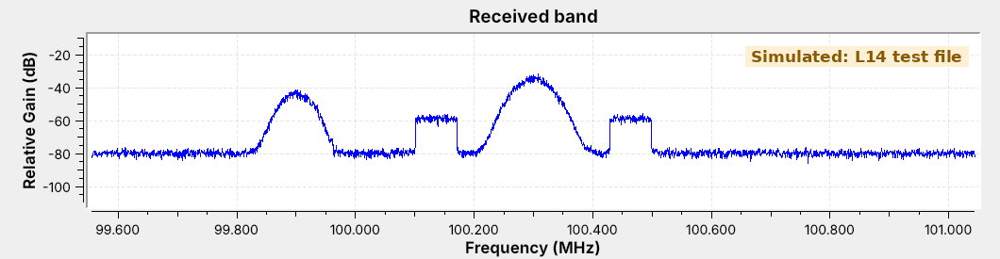
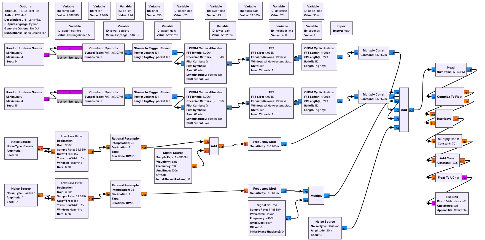
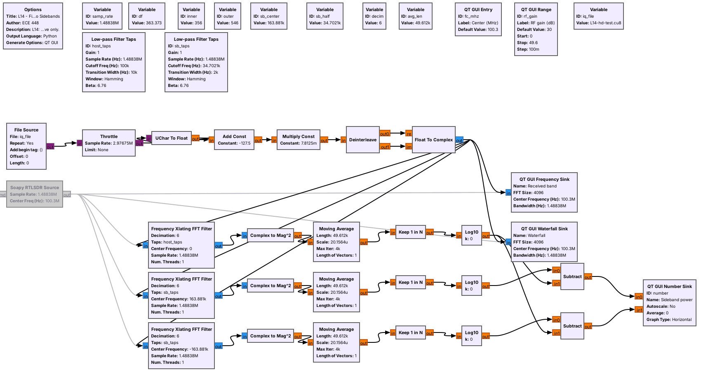
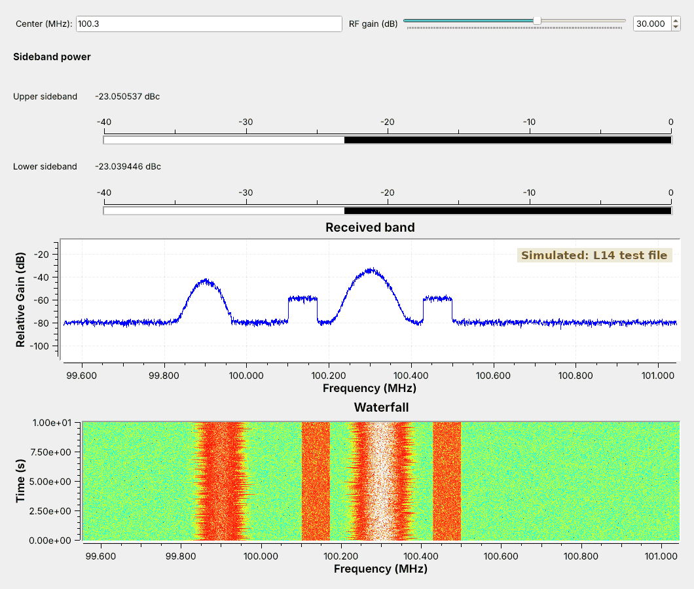
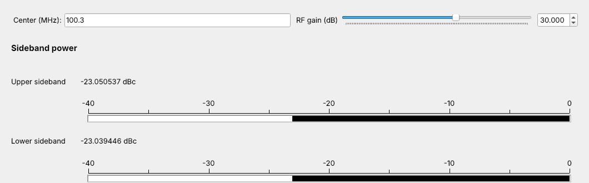

<!-- .slide: class="title-slide" -->

<div class="title-left">

# ECE 448

Software Defined Radios

## Lesson 14 — HD Radio

Spring 2027 · Dr. Neil Rogers

</div>

<div class="title-right">


</div>

---

## Where We Were

- Lesson 7 received an FM station and its RDS data.
- Lesson 13 decoded tones in bins, one FFT frequency at a time.
- Today we find a digital signal hiding beside an FM station.

Note:
Before class, run L14-hd-test-tx.grc once so L14-hd-test.cu8 sits next to L14-hd-find.grc. If the room has an RTL-SDR and an antenna, find a local HD station on the waterfall ahead of time.

---

## Today's Plan

1. The hybrid signal and its subcarriers
2. Why OFDM
3. How strong the sidebands are
4. Finding and measuring them in GNU Radio
5. Decoding with nrsc5

Note:
Parts 1 to 3 are the signal; part 4 is the flowgraph we run; part 5 is the decoder the lab uses on a live station.

---

## Two Shelves Beside a Station



Each shelf is a digital signal about 69 kHz wide. The station at 99.9 MHz has none.

Note:
Simulated test file. The shelves are HD Radio: same program in better quality, often an HD2 or HD3 as well. An ordinary FM radio ignores them.

---

## The Hybrid Signal

<div class="fig" data-inline-svg="./fig/L14-hybrid.svg" style="max-width:720px; margin:0 auto;"></div>

The analog host stays in the center; the sidebands run 129.4 to 198.4 kHz out.

Note:
NRSC-5 defines it. A receiver plays analog first and blends to digital after a few seconds; the station delays its analog audio so the two line up, and the receiver blends back to analog when the digital signal fades.

---

## Subcarriers and Partitions

$$\Delta f = \frac{1{,}488{,}375}{4096} = 363.4\ \text{Hz}$$

- 191 subcarriers per side, numbered 356 to 546, at $k \Delta f$
- 10 partitions of 19: 18 data and 1 reference each, plus 546

Note:
356 times 363.4 Hz is 129.4 kHz; 546 times it is 198.4 kHz. Extended hybrid adds one, two, or four partitions inside 356 on each side. The lab asks where those edges fall, so do not work them here.

---

## Why OFDM

- One 69 kHz carrier: a symbol every 15 μs, shorter than the echoes
- 191 slow carriers: 344.5 symbols per second each, 2.902 ms per symbol
- A 50 μs echo blurs only the first 2% of a symbol

Note:
Multipath from buildings and hills arrives tens of microseconds late. With one wide carrier a 50 microsecond echo lands on three later symbols and needs an equalizer. Each narrow subcarrier sees the channel as one gain and phase. Wi-Fi, LTE, and digital TV use OFDM for the same reason; Lesson 20 returns to it.

---

## Orthogonality and the Guard

$$\Delta f = \frac{1}{T_u}, \quad T_u = 2.752\ \text{ms}, \quad T_g = \tfrac{7}{128} T_u = 150.5\ \mu\text{s}$$

- Spacing $1/T_u$ puts every subcarrier on its neighbors' nulls.
- The guard absorbs echoes up to 150.5 μs, about 45 km of extra path.

Note:
A tone lasting Tu has a sinc spectrum with nulls 1/Tu apart. The transmitter builds every subcarrier at once with an inverse FFT and the receiver separates them with a forward FFT. The guard is a copy of the end of the symbol, which the receiver discards.

---

## OFDM Explorer

<a href="../viz/ofdm-explorer.html" target="_blank" rel="noopener">Open the OFDM explorer</a> (it is also on the lesson page).

- Spacing 1.00: every neighbor crosses zero at the center subcarrier.
- An echo longer than 150.5 μs reaches into the next symbol's FFT window.

Note:
Start at HD Radio: the red dots sit on zero. Move the spacing off 1.00 and the neighbors leak in. Drag the echo past 150 microseconds and the red sliver appears inside symbol 2's FFT window.

---

## How Strong the Sidebands Are

$$-20 - 10\log_{10} 2 = -23.0\ \text{dBc}, \qquad -20 - 10\log_{10} 382 = -45.8\ \text{dBc}$$

- Both sidebands together: −20 dBc, 1% of the host's power
- Since 2010 the FCC has allowed up to −14 dBc.

Note:
The sidebands can differ by up to 10 dB, which protects a neighbor on one side. The lab asks for the −14 dBc numbers, so leave them for the pre-lab.

---

## The Test Signal



Random QPSK on 191 subcarriers per side, −23 dBc each, written as RTL-SDR bytes.

Note:
FFT 4096 at 1,488,375 samples per second, so each bin is one subcarrier; a 224-sample guard. The symbols are random, not NRSC-5 data, so nrsc5 cannot decode this file. 4 s is 11.9 MB. Nothing transmits.

---

## The Sideband Finder



Five blocks turn RTL-SDR bytes into complex samples.

Note:
Subtract 127.5, scale by 1/128, pair the bytes. GRC shows the RTL-SDR Source grayed out; enable it and disable the File Source to go live.

---

## Finding the Sidebands



Flat tops, sharp edges, and constant width on the waterfall.

Note:
Simulated test file. The shelves start at 100.1706 and 100.4294 MHz. They sit about 25 dB under the host's peak on the display, more than the 23 dB between powers, because the host's power is concentrated in fewer bins.

---

## Measuring Sideband Power



- Shift the band to 0 Hz, filter, average $\vert x\vert^2$ for 0.2 s, convert to dB.
- Sideband meter minus host meter is dBc.

Note:
Host band plus or minus 100 kHz; each sideband plus or minus 34.7 kHz around plus or minus 163.9 kHz; decimate by 6. The nrsc5 project's real sample file reads about −24.6 and −23.7 dBc in the same flowgraph.

---

## Decoding with nrsc5

```
nrsc5 -g 40 100.3 0          # tune 100.3 MHz, play HD1
nrsc5 -w hd.cu8 100.3 0      # also record the IQ
nrsc5 -r hd.cu8 0            # decode a recording
```

nrsc5 runs the rest of NRSC-5: sync, QPSK, deinterleaving, decoding, and audio.

Note:
Not part of radioconda; build it from source on Linux, install it with Homebrew on macOS, or use MSYS2 on Windows. We have not yet run it in this course. Program 0 is HD1. A recording made with -w opens in L14-hd-find.grc. gr-nrsc5 is a transmitter, not a receiver.

---

## Key Point

<div class="callout">HD Radio adds two OFDM sidebands, 129.4 to 198.4 kHz from the station's center and about 20 dB below the analog host. They appear as flat shelves on a spectrum, band-power meters measure them, and nrsc5 decodes them.</div>

---

## On the SDR

- RTL-SDR at 1,488,375 samples per second, centered on the station
- Shelves 129 to 198 kHz either side; gain from your L5 table
- The shelves should stand 10 dB above the floor.

Note:
Centering puts the DC spike on the host, away from the meters. Overload buries the sidebands, so back off the gain if the floor rises. Receive only; nothing transmits.

---

## Looking Ahead

- L14 Lab: build the meter, identify a station's mode, decode a live station.
- Lesson 15 recovers carrier phase and symbol timing for mPSK.

Note:
nrsc5 hid the carrier and timing recovery today; Lesson 15 builds it for a single carrier.
