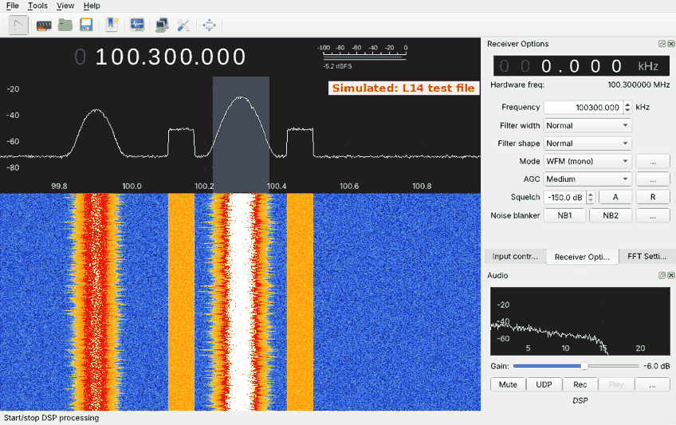
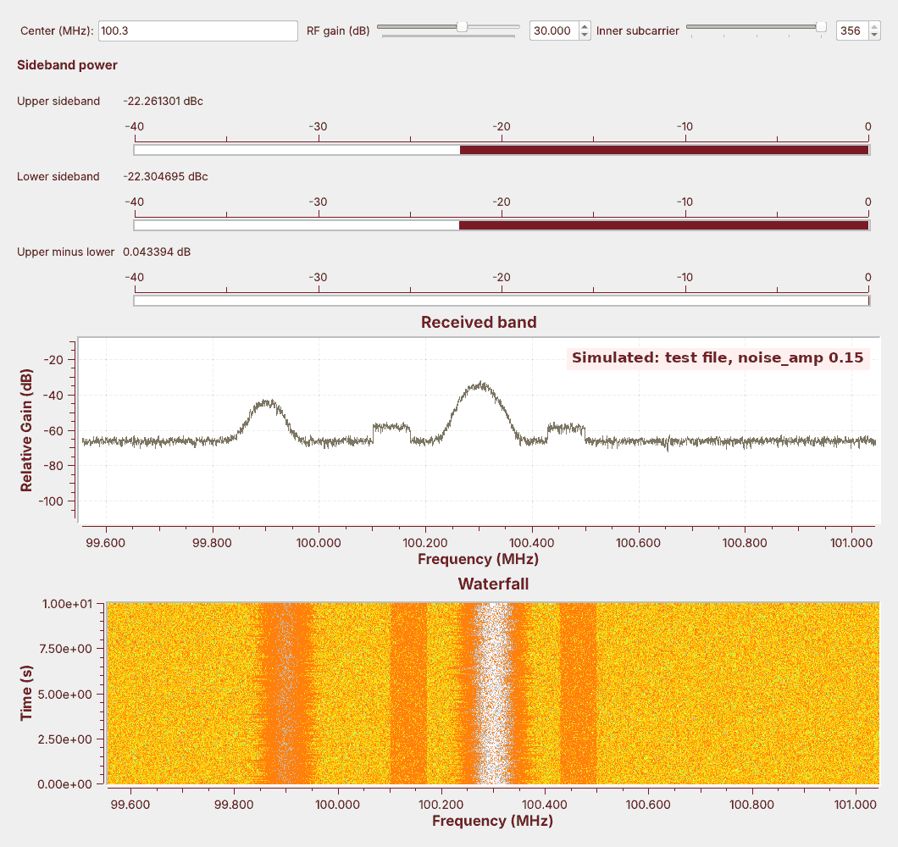

<!-- .slide: class="title-slide" -->

<div class="title-left">

# ECE 448

Software Defined Radios

## Lesson 14 — HD Radio

Spring 2027 · Dr. Neil Rogers

</div>

<div class="title-right">


</div>

---

## Where We Were

- Lesson 7 received an FM station and its RDS data.
- Lesson 13 decoded tones in bins, one FFT frequency at a time.
- Today we find a digital signal that sits beside an FM station.

Note:
Before class, run L14-hd-test-tx.grc once so L14-hd-test.cu8 sits next to L14-hd-find.grc. If the room has an RTL-SDR and an antenna, find a local HD station on the waterfall ahead of time.

---

## Today's Plan

1. HD Radio modes and what is in the spectrum
2. The digital sidebands and OFDM
3. Recreating and finding the sidebands in GNU Radio
4. Measuring them
5. Decoding with nrsc5

Note:
This follows the slides: overview, spectrum, RBDS, sidebands, the OFDM concept and implementation, then tools.

---

## Find the Shelves on the Air



Tune SDR Flex, or GQRX, to an FM station: flat bands beside it are HD Radio.

Note:
Live demo: the RTL-SDR in SDR Flex's full version (its radio drivers are not yet tried with a real radio, so GQRX is the tested path), at 1,488,375 samples per second, tuned to a strong local station. In SDR Flex, drag a box across one shelf and choose Tune here. hdradio.com/stations lists the local HD stations. The figure is GQRX playing the simulated test file.

---

## HD Radio Modes

<div class="fig" data-inline-svg="./fig/L14-hybrid.svg" style="max-width:720px; margin:0 auto;"></div>

- Hybrid keeps the analog host and adds a sideband on each side.
- Extended hybrid widens the sidebands inward; all digital drops the host.

Note:
NRSC-5 defines all three. Hybrid keeps about 130 kHz of analog signal on each side; extended hybrid limits it to about 100 kHz.

---

## What Is in the Spectrum

| Part | Where | Modulation |
| :-- | :-- | :-- |
| Analog host | within about ±130 kHz | FM |
| Inside the host | 0 to 57 kHz after demodulation | audio, pilot, stereo DSB-SC, RBDS BPSK |
| Digital sidebands | ±129.4 to ±198.4 kHz | OFDM, QPSK on each subcarrier |

Note:
RBDS is the US name for RDS: differentially encoded BPSK at 1187.5 bits per second on 57 kHz, carrying the station name, time, and text. Demo: rerun Lesson 7's L07-rds-rx.grc on the same station to show its name; PySDR's RDS chapter, the slides' activity, decodes it in Python.

---

## The Digital Sidebands

- Subcarriers are 363.4 Hz apart: one FFT bin at `fft_len` 4096.
- Each sideband is many narrow subcarriers, numbered 356 to 546.
- Partitions hold 18 data subcarriers and 1 reference subcarrier.
- The sidebands are much weaker than the host.

Note:
Subcarrier k sits at k times 363.4 Hz from the center. The reference subcarriers are 356, 375, 394, and every 19th up to 546. The meter's inner and outer Variables use these numbers.

---

## The OFDM Concept

- OFDM sends data on many closely spaced subcarriers at once.
- Their spectra overlap, but each is zero at its neighbors' centers.
- An FFT at the receiver separates them again.

Note:
OFDM divides a wide channel among many slow subcarriers. Orthogonality is the O in OFDM.

---

## OFDM in GNU Radio

- Each subcarrier carries one I/Q point per symbol: BPSK, QPSK, or QAM.
- An inverse FFT of `fft_len` = 4096 builds a symbol; each bin is one subcarrier.
- The guard, `cp_len` = 224 samples, goes in front of each symbol.

Note:
The blocks are the OFDM Carrier Allocator, a reverse FFT, and the OFDM Cyclic Prefixer, as in the GNU Radio wiki's Basic OFDM Tutorial, which the slides link. The receiver drops the guard, takes a forward FFT, and reads each subcarrier's point.

---

## OFDM Explorer

<a href="../viz/ofdm-explorer.html" target="_blank" rel="noopener">Open the OFDM explorer</a> (it is also on the lesson page).

- At spacing 1.00 every neighbor crosses zero at the center subcarrier.
- An echo longer than the guard reaches into the next symbol's FFT window.

Note:
Start at HD Radio: the red dots sit on zero. Move the spacing off 1.00 and the neighbors leak in. Drag the echo past the guard and the red sliver appears inside symbol 2's FFT window.

---

## The Test Signal


Each side carries random QPSK on subcarriers 356 to 546, written as RTL-SDR bytes.

Note:
The FFT has 4096 points at 1,488,375 samples per second, so each bin is one subcarrier, and the guard is 224 samples. The symbols are random, not NRSC-5 data, so nrsc5 cannot decode this file. The 4 s file is 11.9 MB. Nothing transmits.

---

## The Sideband Finder


Five blocks turn RTL-SDR bytes into complex samples.

Note:
Subtract 127.5, scale by 1/128, pair the bytes. GRC shows the RTL-SDR Source grayed out. To go live, select the File Source and the six blocks after it, press D, and enable the RTL-SDR Source.

---

## Finding the Sidebands


The shelves have flat tops and sharp edges, and their width never changes on the waterfall.

Note:
The figure comes from the simulated test file. The shelves start at 100.1706 and 100.4294 MHz. The display shows power per bin, so the shelves' height is not the power ratio; the meters measure that.

---

## Measuring Sideband Power


- Each meter shifts its band to 0 Hz, filters it, and averages $\vert x\vert^2$ for 0.2 s.
- The sideband meter minus the host meter gives dBc; a third reading compares the sides.

Note:
The host band is plus or minus 100 kHz, each sideband is plus or minus 34.7 kHz around plus or minus 163.9 kHz, and every filter decimates by 6. The nrsc5 project's real sample file reads about −24.3 and −23.8 dBc in the same flowgraph, close to the test file. On a live station the two meters need not agree.

---

## What Noise Does



With `noise_amp` raised to 0.15, the shelves sink toward the floor and the meters read high.

Note:
Demo: change noise_amp from 0.03 to 0.15 in L14-hd-test-tx.grc, rerun it, rerun the finder. The floor rises about 14 dB and the meters read about 0.7 dB high, because the noise in each band adds to the sideband's power.

---

## Decoding with nrsc5

```
nrsc5 -g 30 100.3 0            # tune 100.3 MHz, play HD1
nrsc5 -g 30 -w hd.cu8 100.3 0  # also record the IQ
nrsc5 -r hd.cu8 0            # decode a recording
```

nrsc5 runs the rest of NRSC-5: sync, QPSK, deinterleaving, decoding, and audio.

The nrsc5 README documents these commands; we have not yet tested them in this course.

Note:
nrsc5 is not part of radioconda; build it from source on Linux, with the project's Homebrew formula on macOS, or with MSYS2 on Windows. We have not yet run it in this course. Program 0 is HD1. A recording made with -w opens in L14-hd-find.grc. NRSC5-DUI is a graphical front end for nrsc5; SDR Flex's full version lists nrsc5 as a decoder, not yet tested on a real signal. gr-nrsc5 is a transmitter, not a receiver.

---

## Key Point

<div class="callout">HD Radio adds two OFDM sidebands, 129.4 to 198.4 kHz from the station's center and much weaker than the analog host. They appear as flat shelves on a spectrum, band-power meters measure them, and nrsc5 decodes them.</div>

---

## On the SDR

- Run the RTL-SDR at 1,488,375 samples per second, centered on the station.
- Look for shelves 129 to 198 kHz either side, with gain from your L5 table.
- The shelves should stand 10 dB above the floor.

Note:
Centering puts the DC spike on the host, away from the meters. Overload buries the sidebands, so back off the gain if the floor rises. The RTL-SDR only receives, and nothing transmits.

---

## Looking Ahead

- The L14 Lab builds the meter, identifies a station's mode, and decodes a live station.
- Lesson 15 recovers carrier phase and symbol timing for mPSK.

Note:
nrsc5 performed the carrier and timing recovery for us today; Lesson 15 builds it for a single carrier.
