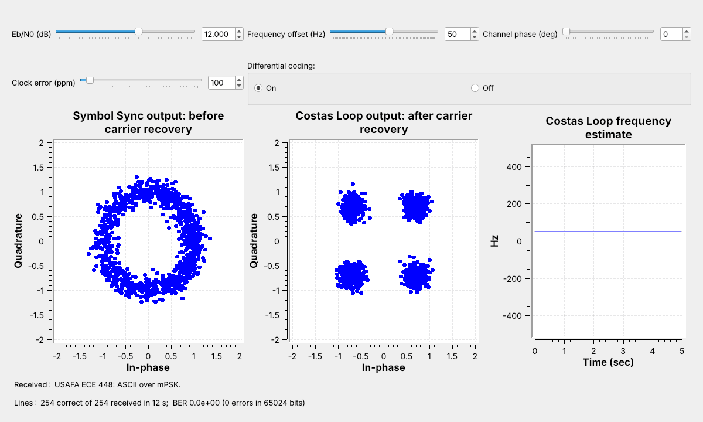
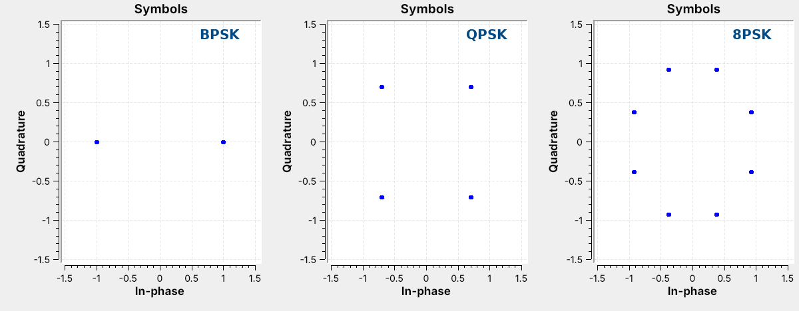
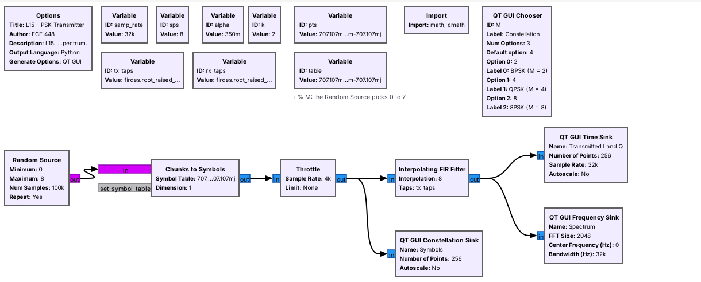
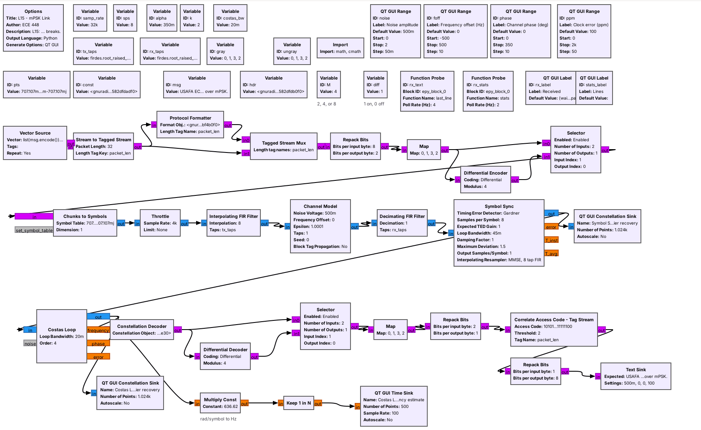
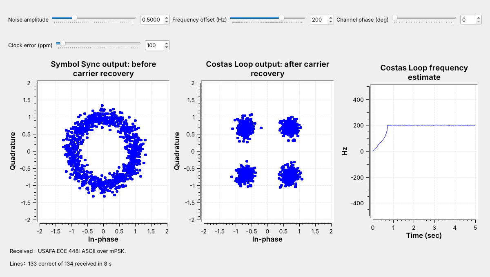
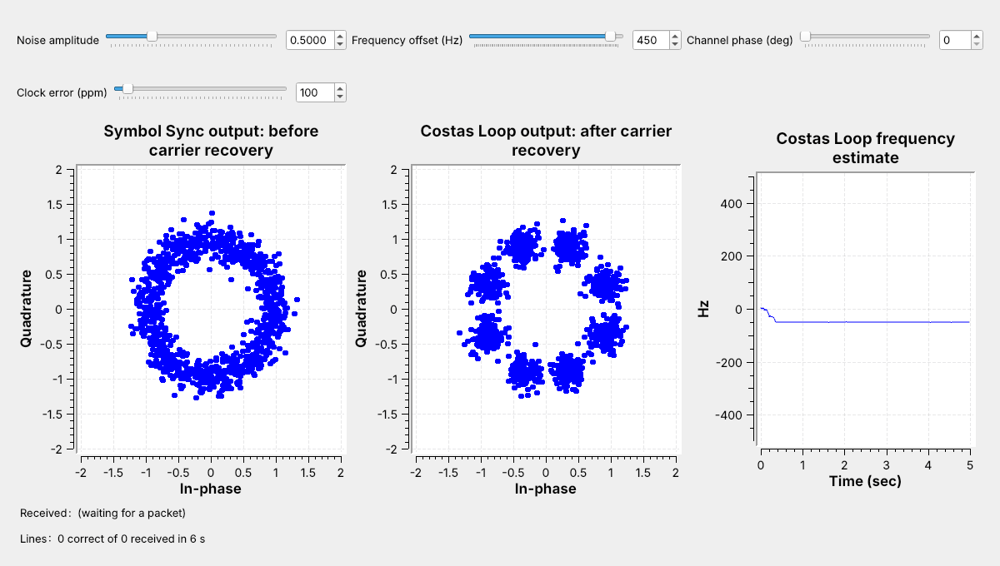
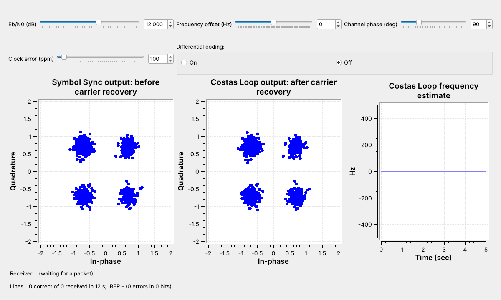
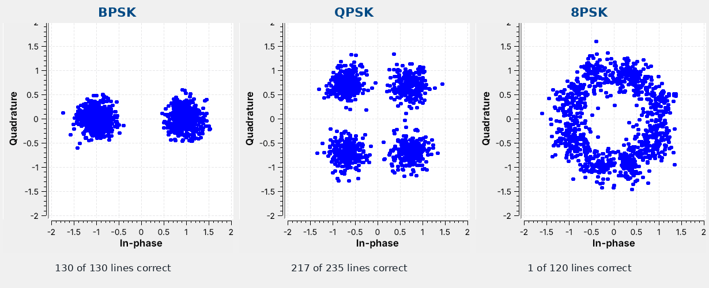

<!-- .slide: class="title-slide" -->

# ECE 448

Software Defined Radios

## Lesson 15 — mPSK

Spring 2027 · Dr. Neil Rogers

---

## Where We Were

- Lesson 3: constellations, Gray coding, and noise clouds
- Lesson 9: RRC pulses, the matched filter, and Symbol Sync
- Lessons 8 and 10: text in packets, and a PlutoSDR link that could lock upside down

Today: BPSK, QPSK, and 8PSK, with carrier recovery.

Note:
Open L15-psk-tx.grc and L15-psk-link.grc in GRC before class. The link runs in the first five minutes and again for the pull-in and ambiguity parts. This lesson runs about two periods with its lab; the lab takes most of the second.

---

## Today's Plan

1. Transmit: the constellations, the RRC filter, the Gray map
2. The channel
3. Timing recovery: Symbol Sync
4. Carrier recovery: the Costas Loop, pull-in, false lock
5. Decoding: phase ambiguity and differential decoding
6. Noise: which constellation breaks first

Note:
Steps 1 to 5 follow the GNU Radio wiki's Guided Tutorial PSK Demodulation, with PySDR's Digital Modulation and Synchronization chapters as background. Keep GRC open the whole period. Part 6 turns up the noise and compares BPSK, QPSK, and 8PSK by eye.

---

## Text over QPSK

A ring before the Costas Loop, four clusters after it, and the text arrives.

Note:
Run L15-psk-link.grc live and type 50 into the frequency offset box; the slider opens at 0. The left plot is Symbol Sync's output: the 50 Hz offset turns the constellation 4.5 degrees a symbol, so the points fill a ring. The middle plot is after the Costas Loop.

---

## Phase-Shift Keying

$M$ points on a circle carry $k = \log_2 M$ bits: 1, 2, and 3.

Note:
Switch the chooser in L15-psk-tx.grc. QPSK sits at 45 degrees plus multiples of 90, and 8PSK at 22.5 plus multiples of 45, where the Costas Loop's detectors expect the points.

---

## Step 1: The Transmitter

Chunks to Symbols, then Lesson 9's RRC filter. Every $M$ fills 5.4 kHz.

Note:
The band is (1 + alpha) times the symbol rate, 1.35 times 4 kHz, whatever M is. More bits per symbol move more data in the same band, but the points sit closer together. GNU Radio's Constellation Modulator packs this chain into one block.

---

## Step 1: Bits to Points

Repack Bits groups $k$ bits; a **Map** turns them into a phase index.

Note:
The phase index is in amber and the Gray label in blue. Neighbors differ in one bit, so a slip to a neighbor corrupts one bit. The label of index i is i XOR (i shifted right one).

---

## Bits per Symbol

| | $k$ | Bit rate | Point spacing |
| :-- | :-: | :-: | :-: |
| BPSK | 1 | 4 kb/s | 2.00 |
| QPSK | 2 | 8 kb/s | 1.41 |
| 8PSK | 3 | 12 kb/s | 0.77 |

At 4,000 symbols per second, in the same 5.4 kHz.

Note:
QPSK doubles BPSK's rate in the same band; 8PSK adds half again. The spacing is Lesson 3's, on a circle of radius 1: more points sit closer together, so less noise pushes a symbol to a neighbor. The link's Noise amplitude slider is the same for every M.

---

## Step 2: The Channel

- Noise spreads each point into a cloud.
- A fixed phase rotates the constellation.
- A frequency offset spins it into a ring.
- A clock error slides the sampling instant.

A 50 Hz offset turns the points $360° \times 50/4000 = 4.5°$ a symbol.

Note:
These are Lesson 3's four problems. Two oscillators are never equal, and the path sets an unknown phase.

---

## The Receiver

Matched filter, Symbol Sync, Costas Loop, Constellation Decoder.

Note:
The Channel Model adds noise, a frequency offset, a fixed phase, and a clock error. Symbol Sync keeps Lesson 9's settings: Gardner, 8 samples per symbol, loop bandwidth 0.045.

---

## Step 3: Timing Recovery

- Symbol Sync locks with the carrier still spinning.
- The Costas Loop then works on one sample per symbol.

Note:
Gardner's detector compares samples half a symbol apart, and a carrier turning a few degrees per symbol barely changes that comparison. A carrier loop placed first would see samples between symbols, which are not on the constellation. The tutorial uses the Polyphase Clock Sync block and a Linear Equalizer for multipath here; we keep Lesson 9's Symbol Sync, and our channel has no multipath.

---

## Step 4: The Costas Loop

Rotate back, measure the error to the nearest point, and update phase and frequency.

Note:
For BPSK the detector is I times Q. For QPSK GNU Radio's detector uses the signs of I and Q, and for 8PSK it also checks which of the two is larger, which is why the loop needs the order M. The loop bandwidth here is 0.02: wider locks faster from farther away but lets in more noise.

---

## Acquisition

From 0 Hz to the 200 Hz offset in about 0.7 s.

Note:
Type 200 into the frequency offset box. Until the estimate settles the packets fail; after that every line arrives. That time is the acquisition time.

---

## Pull-In Range

At 450 Hz the QPSK loop settles at −50 Hz: a false lock.

Note:
Left 500 Hz off, the points turn 45 degrees a symbol and alternate between eight positions, where the detector's error averages to zero. At the default noise of 0.5, BPSK pulls in from about 500 Hz and QPSK from about 375 Hz. The range shrinks as M grows.

---

## Measured Pull-In

| Offset | BPSK | QPSK |
| :-: | :-: | :-: |
| 300 Hz | 6 of 6, 3.1 s | 6 of 6, 2.0 s |
| 400 Hz | 6 of 6, 5.7 s | 4 of 6, 3.3 s |
| 500 Hz | 6 of 6, 9.4 s | 0 of 6 |
| 600 Hz | 0 of 6 | 0 of 6 |

Noise amplitude 0.5, 4,000 symbols per second, cold starts.

Note:
Lock counts out of six runs and median times to lock. Real receivers remove most of the offset first, often with an FLL Band-Edge block. Two Plutos at 915 MHz can differ by tens of kilohertz; one Pluto looped back has almost none.

---

## Step 5: Phase Ambiguity

The loop locked one point away. The constellation looks perfect, but no text arrives.

Note:
A QPSK constellation turned 90 degrees looks the same, so the loop locks to whichever rotation is nearest. BPSK has 2 lock positions, QPSK 4, and 8PSK 8. This is Lesson 10's polarity switch.

---

## Step 5: Differential Decoding

| Index sent | 0 | 1 | 3 | 3 | 2 |
| :-- | :-: | :-: | :-: | :-: | :-: |
| Received, one step off | 1 | 2 | 0 | 0 | 3 |
| Change, mod 4 | – | 1 | 2 | 0 | 3 |

Send the change in phase; a rotation shifts every index but leaves the differences unchanged.

Note:
The Differential Encoder adds each index to the last one sent, mod M; the decoder subtracts. One wrong decision corrupts two changes, so a noisy link makes about twice as many errors. In the flowgraph the variable diff picks the coded or uncoded path at both ends; change it and run again.

---

<!-- .slide: class="viz-cue-slide" -->

## Carrier Recovery Explorer

- Raise the offset until the loop stops locking.
- Turn differential coding off and step the channel phase.
- With almost no noise, watch the QPSK loop fail to pull in.

↗ Interactive on the lesson page

Note:
The explorer runs GNU Radio's Costas Loop algorithm at one sample per symbol for 10 s. With the offset at 0 and coding off, the lock rotation jumps in steps of 360 over M degrees.

---

## Noise

Same noise, three constellations: 8PSK breaks first.

Note:
Run the link with noise amplitude 0.8 and change only M. The clouds are the same size each time; the points are not the same distance apart. Raise the noise a step at a time and watch the Received label break up. The lab records where each one stops.

---

## mPSK on a Real Radio

- The L15 Lab sends QPSK through one PlutoSDR, TX port to RX port, with a 30 dB attenuator.
- The Pluto blocks and an AGC replace the Channel Model.
- Nothing in L15 transmits over the air.

Note:
In class we transmit only into a cable, into a shielded enclosure, or at very low power in an ISM band, and only when the lesson says to. Each start brings a new carrier phase. The PlutoSDR flowgraph has run only in simulation so far; the lab is its first run on hardware.

---

## Key Point

mPSK sends log2 M bits per symbol on the carrier's phase. Symbol Sync recovers the timing, a Costas Loop removes the frequency and phase error, and differential coding removes the 360°/M ambiguity.

Note:
More points carry more bits but need a quieter channel.

---

## Looking Ahead

- L15 Lab: build a carrier-recovery loop, find the noise and offset limits, and run QPSK on a PlutoSDR.
- Lesson 16: frequency hopping.

Note:
Before the lab, run L15-psk-link.grc and be able to compute a bit rate from a symbol rate and M.
