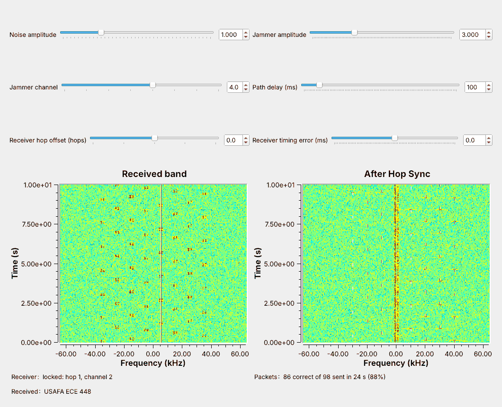
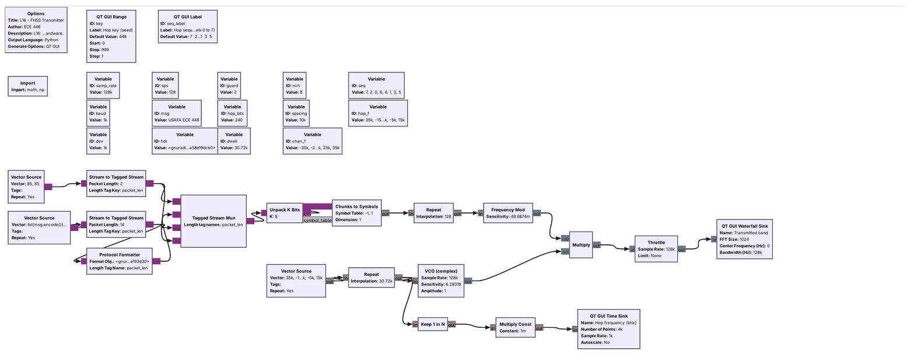
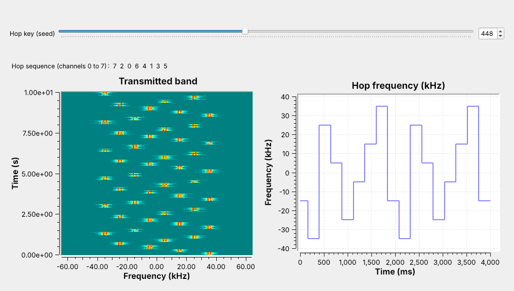
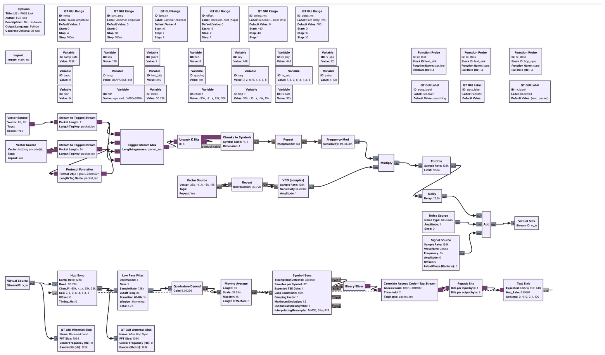
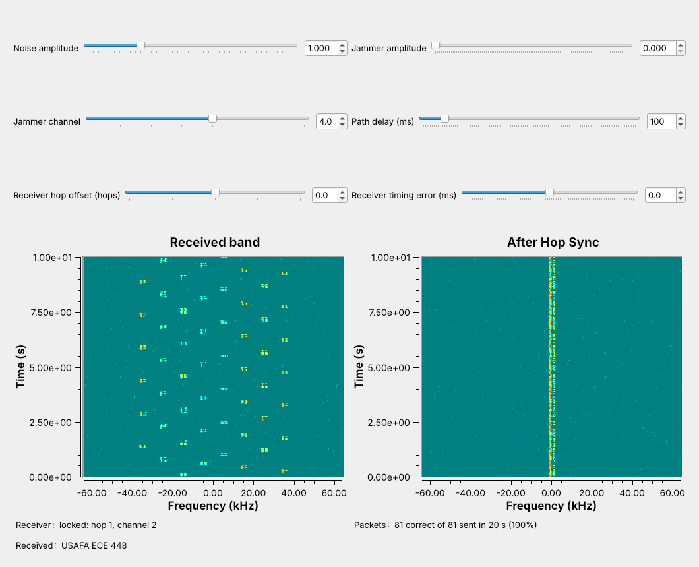
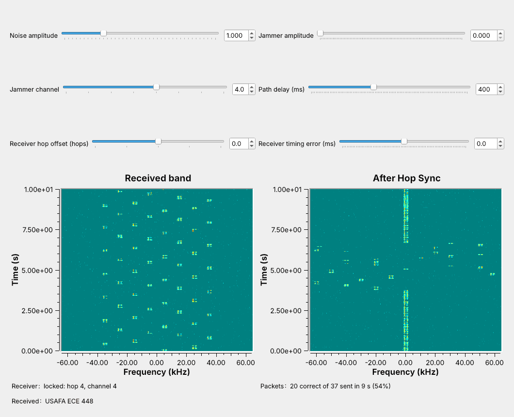
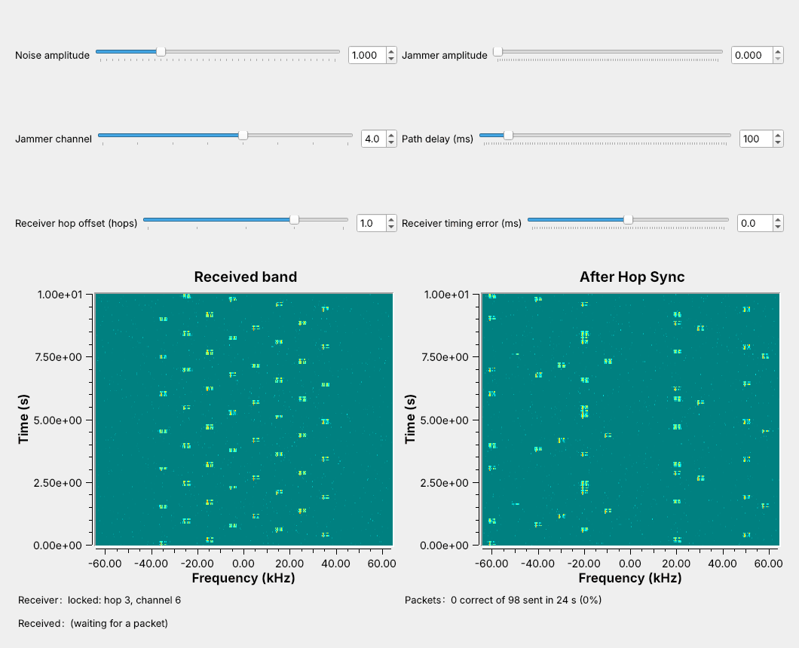

<!-- .slide: class="title-slide" -->

# ECE 448

Software Defined Radios

## Lesson 16 — Frequency Hopping

Spring 2027 · Dr. Neil Rogers

---

## Where We Were

- Lesson 8 sent text through an FSK transmitter, a channel, and a receiver.
- Lesson 8 also put each line in a packet behind a 64-bit access code.
- Lesson 11 wrote Embedded Python Blocks.

Today we send Lesson 8's packets on a new channel every hop.

Note:
Open both L16 flowgraphs in GRC before class. The link flowgraph runs in the first five minutes, with the jammer off, and again with the jammer on at amplitude 3.

---

## Today's Plan

1. The hopping transmitter and the hop sequence
2. The receiver: de-hopping
3. Finding the hops: sync on a known hop
4. A narrowband jammer

Note:
These are the four parts of the lesson page. Part 1 is the transmitter, parts 2 and 3 the receiver. Part 4 runs live with the jammer slider.

---

## A Link That Hops

The link changes channel every 240 ms, and the jammer takes 1 hop in 8.

Note:
Run L16-fhss-link.grc live. Left waterfall: what the receiver sees, with the jammer as a solid line at plus 5 kHz. Right waterfall: after Hop Sync the signal sits at 0 Hz and the jammer hops instead. The Packets label reads about 88%.

---

## Where Frequency Hopping Is Used

- **Bluetooth Classic**: 79 channels of 1 MHz, up to 1600 hops/s
- **SINCGARS**: 2320 channels of 25 kHz, 30–88 MHz, about 100 hops/s
- **FCC Part 15.247** at 915 MHz: at least 50 channels, at most 0.4 s per channel in 20 s

Note:
Hopping limits what a jammer or a busy channel can take, and a listener without the key hears only scattered bursts. SINCGARS takes its sequence from a TRANSEC key and the time of day. Bluetooth's adaptive frequency hopping drops channels that stay busy.

---

## The Hopping Transmitter

A VCO driven by the hop list is the hop synthesizer.

Note:
The top row is Lesson 8's FSK at 1000 baud and 1 kHz deviation, running at 128 kHz. The four-input Tagged Stream Mux adds 2 guard bytes at each end of the packet. The Repeat holds each hop frequency for 30,720 samples, and the VCO's sensitivity of 2 pi makes an input of 1 a frequency of 1 Hz.

---

## One Packet per Hop

$$T_\text{hop} = \frac{240 \text{ bits}}{1000 \text{ baud}} = 240 \text{ ms}$$

Note:
The packet and the hop are the same length, so no packet is split across two channels. The guard bits let the receiver change channel a little early or a little late. A cycle of 8 hops takes 1.92 s; the hop rate is 4.17 per second.

---

## The Hop Sequence

$f_k = 10$ kHz $\times (k - 3.5)$; key 448 gives 7 2 0 6 4 1 3 5.

Note:
The sequence is a permutation of the 8 channels drawn from the key, so each channel appears once per cycle, which also meets Part 15's equal-use rule. Move the key slider in class to show a new order.

---

## Hop Timing

| | L16 link | Bluetooth | SINCGARS |
| :-- | :-: | :-: | :-: |
| Channels | 8 | 79 | up to 2320 |
| Hop rate | 4.17/s | up to 1600/s | about 100/s |
| Time on one hop | 240 ms | 625 µs | about 10 ms |

Our link hops slowly so the waterfall can show each hop.

Note:
The blocks and the synchronization problem are the same at any hop rate. The guard bits take 32 of the 240 bits, 13% of each hop.

---

<!-- .slide: class="viz-cue-slide" -->

## FHSS Explorer

- Jam 1 channel of 8: 1 hop in 8 is lost.
- Set the receiver offset to +1: nothing arrives.
- Press acquire, then jam the sync channel: the receiver never locks.

↗ Interactive on the lesson page

Note:
Start at 8 channels with 1 jammed channel. The long-run delivered fraction tracks 1 minus jammed over channels.

---

## The Receiver

Hop Sync de-hops; the rest is Lesson 8's receiver.

Note:
Hop Sync is an Embedded Python Block. The Low Pass Filter keeps plus and minus 2 kHz and decimates to 32 kHz. The Text Sink sends a message to Hop Sync for every packet, which tells it the hops are still right.

---

## De-Hopping

Multiply by the conjugate hop tone: every hop returns to 0 Hz.

Note:
The transmitter multiplied by e to the j 2 pi f k t; Hop Sync multiplies by its conjugate. FSK needs no carrier phase, so a phase jump at a hop boundary is harmless. At noise amplitude 1 every packet arrives, at 2 about 97%.

---

## Finding the Hops

Park on the sync channel; lock when hop 0 arrives.

Note:
Each channel appears once per cycle, so power on channel 7 means hop 0. Hop Sync locks when the power over the last 2 ms reaches four times its earlier average. It waits at most one cycle, 1.92 s. A start-of-hop marker gives timing but not the hop number; time of day needs a shared clock.

---

## Losing and Regaining Sync

After about 10 hops with no packet, Hop Sync parks and locks again.

Note:
Moving the path delay by 300 ms puts the receiver more than a hop off. Hop Sync parks again after more than 9 hops without a packet and locks on the next hop 0. Here the receiver lost 17 packets, 4.1 s.

---

## Off by One Hop

One hop ahead, the receiver is never on the right channel, and 0 of 98 packets arrive.

Note:
Consecutive entries of a permutation are always different channels. Offsets of minus 1, plus 2, and minus 2 also gave no packets.

---

## Timing Error

| Timing error | Delivered |
| :-: | :-: |
| −20 ms | 5% |
| −17 ms | 45% |
| −16 to +18 ms | 100% |
| +20 ms | 68% |
| +24 ms | 16% |

The 16 guard bits at each end absorb about 16 ms.

Note:
Positive means the receiver changes channel late. The late side reaches a little further because the access-code search allows 2 wrong bits. Three runs of 120 hops at each setting.

---

## A Narrowband Jammer

The jammer takes only the hops on its own channel: 1 in 8.

Note:
The jammer's amplitude is three times the signal's. It reaches the receiver only on the hop tuned to channel 4. We measured 87.8% at jammer amplitudes 1, 3, and 10.

---

## Jammer Sweep

| Jammer amplitude | One fixed channel | Hopping, 8 channels |
| :-: | :-: | :-: |
| 0.5 | 100% | 100% |
| 1 | 0% | 88% |
| 3 | 0% | 88% |
| 10 | 0% | 88% |

The same power spread over 8 channels blocked nothing.

Note:
Eight tones of amplitude 0.354, together as strong as one tone of amplitude 1, blocked no packets. A jammer on the sync channel before the receiver locks keeps it from ever locking; after lock it takes only its 1 hop in 8.

---

## Frequency Hopping on a Real Radio

- L16 Lab: one PlutoSDR, TX port to RX port, 30 dB attenuator
- All 8 channels fit in 1.024 MS/s, so the Pluto never retunes
- Nothing in L16 transmits over the air

Note:
In class we transmit only into a cable, into a shielded enclosure, or at very low power in an ISM band, and only when the lesson says to. An AGC holds the level steady, and Hop Sync finds the radio's own delay. The PlutoSDR flowgraph has run only in simulation so far; the lab is its first run on hardware.

---

## Key Point

A hopper sends each packet on a new channel in a keyed order. A receiver with the key and hop timing de-hops it. A narrowband jammer takes only its own channel's hops, and a receiver one hop off gets nothing.

Note:
The receiver needs the key and the timing. Sync on a known hop gets the timing from the key alone.

---

## Looking Ahead

- L16 Lab: build a hopper and a de-hopper, jam it, then a PlutoSDR
- Lesson 17: RF reverse engineering

Note:
Before the lab, run L16-fhss-link.grc and be able to compute a hop length and a cycle time from the bits per hop.
