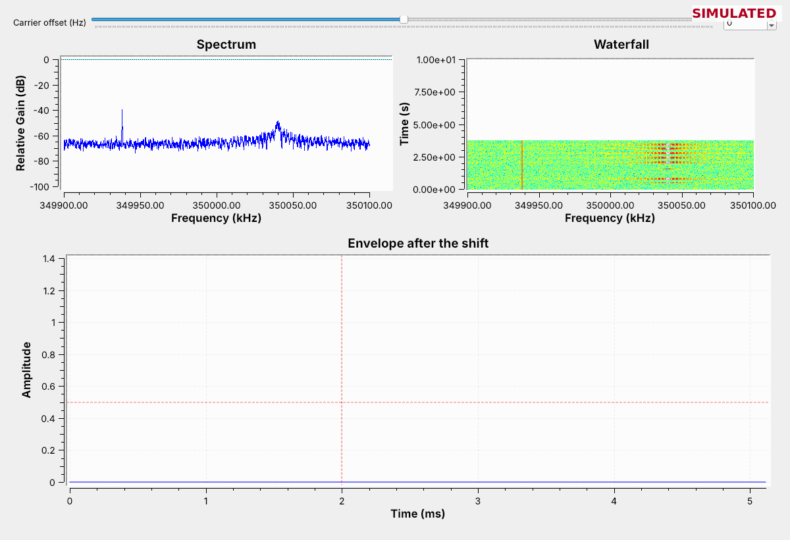
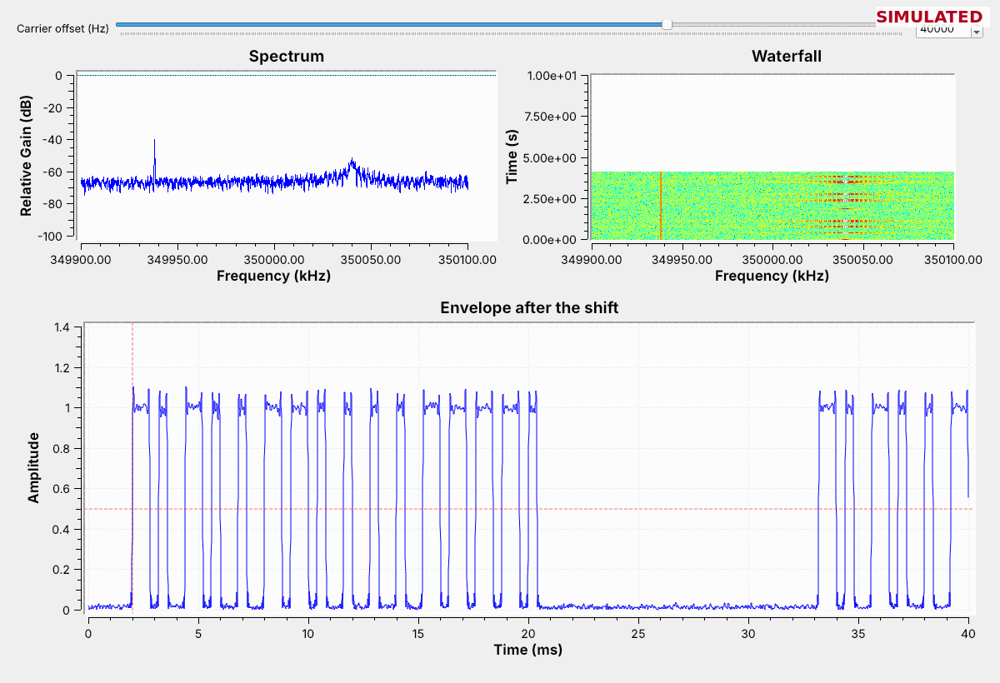
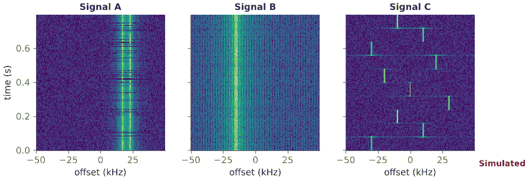
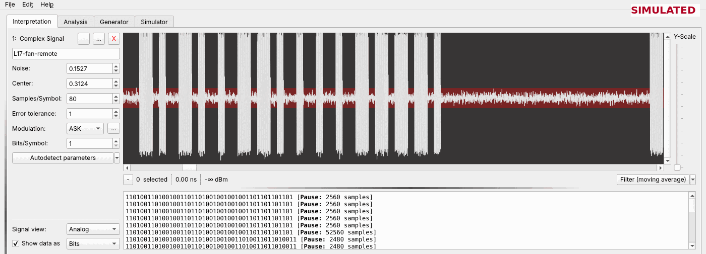
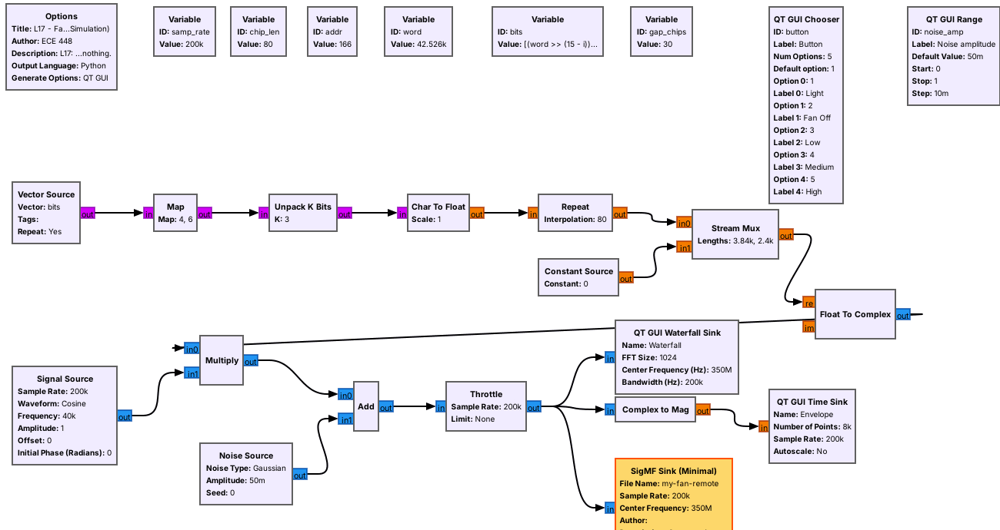
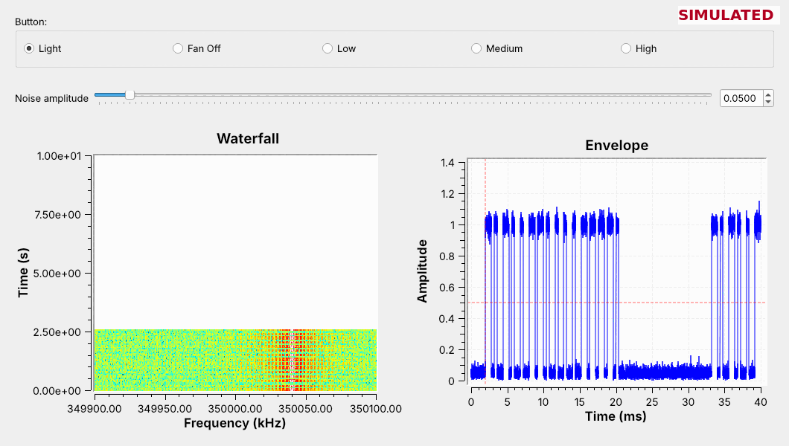

<!-- .slide: class="title-slide" -->

# ECE 448

Software Defined Radios

## Lesson 17 — RF Reverse Engineering

Spring 2027 · Dr. Neil Rogers

---

## Where We Were

- Lesson 11 found a remote's bursts with an energy detector.
- Lesson 12 keyed a carrier on and off.
- Lessons 8, 10, 12, 15, and 16 built transmitters whose formats we chose.

Today the format belongs to someone else, and we work it out.

Note:
Open L17-sigmf-view.grc and URH before class, with L17-fan-remote.sigmf-data in the same folder as the flowgraph. URH's sample rate for the lesson recording is 200000.

---

## Learning Objectives

- Reverse engineer a simple RF transmitter.
- Create a GNU Radio flowgraph to operate the fan.

Note:
These are the two objectives on the 2025 slides. The course objective is 6.6: identify an unknown signal's modulation, symbol rate, and payload structure. The 2025 class used a Hunter ceiling-fan remote near 350 MHz; this lesson uses a Simulated fan remote so that every cadet has the same signal.

---

## The Process

Steps 1 to 3 need only a recording; step 5 goes into a cable.

Note:
Find the carrier, identify the modulation, identify the encoding, build an encoder, and transmit. The encoding step covers the commands, bits, bytes, and nibbles, and the bit rate and baud rate.

---

## The Recording

| Meta field | Value |
| :-- | :-- |
| `core:datatype` | `cf32_le` |
| `core:sample_rate` | 200000 |
| `core:frequency` | 350000000 |
| `core:hw` | Simulated in GNU Radio |

The SigMF Source reads the `.sigmf-data` file; the meta file says how.

Note:
SigMF is the course's recording format. The SigMF Source (Minimal) is a File Source with SigMF documentation: point it at the data file and set its Output Type from core:datatype. GRC marks the SigMF blocks deprecated; they work in 3.10. The recording is 2.4 s, 3.9 MB, one press of each of five buttons.

---

## Step 1: Find the Carrier

The steady line never changes; the remote is the one that bursts.

Note:
Let the recording loop and point at the waterfall. The bursts come five times per 2.4 s loop, once per button. A real band has many steady carriers; the waterfall tells us which signal starts and stops with a button press.

---

## Step 1: Shift to 0 Hz

At a 40 kHz offset the envelope fills with pulses: 350.040 MHz.

Note:
The Frequency Xlating FIR Filter shifts the offset to 0 Hz and keeps plus and minus 10 kHz; Complex to Mag gives the envelope. Move the slider 10 kHz off and the pulses drop to half height; 20 kHz off and they disappear. This replaces URH's Spectrum Analyzer fine-tuning from 2025.

---

## Explore: SDR Flex or GQRX

1. SDR Flex: open an example capture and drag across a burst.
2. Choose a demodulator or slicer and read its rate.
3. GQRX: play the recording as an I/Q file.

Note:
SDR Flex's browser version opens its example captures from the source chip; its slicers derive their own rates. Its external decoders such as rtl_433 need the server version. For GQRX, the device string is file=L17-fan-remote.sigmf-data,freq=350e6,rate=200000,repeat=true,throttle=true.

---

## Capture a Real Remote

- Record a real 315 or 433.92 MHz key fob, doorbell, or sensor to SigMF.
- Find its carrier with URH's Spectrum Analyzer, as in 2025.
- This step only receives.

Note:
Run L17-capture.grc with a PlutoSDR or L17-capture-rtl.grc with an RTL-SDR, with fc set before it starts, because the SigMF Sink writes the center frequency when the flowgraph starts. Record each button. A car key fob usually sends a rolling code, so its frames change from press to press.

---

## Step 2: Identify the Modulation

- The envelope has two levels, and the waterfall shows one frequency.
- That is on-off keying (OOK), Lesson 12's keyed carrier switched by a circuit.

Note:
FSK would show two tracks, as in Lesson 8; PSK would stay on at constant amplitude, as in Lesson 15. OOK is one oscillator and one switch, which is why simple remotes, doorbells, and sensors use it.

---

## SigID: Name the Signal

Open `L17-sigid-a`, `-b`, and `-c` in the viewer and name each modulation.

Note:
The 2025 SigID exercise. Set samp_rate to 100000 and fc to 915e6. A is two-level FSK, as in Lesson 8. B is QPSK, one steady band, as in Lesson 15. C is a frequency hopper, as in Lesson 16; the faint horizontal lines are FFT frames that straddle a hop.

---

## Step 3: URH

Autodetect: ASK, 80 samples a symbol, which is a 400 µs chip.

Note:
File, New Project first, as in 2025. Then File, Open, All Files, then set the sample rate to 200000 in the signal's details; URH does not read the meta file. Each line of the text area is one burst; Pause is the silence after it.

---

## Step 3: Chips to Bits

The fan remote's chips come in threes: `110` is a 1 and `100` is a 0.

Note:
That is pulse-width coding: every bit starts on, and a 1 stays on longer. The other two rows are common too: pulse distance, where the gap carries the bit, and Manchester, where every bit has a mid-bit transition. URH lists 46 or 47 chips, not 48, because the last off chips run into the pause.

---

## Step 3: The Fields

| Light | Fan Off | Low | Medium | High |
| :-: | :-: | :-: | :-: | :-: |
| 0xA61E | 0xA62D | 0xA63C | 0xA64B | 0xA65A |

Note:
The first byte never changes: the address. The third nibble counts up with the buttons: the command. The last nibble is the command inverted: a check. Each press sends the frame 6 times with about 12 ms between frames.

---

## Bit Rate and Baud Rate

$$\begin{aligned}
\text{chip} &= 80 / 200{,}000 = 400\ \mu\text{s} \\
\text{baud rate} &= 2500\ \text{baud} \\
\text{bit rate} &= 2500 / 3 = 833\ \text{bits/s}
\end{aligned}$$

A frame of 16 bits takes 19.2 ms, and one starts every 31.2 ms.

Note:
URH's symbol is our chip, so URH works at the baud rate. Three chips make one bit. These are the encoder's numbers: chip_len for the Repeat and the gap for the Stream Mux.

---

<!-- .slide: class="viz-cue-slide" -->

## Pulse Decoder Explorer

- Find the chip length that leaves no `?` groups.
- Pick another button and read its command.
- Raise the noise and watch the groups break.

↗ Interactive on the lesson page

Note:
It opens at 300 microseconds, which is wrong. At 400 every group is 110 or 100. Noise up to about 0.4 reads cleanly; from about 0.45 groups break into question marks, and by 0.5 almost every frame does. Now and then a flipped bit fails the check instead.

---

## Step 4: Build an Encoder

Map 0 to 4 and 1 to 6; Unpack K Bits with K = 3 gives `100` and `110`.

Note:
Repeat holds each chip 80 samples. The Stream Mux takes 3840 samples of frame and 2400 of zeros, the 12 ms gap. L17-encoder.grc is the same chain as a hier block, as in the 2025 class and the wiki's Hier Blocks and Parameters tutorial.

---

## Step 4: Check the Encoder

Open `my-fan-remote.sigmf-data` in URH: its chips should match the recording.

Note:
Matching chips are the test of steps 1 to 3. The encoder repeats for as long as it runs; the remote stops after six frames.

---

## Step 5: Transmit into a Cable

- The PlutoSDR sends at 350.04 MHz and 1 MS/s, so `chip_len` is 400.
- Its TX port feeds a 30 dB attenuator and a second SDR running `L17-capture.grc`.
- Never connect an antenna, and keep TX attenuation at 30 dB or more.

Note:
In class we transmit only into a cable, into a shielded enclosure, or at very low power in an ISM band, and only when the lesson says to. 350 MHz is not an ISM band. Both Pluto flowgraphs are compiled only; the L17 Lab is their first run on hardware.

---

## Key Point

Find the carrier, identify the modulation, identify the encoding, build an encoder, and transmit. An encoder whose output decodes the same as the recording confirms the first three.

Note:
Matching chips in URH are the test of steps 1 to 3.

---

## Looking Ahead

- The L17 Lab hands you a different remote's recording and no description.
- Lessons 18 and 19 decode ADS-B and AIS, whose formats are published.

Note:
Before the lab, install URH and open the lesson recording in it, and read the lab recording's meta file.
