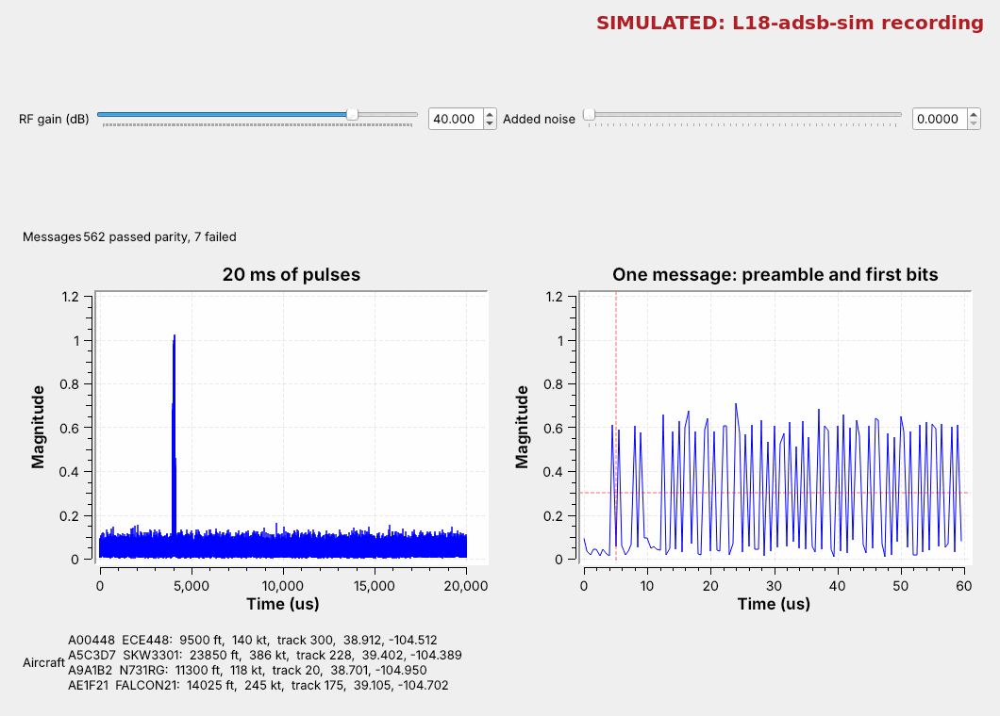
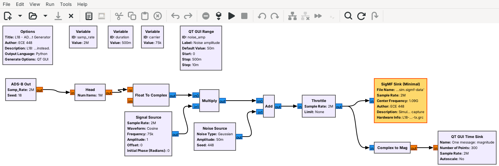
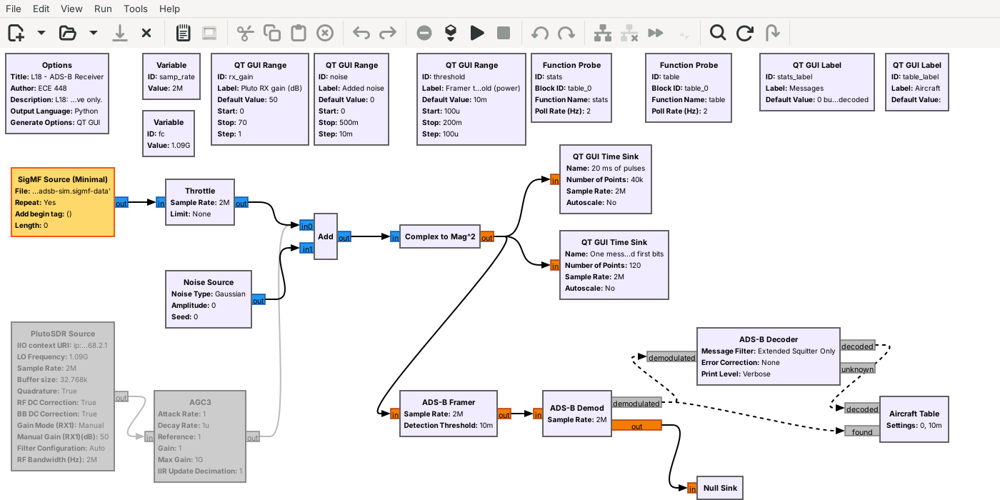
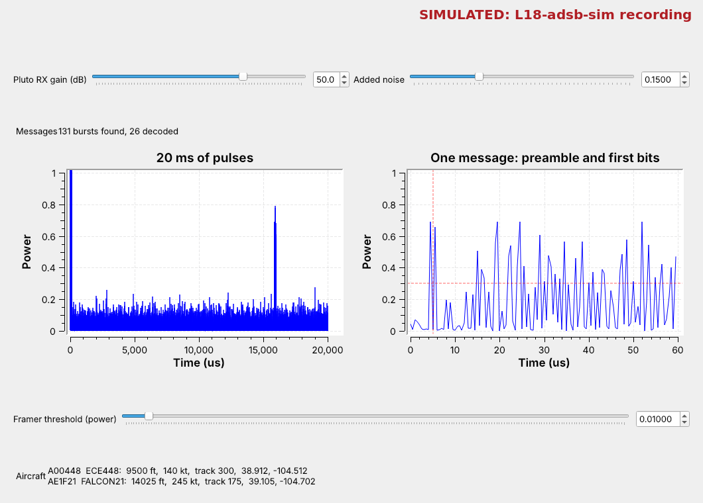
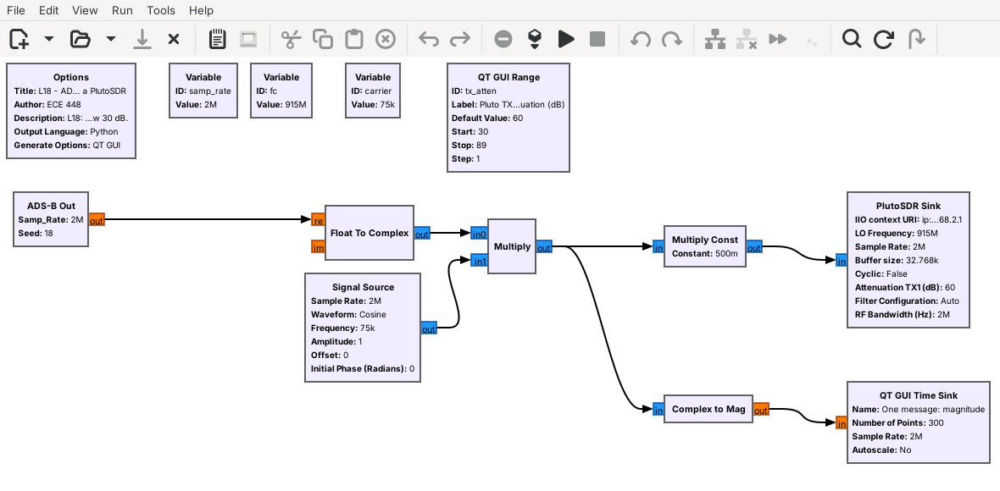

<!-- .slide: class="title-slide" -->

<div class="title-left">

# ECE 448

Software Defined Radios

## Lesson 18 — ADS-B

Spring 2027 · Dr. Neil Rogers

</div>

<div class="title-right">


</div>

---

## Where We Were

- Lesson 12: on-off keying, the simplest pulse signal
- Lesson 11: Embedded Python Blocks
- Lesson 17: finding the bits in an unknown signal

Today we generate, receive, and decode aircraft ADS-B messages.

Note:
Open L18-adsb-tx.grc and L18-adsb-rx.grc in GRC before class, and run the generator once so the recording exists. If the room has a window, a PlutoSDR on the sill hears real aircraft for the Find It on the Air and On the SDR slides. For the 915 MHz demo, cable a Pluto's TX port to an RX port through the 30 dB attenuator.

---

## Today's Plan

1. ADS-B and Mode S
2. The physical layer: pulse-position modulation
3. The ADS-B Out generator, and our PPM block
4. The message: DF, ICAO, ME, parity
5. The receiver: gr-adsb's Framer, Demod, and Decoder
6. Noise, the modules, and live aircraft

Note:
These follow the 2025 slides in order. The reference for every message detail is Sun's The 1090 Megahertz Riddle, in the slides' references.

---

## Aircraft Overhead



Each spike is one 120 µs message; the table fills with aircraft.

Note:
Run the receiver live. Point at the left plot: each spike is a message. The right plot freezes one on its first pulse. The table at the bottom is what gr-adsb has decoded so far. The recording is simulated, and the figure says so.

---

## ADS-B and Mode S

- **Mode S** transponders reply to radar on 1090 MHz.
- **ADS-B** has them broadcast on their own, about twice a second.
- The common form is the **extended squitter**, DF 17.

Note:
Automatic: no one asks. Dependent: the position comes from the aircraft's GPS. Broadcast: anyone may listen. Secondary radar interrogates on 1030 MHz and the transponder answers on 1090. DF 18 is the same message from a device that is not a transponder. In the US, small aircraft below 18,000 ft may use UAT on 978 MHz instead, a different waveform we do not cover.

---

## Find It on the Air

1. In L18-adsb-rx.grc, disable the SigMF Source and Throttle
2. Enable the PlutoSDR Source: `fc` = 1090e6, 2 MS/s
3. Pluto at a window; watch for spikes in time
4. Aircraft fill the table as gr-adsb decodes them

Note:
Same flowgraph as the rest of the lesson. The URI is ip:192.168.2.1. A position appears only after gr-adsb has an even and an odd position message from the aircraft. If nothing shows in a few minutes, raise the RX gain and try another window.

---

## The Physical Layer

<div class="fig" data-inline-svg="./fig/L18-ppm.svg" style="max-width:820px; margin:0 auto;"></div>

A 1 is pulse then quiet; a 0 is quiet then pulse: **pulse-position modulation**.

Note:
Each pulse is 0.5 us and each bit 1 us, so 1 Mb/s. Every bit holds exactly one pulse, so the receiver compares halves and never needs the signal's strength. The preamble's four pulses, at 0, 1.0, 3.5, and 4.5 us, cannot be imitated by data. At 2 MS/s each half bit is one sample, a chip: 16 chips of preamble, 224 of data, 120 us in all.

---

## Message Explorer

<iframe src="../viz/adsb-ppm.html" width="100%" height="473" style="border:1px solid #cddce9; border-radius:6px;" title="ADS-B message explorer"></iframe>

Note:
Start with the first 16 bits: each bit's pulse sits in one half. Raise the noise until a bit turns red and the parity fails. Switch messages: identification, position, velocity.

---

## The ADS-B Out Generator



PPM chips, then a carrier, then noise, as on the 2025 slides.

Note:
The ADS-B Out block is an Embedded Python Block like Lesson 11's. It writes 0.5 s to L18-adsb-sim.sigmf-data and .sigmf-meta, labeled Simulated. The aircraft send ten or more times as often as real ones, so the half second holds about 75 messages. Nothing transmits: the last block is a file sink. L18-adsb-tx-pluto.grc sends the same aircraft from a Pluto at 915 MHz, never 1090.

---

## Inside the PPM Block

```python
out = [1,0,1,0,0,0,0,1,0,1,0,0,0,0,0,0]   # preamble
for x in bits:                             # 112 bits
    out += [1, 0] if x else [0, 1]         # PPM
```

The slides' objective: develop a PPM modulation block.

Note:
Double-click the block and choose Open in Editor. Around these lines it builds 88 bits of message from the AIRCRAFT list, appends 24 parity bits, and places each message at a random time, so messages sometimes overlap as in the sky. Add a fifth aircraft to the list and the receiver shows it.

---

## Message Structure

<div class="fig" data-inline-svg="./fig/L18-frame.svg" style="max-width:820px; margin:0 auto;"></div>

| DF | CA | ICAO | ME | PI |
| :-: | :-: | :-: | :-: | :-: |
| format | capability | address | message | parity |

Note:
The slides' example 8D4840D6202CC371C32CE0576098 is from Sun's book: 8D is DF 17 and CA 5, the address is 4840D6, and the ME field is the callsign KLM1023. The parity bits come from the first 88 bits with a fixed 25-bit generator; gr-adsb's Decoder repeats the calculation and drops any message that disagrees.

---

## What the ME Field Carries

| Type code | Message |
| :-: | :-- |
| 1–4 | identification: callsign |
| 9–18 | airborne position, altitude |
| 19 | velocity |

Note:
The callsign is eight 6-bit characters; the altitude is in 25 ft steps. Position uses Compact Position Reporting: even and odd messages with two zone sizes. A receiver pairs them or uses a reference position within 180 nautical miles. gr-adsb pairs an even and an odd message received within 30 s, so it needs no reference, and a position appears a moment after the callsign.

---

## The Receiver



**Complex to Mag^2** gives pulse power; gr-adsb's three blocks decode it.

Note:
PPM needs only the power, not the phase; gr-adsb's examples use Complex to Mag^2. The left time sink runs freely over 20 ms. The right one triggers at 0.3 and shows 60 us from just before the first pulse. For live signals, the PlutoSDR Source replaces the SigMF Source and Throttle. radioconda ships gr-adsb as gnuradio-adsb; its blocks are under ADS-B in the block list.

---

## Decoding Step by Step

1. **Framer:** find four preamble pulses with quiet between them.
2. **Demod:** compare each pair of chips; the larger half is the pulse.
3. **Decoder:** check the parity, then read the fields.

Note:
The Framer's Detection Threshold is the Framer threshold slider. Error Correction is None, so a message that fails parity is dropped. Print Level Verbose prints every field in the GRC console; Brief needs a terminal window. The Aircraft Table block decodes nothing: it shows what the Decoder sends it, and counts bursts found and messages decoded.

---

## What Noise Does



Raise **Added noise**: the weak aircraft drop out first. Then raise the **Framer threshold**.

Note:
At 0.15 the floor rises until only the two strongest aircraft stand clear. The others still send, but noise beats a pulse in some chip pair of almost every message, so the parity fails. The Framer's threshold of 0.01 is now under the noise, so even the strong two decode less often; at 0.1 they decoded about twenty times as often in our runs, and the weak two stayed gone. Distance does the same thing to real aircraft.

---

## Two GNU Radio Modules

- **gr-adsb**: Framer, Demod, and Decoder; radioconda ships it
- **gr-air-modes**: the other Mode S module, with `modes_rx`

Note:
gr-adsb is Matt Hostetter's module; on the recording it lists the four aircraft exactly as the generator's AIRCRAFT list has them. gr-air-modes is Nick Foster's. Optional: dump1090 and SDRangel, the slides' other tools, decode ADS-B outside GNU Radio.

---

## Key Point

<div class="callout">ADS-B sends 112-bit messages on 1090 MHz as pulses: each bit is one 0.5 µs pulse in the first or second half of its microsecond. The receiver finds the preamble, compares chip pairs, and keeps messages whose parity checks.</div>

Note:
The receiver needs only the power of the signal, not its phase.

---

## On the SDR



- Live aircraft: `fc` = 1090e6, RX gain near 50 dB. Receive only.
- Your own aircraft: L18-adsb-tx-pluto.grc at 915 MHz, receiver at `fc` = 915e6.

Note:
Set the Framer threshold above the floor on the 20 ms plot and below the spikes. The 915 MHz link goes from the Pluto's TX port through a 30 dB attenuator to an RX port, or over the air at 915 MHz at low power if the instructor says so; TX attenuation never below 30 dB. Two Plutos on one laptop use usb: URIs. Never transmit on 1090 MHz: it carries replies that ATC and collision avoidance depend on, and nothing in a message proves who sent it; the Magazu AFIT thesis studies false targets. The Pluto flowgraphs are compiled but not yet run on hardware.

---

## Looking Ahead

- Lesson 19: AIS, the ships' version, on VHF with GMSK
- L18–L19 Lab: live aircraft and a recording of ships

Note:
In the lab, cadets build the ADS-B receiver on the Pluto themselves with gr-adsb and compare the aircraft they decode with a public flight tracker.
