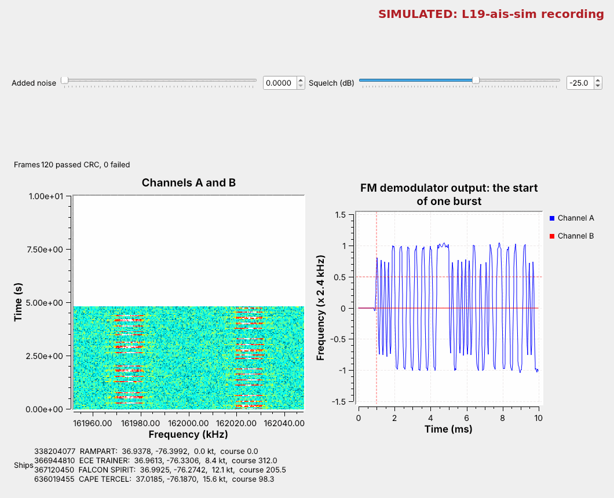
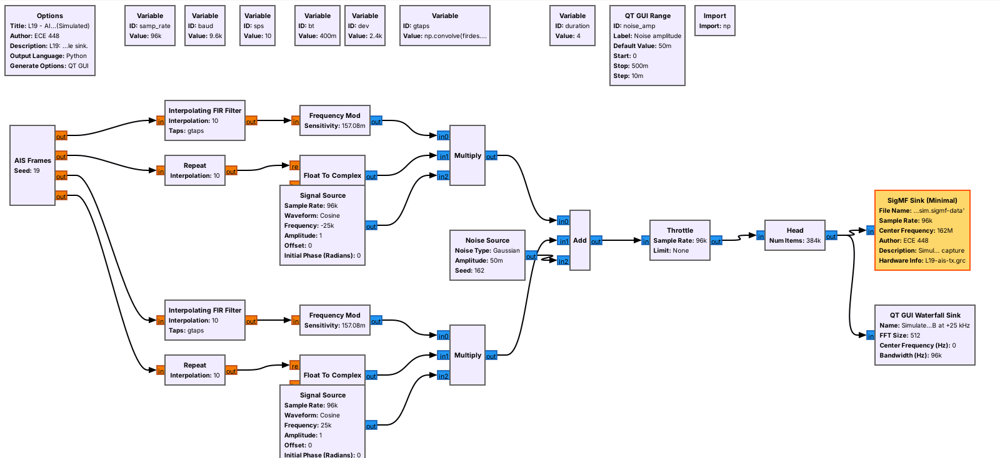
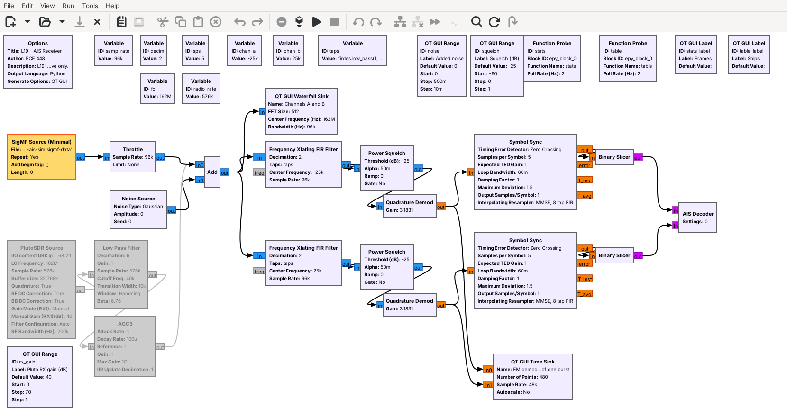
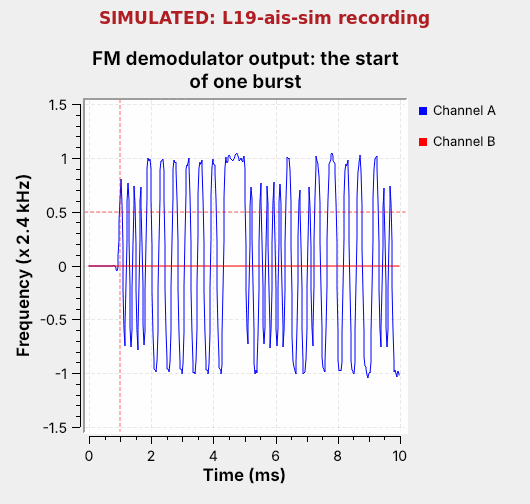
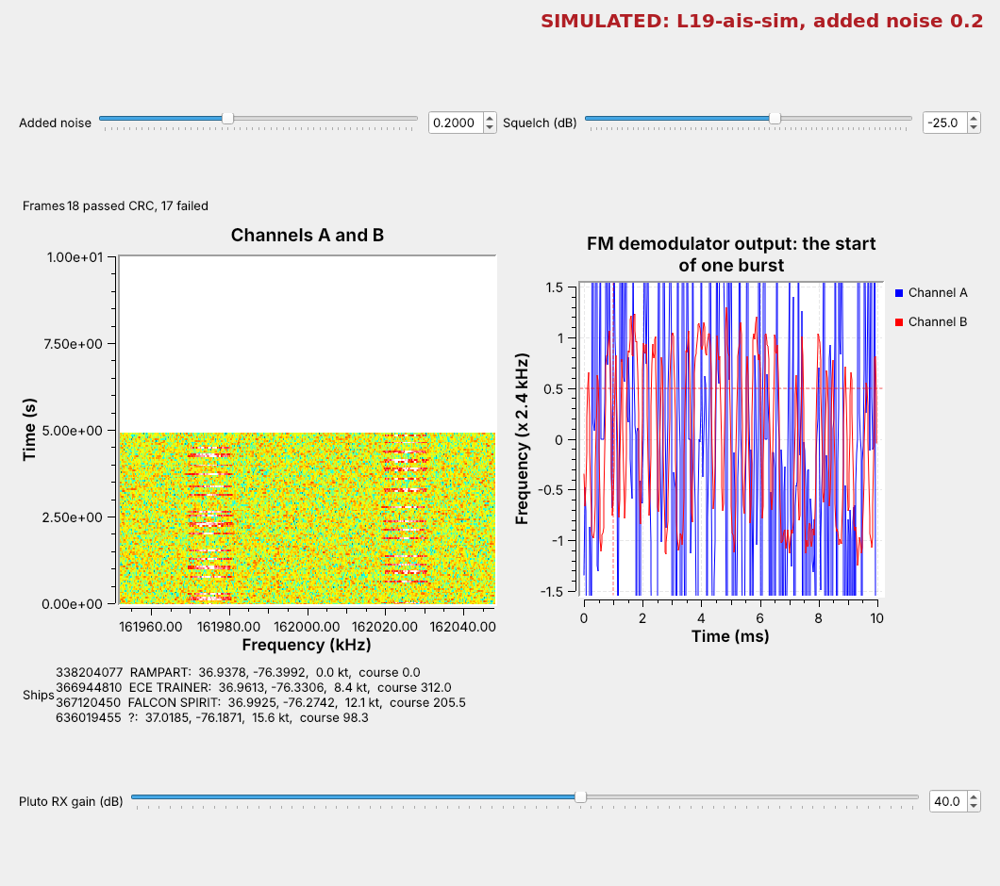

<!-- .slide: class="title-slide" -->

# ECE 448

Software Defined Radios

## Lesson 19 — AIS

Spring 2027 · Dr. Neil Rogers

---

## Where We Were

- Lesson 18: ADS-B, aircraft announcing themselves
- Lesson 8: FSK, and the Quadrature Demod
- Lesson 9: Symbol Sync

Today ships do the same on VHF, with GMSK.

Note:
Open L19-ais-tx.grc and L19-ais-rx.grc before class, with L19-ais-sim.sigmf-data in the same folder. There are no ships near USAFA, so this lesson runs on recordings.

---

## Today's Plan

1. What AIS is: channels, slots, SOTDMA
2. The burst: training, flags, CRC
3. Bit stuffing, NRZI, and GMSK
4. The simulated transmitter
5. The receiver and the AIS Decoder
6. NMEA sentences, noise, and tools

Note:
These follow the 2025 slides in order, with the 2025 GMSK test plots as the model for the transmitter.

---

## Ships in the Harbor

Bursts alternate between two channels; the table fills with ships.

Note:
Run the receiver live on the recording. Each waterfall mark is one burst. The ships are simulated, off Norfolk, Virginia, and the figure says so.

---

## The Automatic Identification System

- Two VHF channels: **161.975** and **162.025 MHz**
- **9600 b/s**, **GMSK**, **NRZI**
- **Slots** of 26.67 ms: 2,250 a minute on each channel

Note:
Large ships carry Class A transponders; small craft may carry Class B. A moving Class A ship reports its position every 2 to 10 s and its name and voyage every 6 minutes. One slot is exactly 256 bits. Ships pick free slots and announce their next ones, which is SOTDMA: Self-Organizing Time Division Multiple Access.

---

## Find It on the Air

1. In L19-ais-rx.grc, disable the SigMF Source and Throttle
2. Enable the PlutoSDR Source and Low Pass Filter: `fc` = 162e6
3. Look for bursts just under one 26.67 ms slot at −25 and +25 kHz

Note:
The course Plutos run from 70 MHz to 6 GHz, so 162 MHz is in range; the URI is ip:192.168.2.1. In Colorado the waterfall stays empty, which is why we use recordings and send our own ships at 915 MHz.

---

## The Burst

Training locks the timing, flags mark the data, and the CRC checks it.

Note:
Ramp 8 bits, training 24 (0101), start flag 0x7E, the 168-bit message, a 16-bit CRC, the end flag, and a 24-bit buffer for stuffed bits and up to about 200 nautical miles of travel. This framing is HDLC. A 424-bit name and voyage message fills two slots.

---

## Bit Stuffing and NRZI

- After five 1s, insert a 0: no flag inside the data.
- NRZI: a 0 changes the level, a 1 keeps it.
- The receiver undoes both.

Note:
A flag has six 1s, so the data must never have six. Under NRZI the receiver asks only whether the level changed, so it needs no polarity. Stuffing also keeps the level changing often enough to track the timing.

---

## GMSK

- FSK: ±2.4 kHz for the two levels
- A Gaussian filter, BT = 0.4, rounds each step first.
- Constant envelope: the amplifier runs at full power.

Note:
2.4 kHz is the minimum shift at 9600 b/s, hence MSK. The Gaussian filter keeps the power inside the 25 kHz channel. A smaller BT narrows the spectrum but smears each bit into its neighbors. GSM phones use GMSK for the same reasons.

---

## AIS Bit Explorer

<iframe src="../viz/ais-bits.html" width="100%" height="528" style="border:1px solid #cddce9; border-radius:6px;" title="AIS bit explorer"></iframe>

Note:
Pick Five 1s to see a stuffed 0. At BT 0.4 single bits already fall short of 2.4 kHz; lower BT and watch them shrink further. Raise the noise until a decided bit turns red.

---

## The Simulated Transmitter

Levels, a Gaussian filter, and FM, as in the 2025 GMSK test plots.

Note:
AIS Frames is an Embedded Python Block: message, CRC, stuffing, flags, NRZI, for four ships. The Interpolating FIR Filter holds each level 10 samples and applies firdes.gaussian at BT 0.4; Frequency Mod gives plus or minus 2.4 kHz; a gate keys the carrier, and Signal Sources move the channels to minus and plus 25 kHz. It writes 4 s at 96 kS/s as SigMF, labeled Simulated. Nothing transmits. L19-ais-tx-pluto.grc sends the same ships from a Pluto at 915 MHz, never on the AIS channels.

---

## The Receiver

Shift, squelch, FM-demodulate, recover the timing, slice.

Note:
For a radio, a PlutoSDR Source at 576 kS/s and a Low Pass Filter decimating by 6 replace the SigMF Source and Throttle; the Pluto streams no slower than about 521 kS/s. Decimation 2 gives 48 kS/s, 5 samples per bit. The squelch outputs zeros between bursts so the timing loop does not chase noise. Quadrature Demod's gain makes 2.4 kHz come out as 1. Symbol Sync uses the zero-crossing detector, which locks within the 24 training bits.

---

## What the Demodulator Shows

Training is a square wave; the flag is the long flat run.

Note:
The 24 training bits change the level every other bit, a period of four bits, for 2.5 ms. The flag holds the level for seven bits, about 0.7 ms. The rounded edges are the Gaussian filter.

---

## Decoding Step by Step

1. Undo NRZI.
2. Find the flags.
3. Remove the stuffed 0s.
4. Check the CRC.
5. Reverse each byte's bits and read the fields.

Note:
The AIS Decoder runs the transmitter backward on each channel. HDLC sends each byte least significant bit first. The slides show Python's crc library with a CRC-8 example; AIS uses the 16-bit X.25 CRC of HDLC, which the decoder computes in a few lines, dropping frames that fail.

---

## NMEA Sentences

`!AIVDM,1,1,,A,14eG;o@034o8sd<L9i:a;WF>062D,0*7D`

| Field | Bits | Meaning |
| :-- | :-: | :-- |
| Message ID | 6 | 1–3 position, 5 name |
| MMSI | 30 | the ship's number |
| Position | 55 | 1/10,000 minute |

Note:
Sentence count, sentence number, sequence number, channel, the message packed 6 bits to a character, fill bits, and a two-digit checksum, the XOR of the characters between ! and *, not a CRC. The MMSI's first three digits give the flag country, 338 and 366 to 369 for the US; the ITU's MID table lists them all. Paste a sentence into pyais to check it.

---

## What Noise Does

Frames fail the CRC; past the squelch, noise opens it.

Note:
At 0.2 both traces swing wildly: the noise alone is above minus 25 dB, the squelch stays open, and Symbol Sync wanders between bursts. Raise the Squelch slider until the noise stays out; too far and weak ships vanish.

---

## Ready-Made Decoders

- radioconda has no AIS module: our decoder is an Embedded Python Block
- **gr-ais**, **gr-satellites**: GNU Radio modules
- **pyais**: NMEA in Python

Note:
The slides list gr-ais, gr-satellites, SDR Angel, and SCEPTRE. A gr-ais fork has a 3.10 branch, but radioconda does not ship it and we have not built it. Optional: on a coast, AIS-catcher and rtl_ais decode from an RTL-SDR outside GNU Radio. gr-satellites decodes AIS received by satellites. The slides' first activity builds an NMEA sentence with pyais.

---

## Key Point

AIS sends HDLC frames at 9600 b/s on two VHF channels with GMSK. The receiver shifts each channel to 0 Hz, FM-demodulates it, recovers the timing, undoes NRZI, finds the flags, removes stuffed 0s, and checks the CRC.

Note:
Same job as ADS-B, different physical layer.

---

## On the SDR

- Your own ships: L19-ais-tx-pluto.grc at 915 MHz; receiver at `fc` = 915e6.
- A real recording: match `samp_rate`, `decim`, and the channel offsets.
- Never transmit on the AIS channels: they are for ships' safety.

Note:
The 915 MHz link goes from the Pluto's TX port through a 30 dB attenuator to an RX port, or over the air at 915 MHz at low power if the instructor says so; TX attenuation never below 30 dB. Two Plutos on one laptop use usb: URIs. It decoded all four ships in simulation; it has not yet run on hardware. For a recording, read the sample rate and center frequency from the .sigmf-meta file, choose decim for about 48 kS/s, and set the channel offsets to 161.975 and 162.025 MHz minus the center. The slides' last activity, sending AIS to someone, goes out at 915 MHz or into a file.

---

## Looking Ahead

- L18–L19 Lab: live aircraft and a recording of ships
- Lesson 20: QAM and OFDM

Note:
The lab's AIS recording has its own sample rate and center frequency, so cadets work out the receiver settings.
