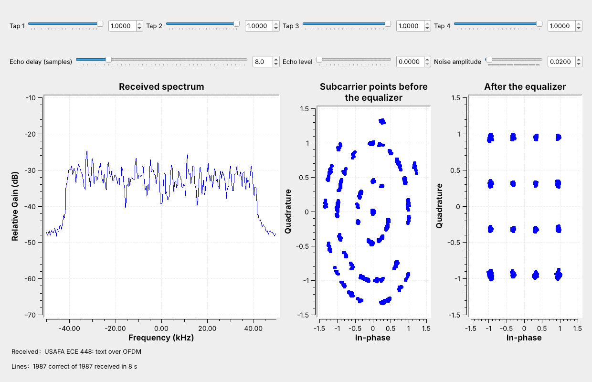
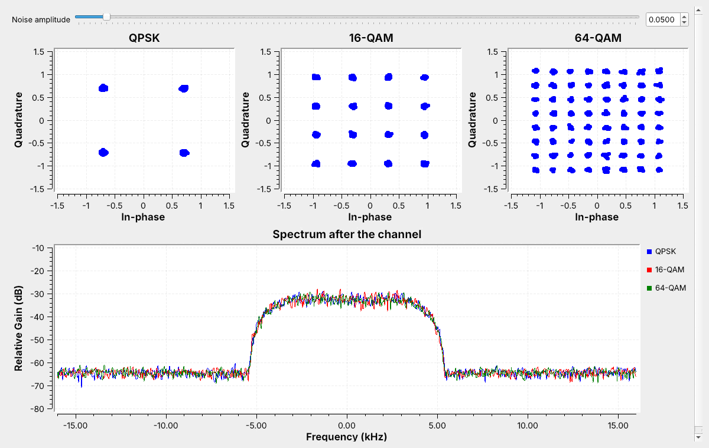
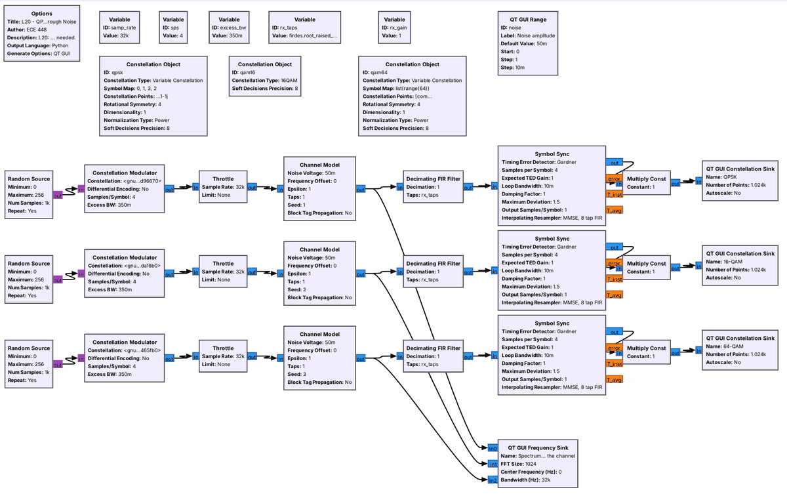
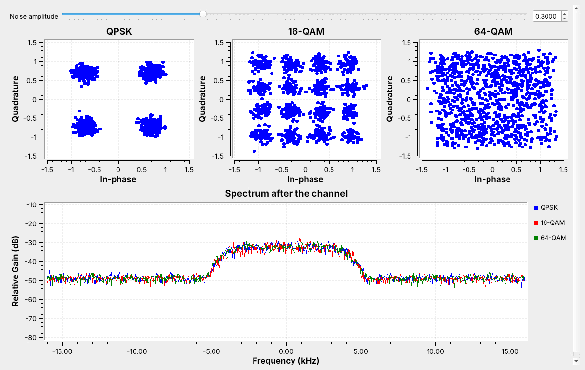
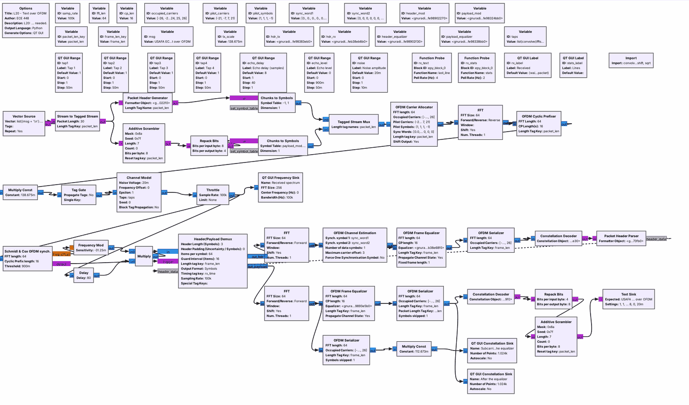
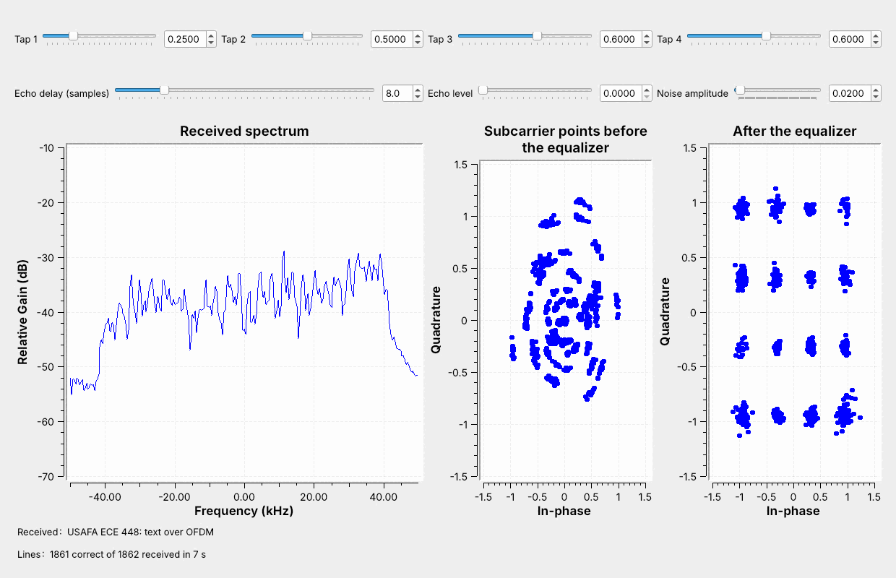
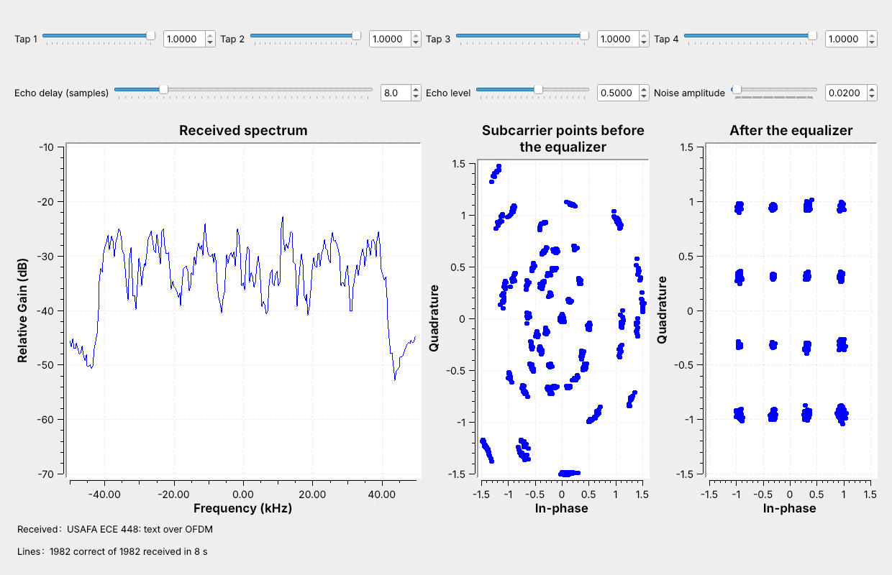
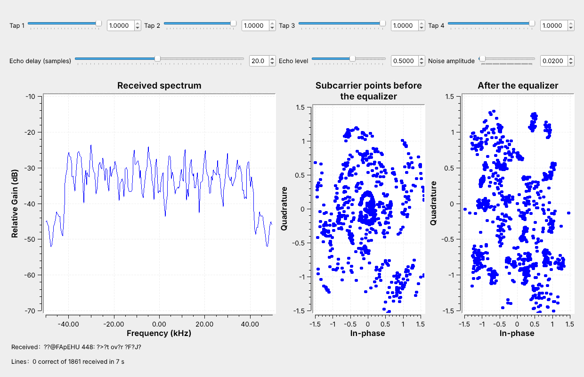
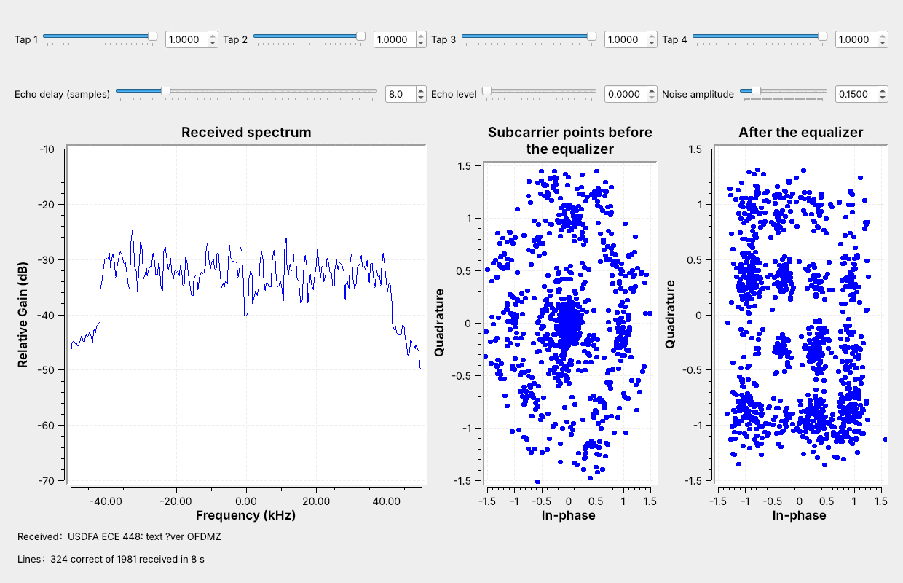

<!-- .slide: class="title-slide" -->

# ECE 448

Software Defined Radios

## Lesson 20 — QAM and OFDM

Spring 2027 · Dr. Neil Rogers

---

## Where We Were

- Lesson 3: constellations and decision regions
- Lesson 14: HD Radio's OFDM subcarriers and guard interval
- Lesson 15: PSK, carrier recovery, and multipath with an equalizer

Today we add amplitude to the constellation and spread the symbols across many subcarriers.

Note:
Open L20-qam-noise.grc and L20-ofdm-link.grc in GRC before class. L20 has no 2025 slides; it follows GNU Radio's constellation objects and its OFDM examples tx_ofdm.grc and rx_ofdm.grc, then PySDR's Digital Modulation, Multipath Fading, and Channel Coding chapters.

---

## Today's Plan

1. QAM: points on a grid
2. Noise on QPSK, 16-QAM, and 64-QAM
3. OFDM in GNU Radio: the transmitter, the guard, the equalizer
4. Lesson 15's taps and an echo on OFDM
5. Where each one is used, and how to find it on the air

Note:
Keep GRC open the whole period. Parts 2 and 4 are sliders moved live.

---

## Text over OFDM

48 subcarriers, each carrying 16-QAM, and the text arrives.

Note:
Run L20-ofdm-link.grc live. The left plot is the spectrum of all 48 subcarriers. The middle plot is the subcarrier points straight out of the receiver's FFT; the right plot is after the equalizer.

---

## From PSK to QAM

QAM sets amplitude and phase: 16 points carry 4 bits, 64 points carry 6, in the same band.

Note:
Each modulation runs at 8,000 symbols per second through the RRC filter with alpha 0.35, so all three fill 10.8 kHz. 16-QAM carries twice QPSK's bits and 64-QAM three times. On a QAM grid each point's decision region is the square around it.

---

## Bits per Symbol

| | Bits | Bit rate | Point spacing |
| :-- | :-: | :-: | :-: |
| QPSK | 2 | 16 kb/s | 1.41 |
| 16-QAM | 4 | 32 kb/s | 0.63 |
| 64-QAM | 6 | 48 kb/s | 0.31 |
| 256-QAM | 8 | 64 kb/s | 0.15 |

All at 8,000 symbols per second, in the same 10.8 kHz, at the same average power.

Note:
Each step adds 2 bits per symbol and roughly halves the spacing. The constellation objects scale every constellation to an average power of 1.

---

## The QAM Flowgraph

A **Constellation Object** holds the points; the **Constellation Modulator** maps and shapes.

Note:
16-QAM is built in. QPSK and 64-QAM list their points and use power normalization. The receiver is Lesson 15's matched filter and Symbol Sync. One noise slider drives all three Channel Models.

---

## Noise on QAM

The same noise makes the same clouds; 64-QAM's points merge first.

Note:
Raise the slider from 0.05 to 0.3 live. More points carry more bits in the same band but need a cleaner signal. PySDR's Digital Modulation chapter runs the same comparison.

---

<!-- .slide: class="viz-cue-slide" -->

## QAM Explorer

- Start with 16-QAM at noise 0.1.
- Raise the noise until the text breaks, then switch to 64-QAM and 256-QAM.

↗ Interactive on the lesson page

Note:
The explorer's noise slider matches the flowgraph's. Wrong decisions and wrong characters are red.

---

## QAM on a Real Receiver

- Inner and outer points differ in amplitude, so an **AGC** must set the level.
- GNU Radio's **Constellation Receiver** recovers the carrier for any constellation.
- A square grid has QPSK's four-fold phase ambiguity.

Note:
A signal 30% weak puts outer points into inner regions. Amplifiers must stay out of compression, which squeezes the outer points. The Costas Loop's detector expects points on a circle; the Constellation Receiver compares each symbol with its nearest point.

---

## From One Carrier to Many

- **OFDM** sends many slow subcarriers instead of one fast carrier.
- Each carries one point per OFDM symbol.
- An inverse FFT builds the symbol; an FFT separates the subcarriers.

Note:
Lesson 14 met these blocks in HD Radio: OFDM Carrier Allocator, FFT, OFDM Cyclic Prefixer. Long symbols mean an echo smears only a small part of each one, and the guard absorbs that part.

---

## The OFDM Flowgraph

64-point FFT, 16-sample guard, 48 data and 4 pilot subcarriers, 1,562.5 Hz apart.

Note:
The transmitter is tx_ofdm.grc with 16-QAM; the receiver is rx_ofdm.grc. Schmidl and Cox finds each packet from the first preamble symbol; the second preamble gives the channel estimate; the Frame Equalizer divides each subcarrier by its gain and turns it back by its phase.

---

## The Guard

The guard copies the end of each symbol, so an echo shorter than it stays out of the FFT window.

Note:
The window holds symbol 2 from both paths; on each subcarrier that sum is one point with a new gain and phase. An echo longer than the guard puts part of symbol 1 in symbol 2's window, and nothing removes that. The flowgraph's guard is 16 samples, 160 microseconds.

---

## Lesson 15's Taps on OFDM

The spectrum tilts; one gain and phase per subcarrier restores the grid.

Note:
Lesson 15 needed an adaptive filter for the same taps on one carrier. The weakest subcarriers come out noisier, because the equalizer amplifies their noise too; at noise 0.05 the weak edge corrupts characters.

---

## An Echo Inside the Guard

An echo 8 samples late ripples the spectrum, and every line still arrives.

Note:
The ripple repeats every 12.5 kHz, eight times across the window. Each subcarrier sees a fixed gain and phase, which the equalizer removes.

---

## An Echo Past the Guard

At 20 samples the echo reaches into the next symbol, and the grid scatters.

Note:
The text breaks at about 9 samples, not 16: the receiver starts its FFT window about 7 samples early as a margin for its own timing. Step the delay up from 8 one sample at a time.

---

## Where Each One Is Used

| System | Subcarriers carry | Guard |
| :-- | :-- | :-- |
| Wi-Fi | BPSK to 1024-QAM | 0.8 µs or more |
| LTE downlink | QPSK to 256-QAM | 4.7 µs |
| DVB-T TV | QPSK to 64-QAM | up to 224 µs |
| HD Radio | QPSK | 0.15 ms |

Single-carrier QAM: cable TV and modems, microwave links.

Note:
802.11a/g Wi-Fi uses today's subcarrier layout at 20 MS/s: 312.5 kHz apart. LTE uses 15 kHz; 5G NR 15 kHz or a multiple. ATSC 3.0, the newer US TV standard, is OFDM too. Cable carries 64- and 256-QAM in 6 MHz channels, and DOCSIS 3.1 moved to OFDM.

---

## Choosing a Scheme

Echoes choose OFDM; noise chooses how many points.

Note:
Wi-Fi and LTE step from 64-QAM down to 16-QAM and QPSK as the signal weakens, adding error-correcting code: PySDR calls these modulation and coding schemes. HD Radio stays with QPSK to reach the edge of coverage.

---

## On the SDR

- Wi-Fi: HackRF at 20 MS/s, 2.437 GHz; flat-topped bursts about 17 MHz wide.
- LTE: RTL-SDR, 729 to 756 MHz; a flat band that stays on.
- HD Radio: Lesson 14's shelves.

Note:
SDR Flex or GQRX; SDR Flex's README says it targets up to about 10 MS/s and its radio drivers have not been tried on a real radio, so GQRX is the tested path. Some beacons use the older 802.11b format and look rounded. Look at the spectrum only; nothing here transmits.

---

## Key Point

More QAM points carry more bits but need a cleaner signal. OFDM splits a channel into slow subcarriers with a guard, so an echo shorter than the guard becomes one gain and phase per subcarrier.

Note:
This is the last lesson; the rest of Module 7 is the final project.

---

## Looking Ahead

- The final project: pick a signal, write success criteria, build it.
- Today's flowgraphs are starting points for a QAM or OFDM project.

Note:
Ideas: send a file over the OFDM link through a PlutoSDR and a cable with an inline 30 dB attenuator and an AGC, add a 64-QAM payload, or survey the Wi-Fi and LTE bands.
