# L1 - Course Introduction

::::{frame}
:class: title-frame

ECE 448 · Spring 2027

<h1 class="frame-title">Course Introduction</h1>

Every wireless signal around you is generated, sent, and received the same way. In this course you build the radios that do it.

Lesson 1 · Software Defined Radios · Dr. Neil Rogers
::::

::::{frame} Slides
:::{admonition} Slides
:class: slides
<a href="../../slides/L01-course-intro.html" target="_blank" rel="noopener">html slides</a>
<a href="../../slides/L01-course-intro.html?print-pdf" target="_blank" rel="noopener">pdf slides</a>
<a href="../../slides/L01-course-intro.md" target="_blank" rel="noopener">raw markdown slides</a>
:::
::::

::::{frame} Welcome & Introductions

_Instructor and student introductions — background, career interests, prior exposure to RF, DSP, or programming._
::::

::::{frame} About Your Instructor

**Lt Col Neil Rogers, USAF (Ret.)** — BS from TU; MSEE and PhD from AFIT.
Currently the **Erdle Chair** at USAFA and a **Field Applications Engineer** at **Analog Devices**.
::::

::::{frame} Where I've Been

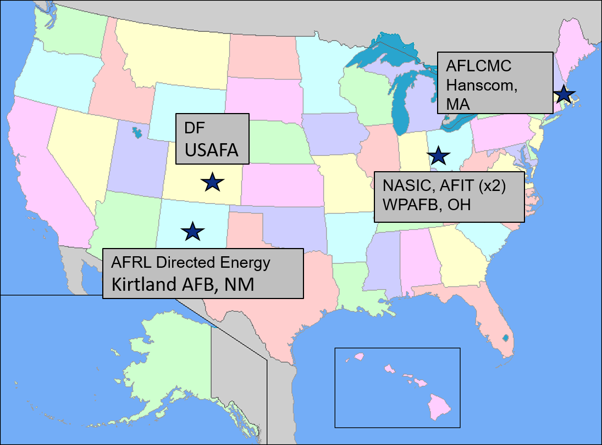
_DF/USAFA · AFRL Directed Energy, Kirtland AFB · NASIC and AFIT (×2), WPAFB · AFLCMC, Hanscom AFB._
::::

::::{frame} Officer Training School

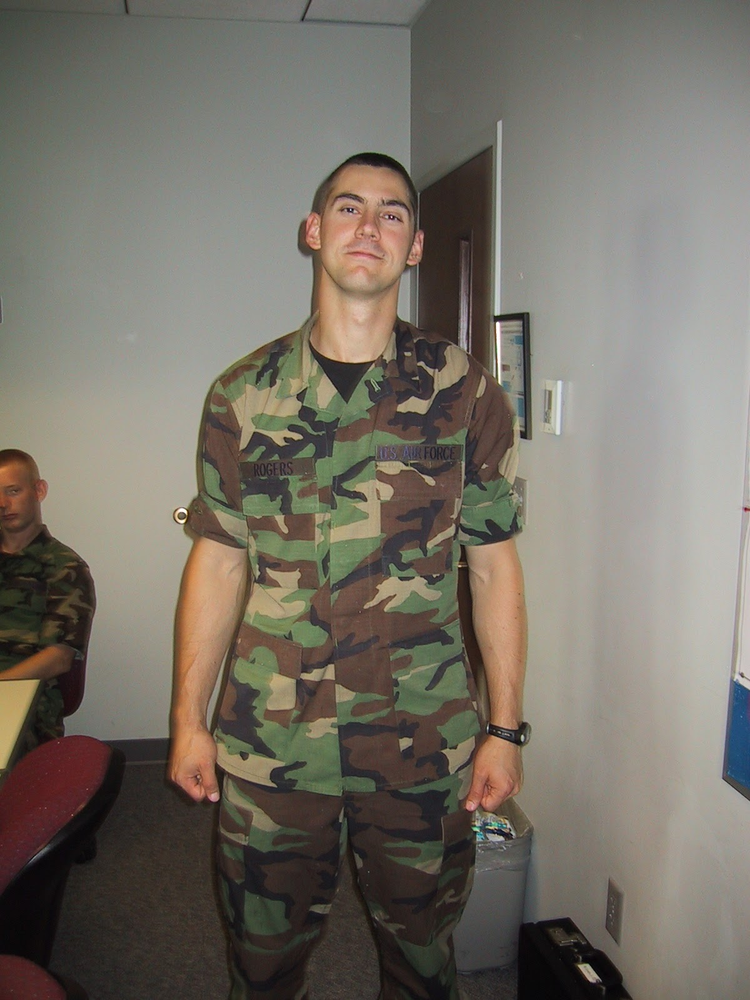
_Officer Training School — where it started._
::::

::::{frame} Active Denial System 2

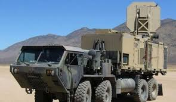
_Active Denial System 2 at AFRL Directed Energy. Section chief for Active Denial and High-Power Sources._
::::

::::{frame} Deployment with the 379th AEW

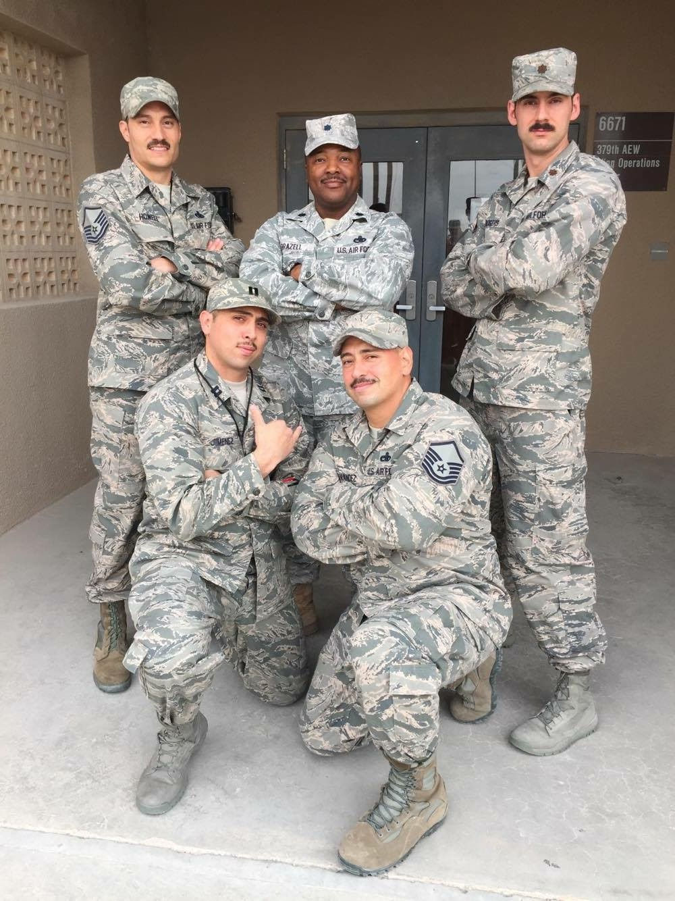
_Deployment with the 379th AEW._
::::

::::{frame} E-8C Joint STARS

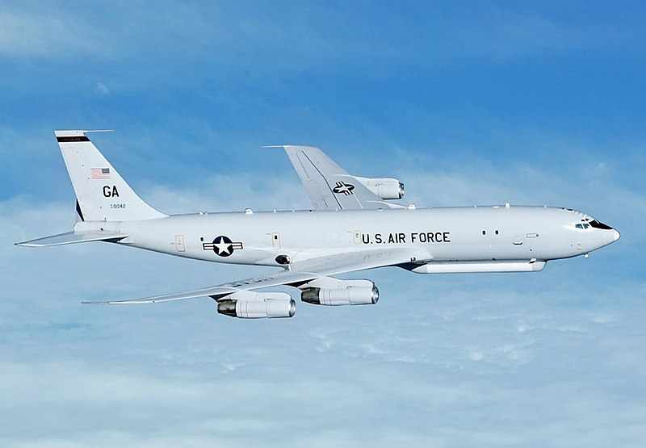
_E-8C Joint STARS — airborne ground surveillance radar._
::::

::::{frame} Academy Center for UAS Research

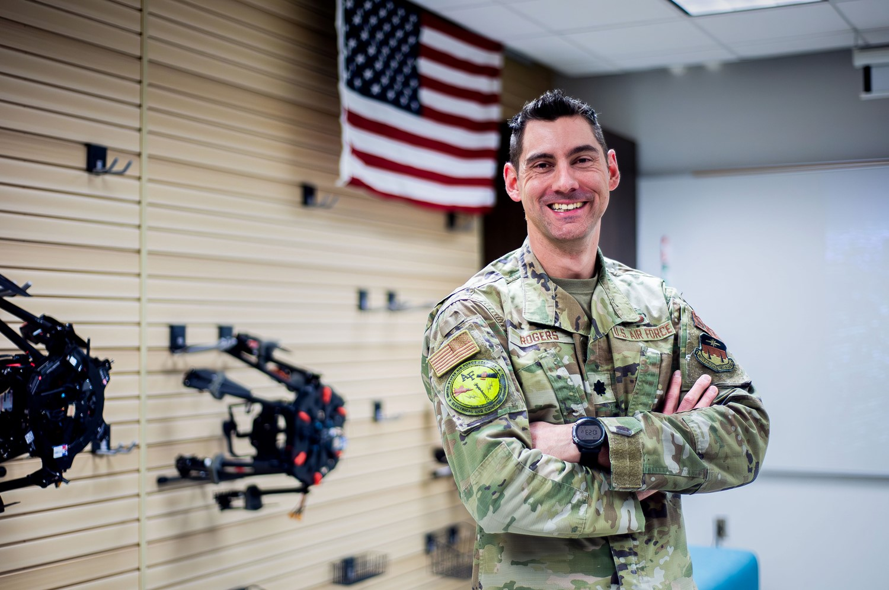
_Directed the Academy Center for UAS Research (ACUASR) at USAFA through 2025._
::::

::::{frame} Retirement from Active Duty

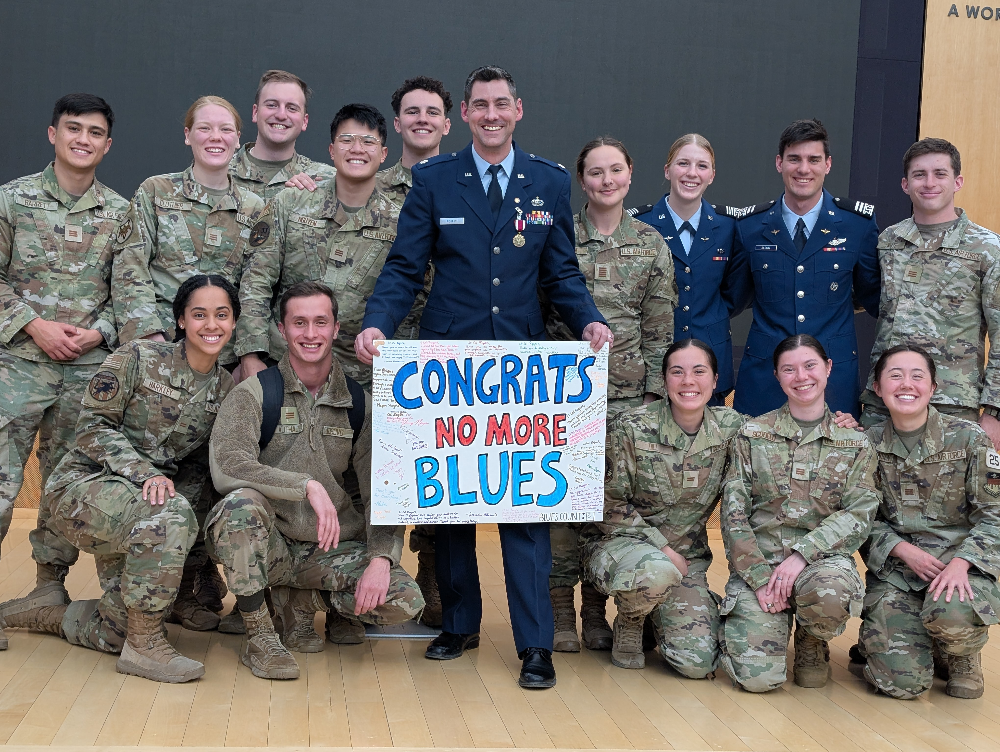
_Retirement from active duty — cadets sent me off with "No More Blues."_
::::

::::{frame} Now: Analog Devices

Today my day job with **Analog Devices** puts me shoulder-to-shoulder with the team designing the **ADALM-PLUTO** and **ADALM-PHASER** we'll use in this course.

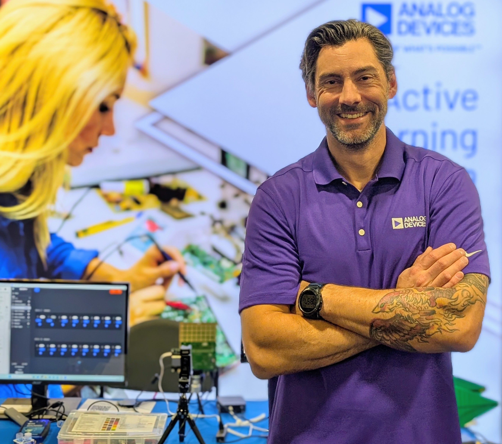
_Field Applications Engineer at Analog Devices — the folks who make the ADALM-PLUTO and ADALM-PHASER._
::::

::::{frame} Off the Clock

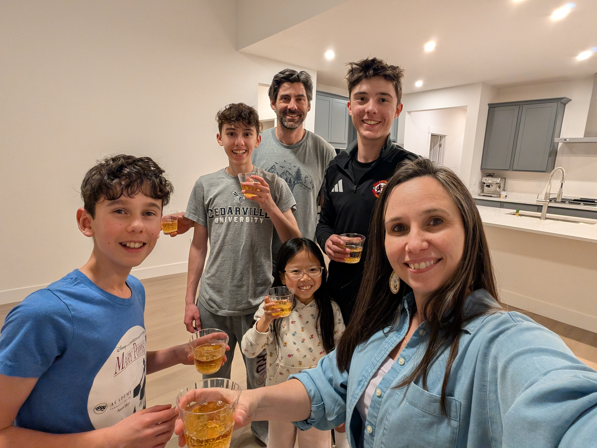
_Four kids (ages 11, 13, 15, 17). We just moved into a new house — fixing it up is a running hobby._
::::

::::{frame} CrossFit

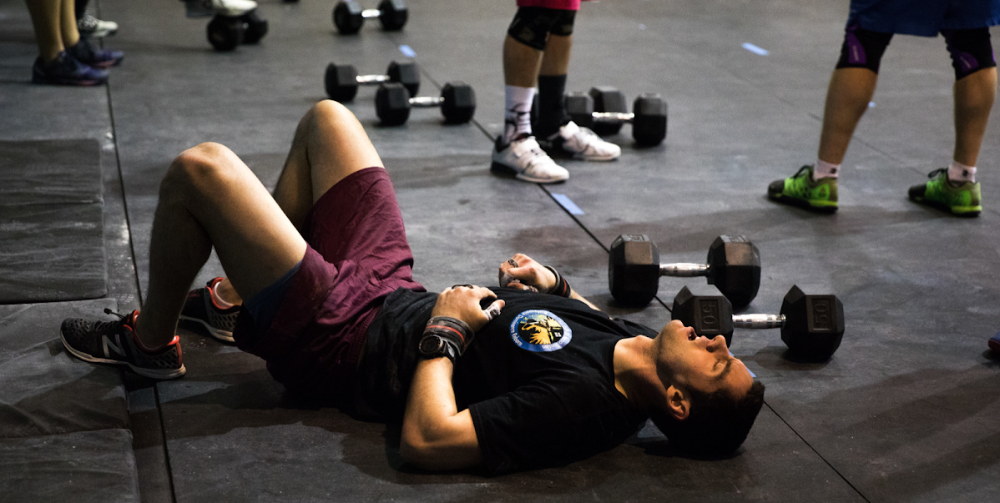
_CrossFit._
::::

::::{frame} Guitar with the Band at Trace

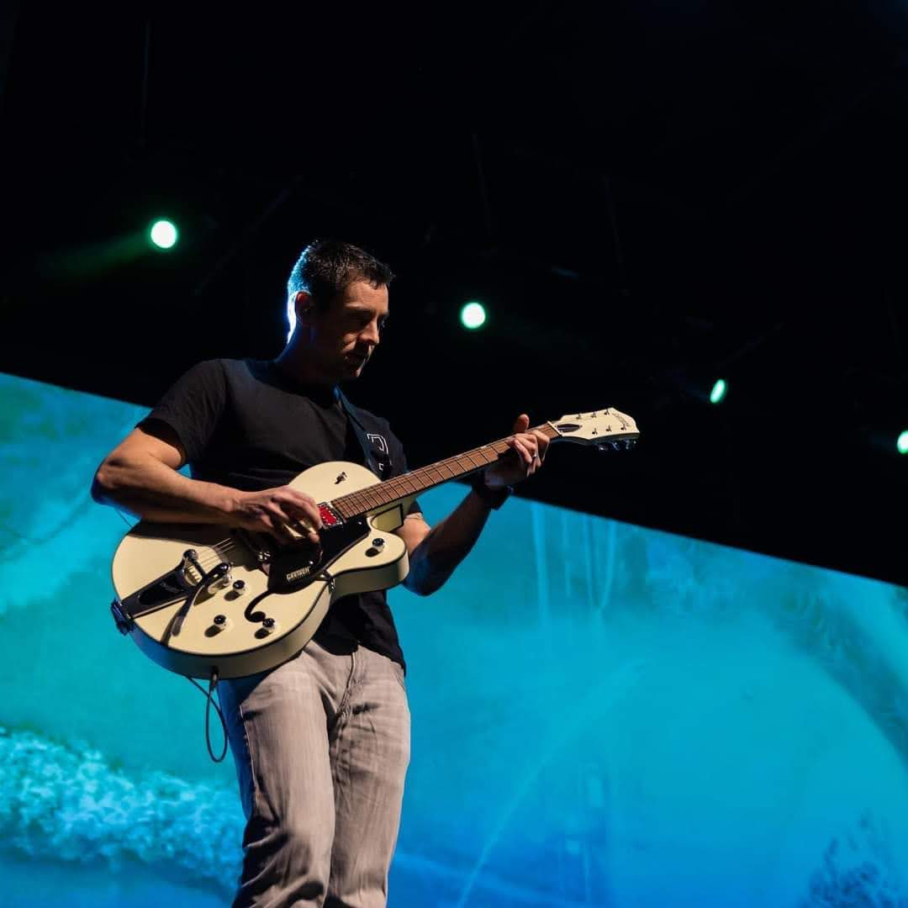
_Playing guitar with the band at Trace, my church._
::::

::::{frame} How I Teach

- **We're learning this together.** I don't have all the answers, and I'll say so when I don't.
- **Mistakes are part of learning.** Make them cheaply, and make them count.
- **Ask questions.** There is no such thing as a dumb question — if something isn't clicking for you, it's almost certainly not clicking for someone else.
::::

::::{frame} Why This Course Exists

Think about the last hour. How many wireless links did you use? Cellular data, WiFi, Bluetooth earbuds, a car key fob, an RFID badge, GPS on your phone, maybe a garage door opener, a drone downlink, ADS-B chirping overhead every second — modern life is soaked in RF. **Every one of those signals is generated, transmitted, and received the same fundamental way.** Once you know how, you can decode most of them yourself.

**ECE 447** teaches you the *theory* behind these systems — the math of modulation, coding, and channel capacity. **ECE 448 is where that theory meets a $30 dongle and a laptop.** Here we watch what a signal does rather than calculate it: turn the noise up and see the constellation spread, narrow a filter and hear the audio change. Instead of drawing block diagrams, you'll build them in GNU Radio. Instead of trusting that "the receiver demodulates the signal," you'll write the receiver.
::::

::::{frame} What Is a Software Defined Radio?

Traditionally, a radio is a **stack of specialized analog and digital hardware** — filters, mixers, IF stages, demodulators — all tuned at the factory for one job (broadcast FM, GPS, LTE). Change the job and you change the hardware.

A **Software Defined Radio** collapses that stack. It puts an **ADC as close to the antenna as physically possible** on receive, and a **DAC as close to the antenna as possible** on transmit. Everything between the ADC/DAC and the user — filtering, mixing, demodulation, decoding — moves into **software** running on a general-purpose CPU or FPGA.

The consequence: **the same $30 piece of hardware can be an FM radio, an ADS-B receiver, a GPS receiver, a spectrum analyzer, or a tool for reverse-engineering a garage door opener** — depending only on the software you point at it.
::::

::::{frame} Two Ideas We Keep Coming Back To

Two ideas we'll keep coming back to:

1. **The signal is data.** Once digitized, a radio wave is just a stream of complex numbers. Every DSP tool you know applies.
2. **Real radios are messy.** Noise, non-linearity, clock offsets, multipath — the reason SDR programming is hard isn't the math, it's the non-ideal hardware and channel.
::::

::::{frame} Why This Matters to You

SDRs are how modern militaries build agile, reconfigurable RF systems. The same platform in your hands (a Pluto or Phaser) is a smaller sibling of what flies on aircraft, satellites, and deployed EW pods.

- **Communications** — tactical radios, data links, SATCOM, Link-16.
- **Electronic warfare** — DF, jamming, protection, cognitive EW.
- **Signals intelligence** — SIGINT collection and analysis.
- **Radar** — coherent radar processing, cognitive/adaptive radar (see ECE 444 for the antenna and beamforming side).
- **Test & measurement** — spectrum monitoring, waveform validation, over-the-air testing.

By the end of this course you will have **built receivers and transmitters for real waveforms** — the same class of software running on the systems you may one day operate, specify, or defend against.
::::

::::{frame} Course Roadmap

Seven modules and twenty lessons, culminating in a **self-defined final project**:

| Module | Focus |
| :-: | :- |
| 1 | Foundations of Detection & Link Budgets |
| 2 | SDR & GNU Radio Foundations |
| 3 | Analog Modulation (AM, FM) |
| 4 | Digital Modulation (FSK, PAM, ASCII/PAM) |
| 5 | Custom Blocks & Midterm |
| 6 | Waveform Applications & RF Reverse Engineering (CW, DTMF, HD Radio, mPSK, FHSS, ADS-B, AIS) |
| 7 | QAM, OFDM, and the Final Project |

See the [syllabus](../../syllabus.md) for the full schedule, the midterm (a fox hunt and a capture-the-flag), and the final-project structure.
::::

::::{frame} Show & Tell: A Real SDR, Live

_Bring in a PlutoSDR (the course radio, in extended-frequency mode, 70 MHz to 6 GHz) and the ADALM-PHASER, plus a broadband whip antenna; an RTL-SDR and a HackRF can sit beside them as optional extras. Run `L05-fm-spectrum.grc` on the PlutoSDR, with its center-frequency slider widened to 70 MHz to 6 GHz so you can type each band into the slider's counter, sweep across a few bands, and identify signals in real time — broadcast FM, ADS-B at 1090 MHz, cellular, WiFi, LTE, an FRS handheld. Point out that we'll decode most of these ourselves by the end of the semester._

_Hardware checklist:_ `_TBD_`
::::

::::{frame} Preparing for L2

Read the assigned sections on **SDR hardware architectures** before the next class — we'll dig into the RF frontend, ADC/DAC, and host boundary, and connect sample rate, bandwidth, and dynamic range to what a given SDR can (and can't) do.
::::
